# BÁO CÁO THỰC NGHIỆM TỔNG HỢP: DỰ BÁO GIÁ ĐỒNG MỘT PHIÊN TRƯỚC

**Ngày cập nhật:** 20/11/2026 (hợp nhất V24 và EDA V26)  |  **Tác giả thực nghiệm:** Viên Đăng Khoa  |  **Học phần:** IS403

**Quy ước trình bày:** Không chia nội dung kết quả theo phiên bản. Kết quả được hợp nhất theo **mô hình – bộ đặc trưng – chiến lược – split**, với phiên bản ghi ngay sau mỗi số liệu để truy xuất. Mọi bảng được tính trực tiếp từ CSV của các ZIP; không train lại trong lúc biên soạn.

## Tóm tắt

Nghiên cứu đối chiếu các mô hình LSTM, GRU, CNN-LSTM, CNN-GRU, SimpleRNN, Ridge, và SA-LSTM bằng hai cách biểu diễn dự báo giá trực tiếp (Direct) hoặc sai phân giá (Residual). Thí nghiệm mở rộng bộ đầu vào `Copper, Aluminium, Tin, WTI` nhằm kiểm tra liệu thay Gold/Silver bằng WTI có cải thiện sai số ngoài mẫu. **Xếp hạng mô hình tốt nhất chỉ tính các mô hình fitted**, trong khi Naive Persistence luôn được báo riêng như baseline định lượng. Dữ liệu V24 hoàn tất ma trận 48/48 tổ hợp SA-LSTM cho hai bộ FS04/FS06 ở bốn split và ba chiến lược; các thứ hạng dựa trên MAE holdout chưa đồng nghĩa chứng minh ưu thế tổng quát hóa.

**Từ khóa—** dự báo giá đồng, chuỗi thời gian, LSTM, GRU, CNN-LSTM, residual learning, simulated annealing, walk-forward, kiểm định thống kê, khả năng tái lập.

**Cấu trúc báo cáo—** Theo bố cục bài báo thực nghiệm, phần 1 khóa bài toán, dữ liệu, EDA và phương pháp; phần 2–8 trình bày kết quả định lượng/độ bền; phần 9–11 thảo luận, giới hạn và kết luận. Hình kiến trúc mô tả đúng code đã chạy; hình định lượng luôn có CSV nguồn và provenance trong `copper-forecasting/docs/MODULE1_VISUAL_EVIDENCE.md`.

## 1. Mục tiêu và phương pháp thống nhất

### 1.1. Bài toán và nguồn dữ liệu

- Target: `Copper(t)`; đầu vào dùng 22 phiên `t−22 ... t−1` (`LOOKBACK=22`, `HORIZON=1`). Dữ liệu gốc 2.710 quan sát, từ **13/01/2016 đến 13/11/2026** theo fingerprint/manifest cũ. Phải kiểm tra đồng bộ thời điểm đóng cửa của các thị trường nếu ứng dụng dự báo thật.

- Holdout theo thời gian gồm 80/20 (542 test), 90/10 (271), 92.5/7.5 (204), 95/5 (136); bảng cùng split chỉ hợp lệ nếu ngày test tương đồng. MAE/RMSE tính trên đơn vị giá gốc. Không chọn hyperparameters bằng test.

- **Direct:** dự đoán `Copper(t)` trực tiếp. **Residual:** dự đoán `ΔCopper(t) = Copper(t) − Copper(t−1)` rồi cộng lại Copper(t−1). **Naive:** dùng Copper(t−1) làm dự báo. Đây là baseline không huấn luyện, không tham gia xếp hạng fitted.

- **Expanding:** dùng lịch sử đến ranh giới train. **Rolling 756:** giữ 756 phiên gần nhất trước fit. **Recency:** toàn lịch sử nhưng weighted half-life 252 phiên. Các chiến lược holdout không phải mỗi phiên lại retrain; chỉ walk-forward mới refit theo lịch.

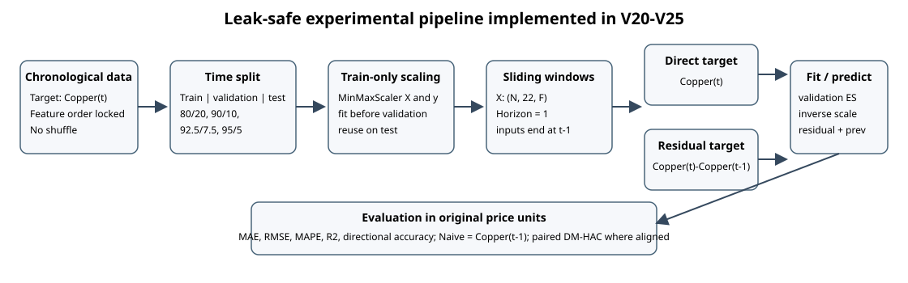

*Hình 1. Pipeline code-faithful từ dữ liệu theo thời gian, split và scaler chỉ fit trên train, cửa sổ `(N,22,F)`, hai target Direct/Residual đến đánh giá trên đơn vị giá gốc. Nguồn code: V20 cell 2/8/10/14/18 và V21 cell 6/8/10; `fig:leak_safe_pipeline`.*

### 1.2. Quy ước bộ đặc trưng — thống nhất toàn bộ báo cáo

Mỗi **feature set (FS)** biểu thị danh sách biến đầu vào tại mỗi phiên trong cửa sổ 22 phiên, **không phải một bộ dataset độc lập**. Tất cả dùng cùng chuỗi ngày/target Copper; thay FS chỉ thay số chiều và thông tin đầu vào. Các mã `FSxx` dưới đây được sử dụng xuyên suốt mọi bảng, từ kết quả holdout, chiến lược đến walk-forward.

| Mã chuẩn | Tên mô tả | Thứ tự biến đầu vào | Số biến F | Nguồn thực nghiệm |
| --- | --- | --- | ---: | --- |
| **FS01_CU** | Copper tự hồi quy | `Copper` | 1 | V20 |
| **FS02_PAPER_CU** | Paper3 kèm lịch sử Copper | `Copper, WTI, Gold, Silver` | 4 | V20, V21 |
| **FS03_PAPER_EXO** | Ba biến ngoại sinh bài báo | `WTI, Gold, Silver` | 3 | V21, V21-80 |
| **FS04_METALS_CU** | Nhóm kim loại kèm Copper (Legacy14 cũ) | `Copper, Aluminium, Tin, Silver, Gold` | 5 | V20, V21, V21-80, V24 |
| **FS05_METALS_EXO** | Nhóm kim loại không Copper (Legacy14 cũ) | `Aluminium, Tin, Silver, Gold` | 4 | V21, V21-80 |
| **FS06_WTI_CU** | Nhôm–thiếc–dầu WTI kèm Copper (nhóm mở rộng mới) | `Copper, Aluminium, Tin, WTI` | 4 | V22-N, V22-S, V23, V24 |

**Đối chiếu tên kỹ thuật trong CSV:** `copper_only` → FS01; `copper_paper3` / `paper3_with_copper` → FS02; `paper3_without_copper` → FS03; `copper_legacy14` / `legacy14_with_copper` → FS04; `legacy14_without_copper` → FS05; `copper_al_tin_wti` / `wti_replacement_with_copper` → FS06. Trong mọi nhận xét sau, `FS04 → FS06` nghĩa là thay Gold và Silver bằng WTI, đồng thời giảm số biến từ 5 xuống 4, **không phải phép thay từng biến độc lập**.

### 1.3. Khảo sát dữ liệu và kiểm định thống kê chuyên sâu (EDA V26)

**Nguồn xác minh:** `copper_v26_comprehensive_eda_results.zip` (V26), đối chiếu các CSV và `manifest.json` thay vì suy luận từ đồ thị. Bộ dữ liệu có SHA-256 `9580ede12d474c8f990556842d551dac176b3c16b2d6a4bffb7dc41dd54bf600`, trùng fingerprint trong báo cáo V20–V24. Những p-value dưới đây chỉ được kết luận trong **phạm vi mẫu và mô hình kiểm định**, mức ý nghĩa quy ước α = 0.05.

#### 1.3.1. Mẫu thống kê, ranh giới thời gian và nguyên tắc chống leakage

- Toàn bộ bảng mức giá có **2.710 quan sát**, từ **13/01/2016 đến 13/11/2026**. Kiểm tra EDA dựa trên **2.195 dòng đầu**, kết thúc **12/11/2024**; mỗi chuỗi returns/sai phân có 2.194 quan sát. Phần kiểm định V26 không dùng 515 dòng sau mốc EDA. Các phép so sánh phân phối giá toàn kỳ chỉ dùng cho kiểm toán dữ liệu, **không** để chọn biến/siêu tham số.
- **Điểm cần sửa khi diễn giải “train-only”:** Mốc EDA 12/11/2024 muộn hơn thời điểm bắt đầu test 80/20 trong báo cáo (**07/10/2024**). Vì thế V26 **không phải tập train thuần túy của giao thức 80/20**. Không được dùng lựa chọn biến dựa trên V26 để tuyên bố kiểm tra 80/20 hoàn toàn chưa từng nhìn dữ liệu test; với split 90/10, 92.5/7.5, 95/5, mốc EDA nằm trước giai đoạn test nhưng vẫn cần khóa feature-selection tại đúng mốc train/validation tương ứng.
- Tập EDA sử dụng `pct_change(fill_method=None)` cho **simple returns**, tức `r_t=P_t/P_{t-1}-1`; sai phân là `ΔP_t=P_t-P_{t-1}`. Đây là các phép biến đổi khác target residual theo đơn vị giá; không được hoán đổi kết quả kiểm định giữa chúng một cách không giải thích.
- Mỗi quan sát là **phiên có trong dữ liệu**, không nhất thiết là một ngày dương lịch liên tiếp. Kết quả ngày theo `Date` chưa chứng nhận sự đồng bộ **giờ công bố/giờ đóng cửa** giữa sàn hàng hóa.

#### 1.3.2. Chất lượng dữ liệu, tần suất ghi nhận và thống kê mô tả

Manifest V26 xác nhận không có ngày trùng, không có missing trong 6 chuỗi khảo sát và giá đều dương. Các đặc trưng có đơn vị/biên độ khác nhau nên phải fit scaler trên train, không diễn giải việc giá Tin lớn hơn Copper là tín hiệu dự báo mạnh hơn.

| Chuỗi | N | Min | Max | Mean | Std | Missing |
| --- | --- | --- | --- | --- | --- | --- |
| Copper | 2710 | 1.944 | 6.888 | 3.683 | 1.143 | 0 |
| Aluminium | 2710 | 1462.000 | 3849.000 | 2261.739 | 500.506 | 0 |
| Tin | 2710 | 13205.000 | 57760.000 | 26660.641 | 10176.024 | 0 |
| WTI | 2710 | 11.570 | 119.780 | 64.680 | 17.294 | 0 |
| Gold | 2710 | 1073.600 | 5354.800 | 2059.296 | 988.212 | 0 |
| Silver | 2710 | 11.772 | 115.148 | 26.635 | 15.862 | 0 |

**Khoảng cách giữa hai ngày liên tiếp trong dữ liệu:**

| Khoảng cách (ngày) | Số lần |
| --- | --- |
| 1 | 2149 |
| 2 | 8 |
| 3 | 521 |
| 4 | 26 |
| 6 | 2 |
| 19 | 1 |
| 28 | 1 |
| 66 | 1 |

**Nhận xét kiểm toán:** Những khoảng nghỉ 3–4 ngày có thể tương ứng cuối tuần/ngày nghỉ, nhưng còn xuất hiện gap **19, 28 và 66 ngày**, chưa thể giải thích bằng lịch thị trường thông thường nếu không đối chiếu nguồn dữ liệu. Đặc biệt khoảng gap lớn có thể làm “lag 1 phiên” khác nhiều so với “1 ngày” và làm returns cộng dồn nhiều ngày. Cần truy lại các ngày đầu/cuối gap trước khi công bố mô hình có thể sử dụng thực tế. V26 chưa xuất ngày bắt đầu/kết thúc cụ thể của từng gap, nên báo cáo **không tự suy đoán** nguyên nhân hoặc thời điểm.

#### 1.3.3. Phân phối biến động, ngoại lệ và kiểm định chuẩn Jarque–Bera

**H₀ (Jarque–Bera):** chuỗi simple returns có skewness = 0 và kurtosis = 3, phù hợp giả thiết chuẩn. **H₁:** phân phối lệch khỏi chuẩn. Dưới α = 0.05, cả sáu chuỗi đều bác bỏ H₀ trong mẫu EDA. Độ nhọn (excess kurtosis) lớn cho thấy đuôi nặng, riêng WTI cực đoan rõ rệt; điều này là tín hiệu cần kiểm tra outlier và vấn đề định nghĩa nguồn giá, chứ không được tự xóa quan sát.

| Chuỗi | Mean return | Std return | Skew | Excess kurtosis | Outlier robust z>3.5 | JB p |
| --- | --- | --- | --- | --- | --- | --- |
| Copper | 0.000437 | 0.013661 | -0.174 | 2.296 | 25 | 8.53e-108 |
| Aluminium | 0.000338 | 0.012848 | -0.002 | 4.219 | 28 | 0.0000 |
| Tin | 0.000492 | 0.015286 | -0.911 | 9.091 | 78 | 0.0000 |
| WTI | 0.000875 | 0.032693 | 5.181 | 172.438 | 47 | 0.0000 |
| Gold | 0.000440 | 0.009092 | 0.008 | 4.984 | 81 | 0.0000 |
| Silver | 0.000524 | 0.018242 | -0.427 | 11.364 | 139 | 0.0000 |

**Lưu ý:** V26 sử dụng ngưỡng robust-z > 3.5 làm *cờ cảnh báo*, không có cơ sở để kết luận tất cả các điểm bị đánh dấu là dữ liệu lỗi. Sự kiện thị trường thật vẫn có thể tạo returns rất lớn. Vì WTI có skew = **5.181**, excess kurtosis = **172.438**, kết quả riêng WTI cần kiểm tra giá gốc quanh các phiên cực trị trước khi dùng để lý giải cải thiện của FS06.

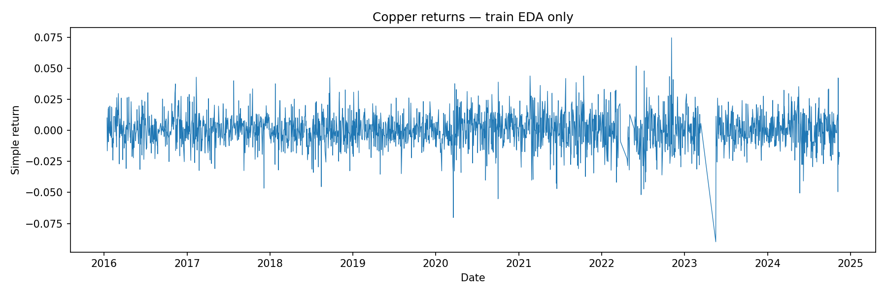

*Hình 2. Simple returns của Copper trên 2.195 dòng EDA đến 12/11/2024; nguồn định lượng `02_returns_distribution_JB.csv`; `fig:copper_returns_v26`.*

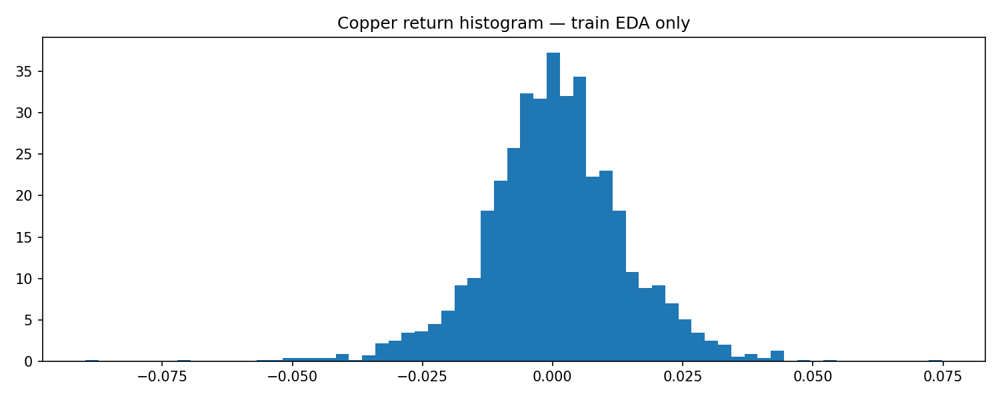

*Hình 3. Histogram Copper simple returns. Hình hỗ trợ trực giác đuôi dày; kết luận chuẩn hóa phải dựa trên Jarque–Bera trong CSV, không đọc bằng mắt; `fig:copper_return_distribution`.*

#### 1.3.4. Kiểm định tính dừng ADF kết hợp KPSS

- **ADF:** H₀ chuỗi có nghiệm đơn vị (unit root); p < 0.05 bác bỏ H₀. **KPSS:** H₀ chuỗi dừng quanh mức trung bình (level stationarity); p < 0.05 bác bỏ H₀. Hai kiểm định có H₀ đối nghịch, nên dùng phối hợp thay vì chỉ nhìn một p-value.
- Trong V26, cả ADF và KPSS dùng hồi quy `regression="c"` (hằng số, **không thêm trend xác định**) với lựa chọn độ trễ tự động. Giá trị KPSS ở ranh giới báo cáo 0.01 hoặc 0.10 là **giới hạn bảng nội suy p-value của hàm kiểm định**, không phải độ chính xác tuyệt đối.

| Chuỗi | Biến đổi | ADF stat | ADF p | KPSS stat | KPSS p | Nhận xét α=5% |
| --- | --- | --- | --- | --- | --- | --- |
| Copper | Mức giá | -1.699 | 0.4318 | 5.464 | 0.0100 | ADF không bác bỏ; KPSS bác bỏ |
| Copper | Sai phân | -17.671 | 3.64e-30 | 0.049 | 0.1000 | ADF bác bỏ; KPSS không bác bỏ |
| Copper | Returns | -17.322 | 5.47e-30 | 0.070 | 0.1000 | ADF bác bỏ; KPSS không bác bỏ |
| Aluminium | Mức giá | -2.051 | 0.2647 | 3.563 | 0.0100 | ADF không bác bỏ; KPSS bác bỏ |
| Aluminium | Sai phân | -9.623 | 1.69e-16 | 0.049 | 0.1000 | ADF bác bỏ; KPSS không bác bỏ |
| Aluminium | Returns | -43.822 | 0.0000 | 0.060 | 0.1000 | ADF bác bỏ; KPSS không bác bỏ |
| Tin | Mức giá | -1.852 | 0.3552 | 3.487 | 0.0100 | ADF không bác bỏ; KPSS bác bỏ |
| Tin | Sai phân | -8.112 | 1.22e-12 | 0.072 | 0.1000 | ADF bác bỏ; KPSS không bác bỏ |
| Tin | Returns | -8.380 | 2.52e-13 | 0.090 | 0.1000 | ADF bác bỏ; KPSS không bác bỏ |
| WTI | Mức giá | -2.491 | 0.1176 | 3.787 | 0.0100 | ADF không bác bỏ; KPSS bác bỏ |
| WTI | Sai phân | -8.677 | 4.39e-14 | 0.083 | 0.1000 | ADF bác bỏ; KPSS không bác bỏ |
| WTI | Returns | -8.440 | 1.77e-13 | 0.099 | 0.1000 | ADF bác bỏ; KPSS không bác bỏ |
| Gold | Mức giá | 0.448 | 0.9832 | 6.520 | 0.0100 | ADF không bác bỏ; KPSS bác bỏ |
| Gold | Sai phân | -20.561 | 0.0000 | 0.147 | 0.1000 | ADF bác bỏ; KPSS không bác bỏ |
| Gold | Returns | -20.603 | 0.0000 | 0.068 | 0.1000 | ADF bác bỏ; KPSS không bác bỏ |
| Silver | Mức giá | -1.132 | 0.7023 | 4.908 | 0.0100 | ADF không bác bỏ; KPSS bác bỏ |
| Silver | Sai phân | -13.336 | 6.05e-25 | 0.047 | 0.1000 | ADF bác bỏ; KPSS không bác bỏ |
| Silver | Returns | -46.660 | 0.0000 | 0.048 | 0.1000 | ADF bác bỏ; KPSS không bác bỏ |

**Diễn giải thực nghiệm:** Trong 2.195 dòng đầu, cả sáu chuỗi mức giá có mẫu hình **phù hợp với chuỗi không dừng** theo cặp ADF–KPSS; sai phân và simple returns đều có bằng chứng thuận lợi cho tính dừng quanh trung bình. Tuy nhiên, điều này **không chứng minh tuyệt đối rằng các chuỗi là I(1)** hoặc là random walk; các điểm gãy, biến động phương sai và lựa chọn đặc tả kiểm định có thể ảnh hưởng sức mạnh kiểm định. Nếu muốn phát biểu I(1), cần thêm chẩn đoán cho log-level/log-return và tính ổn định qua subsample.

**Hàm ý mô hình:** Dự báo giá mức có thể khó ngoại suy theo regime; residual/returns cung cấp một biểu diễn khác để nghiên cứu. Dẫu vậy, kiểm định tính dừng không tự chứng minh Residual-GRU sẽ thắng các phương pháp Direct, vì chúng còn khác objective và huấn luyện.

#### 1.3.5. Tự tương quan trung bình và cụm biến động: Ljung–Box, ARCH-LM

- **Ljung–Box trên returns:** H₀ không có tự tương quan tuyến tính ở các lag đến h; nếu p ≥ 0.05, chưa bác bỏ H₀ (không đồng nghĩa không thể dự báo bằng quan hệ phi tuyến).
- **Ljung–Box trên returns bình phương:** H₀ không có tự tương quan trong bình phương returns; p nhỏ gợi ý độ lớn biến động có cấu trúc theo thời gian.
- **ARCH-LM:** H₀ không có hiệu ứng ARCH đến lag được xét; bác bỏ H₀ gợi ý phương sai có điều kiện thay đổi, không mặc nhiên chứng minh mô hình GARCH cụ thể là đúng.

| Chuỗi | Lag | LB returns p | LB returns² p | ARCH-LM p |
| --- | --- | --- | --- | --- |
| Copper | 5 | 0.5578 | 6.49e-08 | 1.17e-06 |
| Copper | 10 | 0.1239 | 5.47e-09 | 4.95e-06 |
| Copper | 22 | 0.0635 | 1.87e-07 | 0.0005 |
| Aluminium | 5 | 0.0159 | 2.33e-79 | 2.30e-53 |
| Aluminium | 10 | 0.0929 | 3.65e-135 | 3.12e-65 |
| Aluminium | 22 | 0.0179 | 5.23e-170 | 9.62e-60 |
| Tin | 5 | 0.4131 | 4.07e-34 | 1.41e-24 |
| Tin | 10 | 0.0280 | 3.74e-57 | 2.94e-30 |
| Tin | 22 | 0.0034 | 2.48e-86 | 4.76e-40 |
| WTI | 5 | 5.57e-13 | 1.84e-41 | 2.03e-40 |
| WTI | 10 | 2.12e-11 | 7.90e-40 | 9.59e-38 |
| WTI | 22 | 6.68e-16 | 3.12e-35 | 2.66e-32 |
| Gold | 5 | 0.1724 | 1.94e-22 | 7.73e-16 |
| Gold | 10 | 0.0292 | 2.67e-43 | 4.43e-22 |
| Gold | 22 | 0.0154 | 4.03e-62 | 4.37e-23 |
| Silver | 5 | 0.3789 | 7.62e-18 | 2.45e-16 |
| Silver | 10 | 0.5121 | 9.83e-21 | 4.28e-16 |
| Silver | 22 | 0.2485 | 5.47e-24 | 5.96e-15 |

**Đối với Copper:** Ljung–Box trên returns chưa bác bỏ H₀ ở lag 5 (p=0.5578), 10 (p=0.1239) và 22 (p=0.0635); ngược lại Ljung–Box trên returns bình phương và ARCH-LM đều có p < 0.001 ở ba lag. Đây là bằng chứng rằng **dự báo hướng/trung bình biến động khó hơn việc tìm cấu trúc biến động phương sai**, nhưng không phải bằng chứng không thể dự báo giá. WTI có tự tương quan returns rõ ở các lag khảo sát; cần đặc biệt xem xét dị thường phân phối WTI và các khoảng trống ngày.

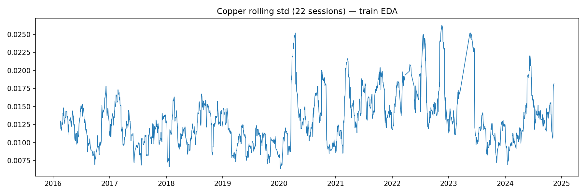

*Hình 4. Độ lệch chuẩn rolling 22 phiên của Copper returns trên mẫu EDA V26. Bằng chứng ARCH/Ljung–Box tương ứng nằm trong `04_lb_arch.csv`; `fig:copper_rolling_volatility`.*

#### 1.3.6. Quan hệ giữa các hàng hóa: Spearman mức giá, returns trễ, FDR và VIF

**Mức giá:** Spearman đo quan hệ thứ hạng đơn điệu cùng thời điểm, không đo mức bổ sung thông tin cho dự báo Copper(t) từ t−1. Dựa trên train V26, Aluminium (0.9279) và Tin (0.8829) cao nhất; WTI (0.7711) nhỉnh hơn Gold (0.7425) và Silver (0.7424). **Không được** chọn bộ feature chỉ vì thứ tự Spearman mức giá, do nhiều chuỗi có xu hướng chung không dừng.

| Ngoại sinh | Spearman mức giá với Copper | Spearman return lag 1 | p hiệu chỉnh FDR (lag 1) |
| --- | --- | --- | --- |
| Aluminium | 0.9279 | 0.0093 | 0.9377 |
| Tin | 0.8829 | -0.0185 | 0.9377 |
| WTI | 0.7711 | 0.0142 | 0.9377 |
| Gold | 0.7425 | 0.0910 | 0.0006 |
| Silver | 0.7424 | 0.0388 | 0.5175 |

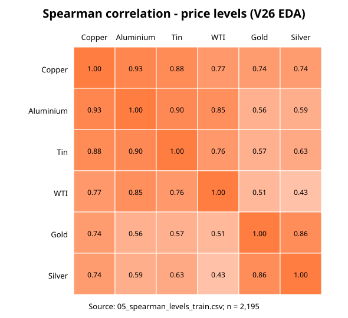

*Hình 5. Ma trận Spearman mức giá được script dựng trực tiếp từ `05_spearman_levels_train.csv` (n=2.195). Hệ số cao có thể phản ánh xu thế chung của level và không bảo đảm giá trị dự báo; `fig:spearman_price_levels`.*

**Kiểm tra độ trễ:** 5 ngoại sinh × 6 lag (1, 2, 5, 10, 22, 50) = **30 phép thử Spearman**, với điều chỉnh **Benjamini–Hochberg FDR** cho mỗi họ kiểm định. Chỉ **Gold ở lag 1** có Spearman p sau FDR < 0.05 (`ρ=0.0910`, `q≈0.000591`); dù có ý nghĩa thống kê, **độ lớn tương quan rất nhỏ**. Pearson Gold lag 1 sau FDR có p≈0.0815, chưa dưới 0.05. Không có bằng chứng FDR < 0.05 cho WTI tại 6 lag đã thử. Các p-value tương quan truyền thống có thể lạc quan nếu chuỗi có phụ thuộc thời gian; nên xem đây là khảo sát, chưa thay thế kiểm định dự báo out-of-sample.

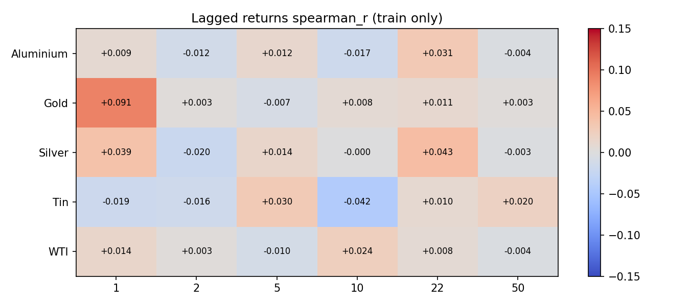

*Hình 6. Spearman giữa returns ngoại sinh trễ và Copper return hiện tại; hệ số/p-value/FDR đọc từ `05_lagged_returns_correlations_FDR.csv`; `fig:lagged_spearman_returns`.*

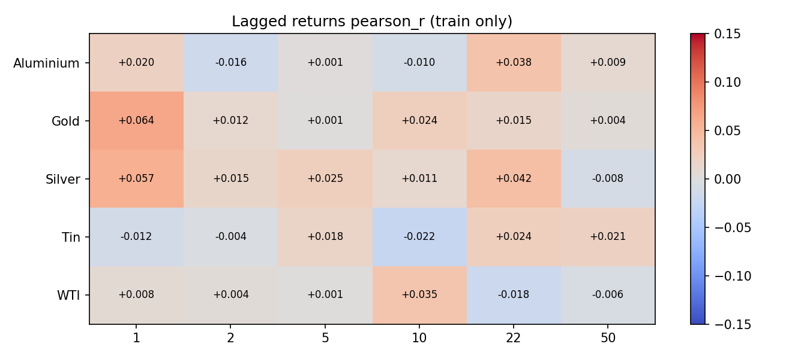

*Hình 7. Pearson trên cùng biến/lags với Hình 6. Hai heatmap là khảo sát train EDA, không phải bằng chứng causal hoặc cải thiện ngoài mẫu; `fig:lagged_pearson_returns`.*

**Đa cộng tuyến VIF:**

| Ngoại sinh | VIF mức giá | VIF returns |
| --- | --- | --- |
| Aluminium | 9.163 | 1.166 |
| Tin | 7.190 | 1.155 |
| WTI | 3.362 | 1.066 |
| Gold | 5.841 | 1.656 |
| Silver | 6.681 | 1.751 |

Các VIF mức giá cao hơn returns (ví dụ Aluminium 9.163, Tin 7.190) cho thấy các biến giải thích mang nhiều thông tin tuyến tính trùng lặp khi dùng mức giá. Điều này có thể làm mô hình tuyến tính khó tách đóng góp hệ số; VIF **không** phải phép kiểm định feature relevance và cũng không tự chứng minh LSTM/GRU gặp cùng vấn đề. VIF ở đây được tính chung cho 5 ngoại sinh, không phải riêng từng FS04/FS06.

#### 1.3.7. Granger causality — kiểm định dự kiến nhưng **chưa có kết quả hợp lệ**

**H₀:** Các độ trễ của một hàng hóa ngoại sinh **không cung cấp thêm khả năng giải thích tuyến tính** cho Copper returns sau khi tính đến độ trễ của chính Copper; **H₁:** có giá trị giải thích gia tăng dưới đặc tả kiểm định. Granger **không** có nghĩa là quan hệ nhân quả kinh tế. V26 dự kiến kiểm tra 5 ngoại sinh × 4 bậc trễ (1,2,5,10) = 20 phép thử, nhưng **20/20 đều báo `status=error`**, thông báo: `grangercausalitytests() got an unexpected keyword argument 'verbose'`. Nguyên nhân là lời gọi `verbose=False` không tương thích với `statsmodels 0.15.0` trong môi trường ZIP.

**Trạng thái bắt buộc trình bày:** Chưa có F-statistic/p-value hợp lệ; **không thể kết luận Granger có hoặc không có ý nghĩa** từ V26. Phải sửa notebook bằng cách bỏ `verbose=False`, chạy lại trên đúng train và hiệu chỉnh FDR cho 20 phép thử, đồng thời kiểm tra tính phù hợp của giả định và các mô hình ở từng lag. Không lấy tương quan trễ thay thế Granger.

#### 1.3.8. Kiểm định đứt gãy và thay đổi cấu trúc

**A. CUSUM trên returns:** H₀ tham số trung bình trong mô hình chỉ có hằng số ổn định qua thời gian; H₁ có bất ổn theo thống kê CUSUM. Kết quả (đã FDR 6 chuỗi):

| Chuỗi | CUSUM stat | p gốc | p FDR |
| --- | --- | --- | --- |
| Copper | 0.6272 | 0.8264 | 0.8264 |
| Aluminium | 0.8974 | 0.3964 | 0.8245 |
| Tin | 0.8861 | 0.4122 | 0.8245 |
| WTI | 0.8861 | 0.4123 | 0.8245 |
| Gold | 0.6489 | 0.7936 | 0.8264 |
| Silver | 0.7342 | 0.6538 | 0.8264 |

Không chuỗi nào có CUSUM p < 0.05; với Copper, p=0.8264. **Điều này chỉ nói chưa phát hiện bằng chứng đổi mức trung bình theo kiểm định này**, không chứng minh thị trường không đổi regime, đặc biệt khi kiểm định phương sai bên dưới cho kết quả khác.

**B. Zivot–Andrews trên mức giá:** H₀ có nghiệm đơn vị; H₁ chuỗi dừng quanh xu hướng/hằng số có một điểm gãy nội sinh (đặc tả `ct`). Kết quả:

| Chuỗi | ZA stat | ZA p | Điểm gãy ứng viên | p FDR |
| --- | --- | --- | --- | --- |
| Copper | -3.9774 | 0.5188 | 2020-10-01 | 0.9260 |
| Aluminium | -3.7793 | 0.6491 | 2021-02-03 | 0.9260 |
| Tin | -3.1929 | 0.9260 | 2020-11-30 | 0.9260 |
| WTI | -3.5722 | 0.7747 | 2021-08-20 | 0.9260 |
| Gold | -3.5180 | 0.8032 | 2022-03-08 | 0.9260 |
| Silver | -4.3317 | 0.2975 | 2020-05-04 | 0.9260 |

Tất cả ZA p > 0.05, do đó chưa bác bỏ H₀ theo phép thử có một điểm gãy. **Ngày gãy ứng viên không phải là ngày đã chứng minh có đứt gãy có ý nghĩa thống kê.** ZA chỉ mô hình hóa một điểm gãy và không bảo đảm phát hiện mọi loại thay đổi cấu trúc.

**C. Brown–Forsythe trên phương sai returns:** H₀ hai nửa train có độ phân tán bằng nhau, H₁ phương sai khác nhau. Hai nửa được chia **cố định** tại khoảng 30/04–01/05/2020, 1.097 returns mỗi nửa; đây không phải thuật toán tự tìm ngày điểm gãy. Dùng Levene(center=median) và hiệu chỉnh FDR trên 6 hàng hóa.

| Chuỗi | Std nửa 1 | Std nửa 2 | Thay đổi std (%) | p FDR | Kết luận 5% |
| --- | --- | --- | --- | --- | --- |
| Copper | 0.01212 | 0.01505 | +24.1% | 9.57e-10 | Khác phương sai |
| Aluminium | 0.01074 | 0.01466 | +36.6% | 9.41e-13 | Khác phương sai |
| Tin | 0.01095 | 0.01864 | +70.3% | 2.93e-26 | Khác phương sai |
| WTI | 0.03947 | 0.02409 | -39.0% | 0.2438 | Chưa đủ bằng chứng |
| Gold | 0.00877 | 0.00941 | +7.3% | 0.0077 | Khác phương sai |
| Silver | 0.01521 | 0.02084 | +37.0% | 1.01e-12 | Khác phương sai |

Copper có độ lệch chuẩn returns tăng từ khoảng **0.01212** lên **0.01505** (+24.1%) với p FDR < 10⁻⁸. Aluminium, Tin, Gold, Silver cũng có bằng chứng khác phương sai; WTI không đạt mức ý nghĩa trong phép chia đôi này dù độ lệch chuẩn mẫu giảm từ khoảng 0.03947 xuống 0.02409. Phải phân biệt **“không phát hiện khác phương sai trong hai nửa”** với **“phương sai ổn định trong mọi giai đoạn”**. Do returns có phụ thuộc và ARCH effect, p-value Brown–Forsythe dưới giả định quan sát độc lập cần được diễn giải thận trọng.

#### 1.3.9. Đồng liên kết Engle–Granger (khảo sát bổ sung)

**H₀:** Không có đồng liên kết giữa mức giá Copper và từng ngoại sinh (kiểm định cặp, không phải hệ đa biến); H₁: có quan hệ đồng liên kết dưới đặc tả Engle–Granger. Kết quả đều **không bác bỏ H₀ ở mức 5%** kể cả sau FDR:

| Cặp Copper– | coint t | p | p FDR |
| --- | --- | --- | --- |
| Aluminium | -2.8283 | 0.1568 | 0.4449 |
| Tin | -2.5158 | 0.2722 | 0.4449 |
| WTI | -2.3356 | 0.3559 | 0.4449 |
| Gold | -1.9912 | 0.5332 | 0.5332 |
| Silver | -2.7515 | 0.1816 | 0.4449 |

Không thể kết luận *chắc chắn không có* đồng liên kết: kiểm định có giả định các chuỗi phù hợp với I(1), nhạy với xu hướng/điểm gãy và chỉ xét từng cặp. Không dùng kết quả này để loại biến ngoại sinh một cách tự động.

#### 1.3.10. Tổng hợp ý nghĩa EDA đối với FS01–FS06 và thiết kế mô hình

1. **Đầu vào & target:** Mức giá Copper và các ngoại sinh có dấu hiệu không dừng, sai phân/returns biểu hiện gần dừng trong train EDA. Residual là một giả thuyết thiết kế hợp lý để đối chứng Direct; EDA chưa chứng minh Residual là phương pháp tốt nhất trên mọi thời điểm.
2. **Khả năng dự báo:** Copper returns không có tự tương quan tuyến tính nổi bật đến lag 22 theo Ljung–Box, nhưng returns² và ARCH-LM cho thấy volatility clustering. Điều này phù hợp với việc cần benchmark Naive và đánh giá thêm các tín hiệu về độ biến động; không khẳng định mức giá là random walk.
3. **Chọn biến:** FS06_WTI_CU là thử nghiệm thay **cả Gold+Silver bằng WTI** và giảm F từ 5 xuống 4 so với FS04_METALS_CU. Spearman mức giá và các lagged correlations chưa đủ chứng minh WTI tốt hơn; Gold lag 1 là tín hiệu tương quan nhỏ được FDR giữ lại, cần đánh giá incremental forecast value bằng validation thích hợp.
4. **Đứt gãy:** CUSUM trung bình không phát hiện bất ổn rõ, nhưng phương sai Copper thay đổi giữa hai nửa mẫu và ARCH có ý nghĩa. Điều này gợi ý bổ sung kiểm tra ổn định theo thời gian; không thể gán mặc định “concept drift đã được chứng minh”.
5. **Rủi ro dữ liệu:** Gap ngày lên đến 66, returns WTI có đuôi cực lớn và chưa có audit thời điểm thị trường. Đây là các rủi ro dữ liệu cần kiểm tra nguồn trước khi khẳng định các biến đã sẵn có vào thời điểm dự báo.
6. **Phần chưa hoàn tất:** Granger 20/20 lỗi kỹ thuật; kết luận về tính nhân quả dự báo tuyến tính ở các lag 1/2/5/10 hiện là **chưa thực nghiệm thành công**, không được giả định bằng “không có ý nghĩa”.

**Giới hạn chung:** Các kiểm định thống kê hiện dùng tập train V26 kết thúc 12/11/2024, có thể chồng sang giai đoạn test 80/20; p-values được tính từ nhiều chuỗi thời gian có phụ thuộc và có thể vi phạm giả định độc lập một số phép thử. Các bảng EDA chỉ mô tả mẫu và định hướng giả thuyết, không thay thế đánh giá out-of-sample với test hoàn toàn chưa sử dụng.

### 1.4. Mô hình, hyperparameters và tính công bằng

- Nhóm Non-SA: LSTM/GRU/CNN-LSTM/CNN-GRU Direct và Residual, Ridge Residual, Naive; cấu hình cũ 65 epochs tối đa, EarlyStopping patience 9, batch 64, Adam LR 0.001. Các so sánh WTI với Legacy14 nội bộ nhóm Non-SA gần nhất với phép thay feature có kiểm soát.

- Nhóm SA-series: LSTM Direct, SimpleRNN Direct, LSTM dùng Paper HP, LSTM dùng SA tìm/tối ưu HP; tối đa 100 epochs ở holdout. Paper HP của Chen et al. (2023) được tái hiện theo những chi tiết đã công bố, không phải code gốc xác minh được.

- **V21 Reoptimized** dùng hyperparameters đã lưu, còn **V22 Reoptimized** tìm mới bằng SA (16 trials, reference split 80/20, 15 epochs/trial). V23/V24 chỉ huấn luyện từ các hyperparameters đã chọn, không chạy SA Search lại. Do vậy, MAE V21–V22 của nhánh này đồng thời chịu tác động đổi feature **và** đổi hyperparameters, không phải ablation thuần feature.

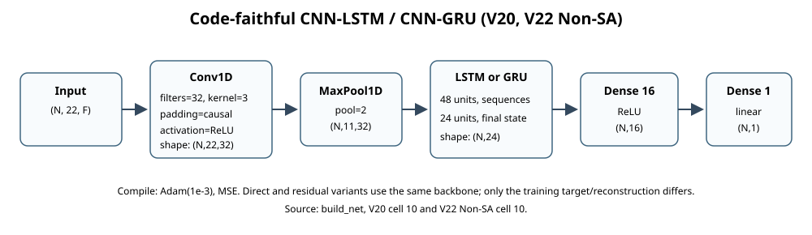

*Hình 8. Input `(N,22,F)` qua Conv1D 32 filters, kernel 3, causal/ReLU, MaxPooling1D(2), hai tầng LSTM hoặc GRU 48→24, Dense 16→1. Direct và Residual dùng cùng backbone; chỉ target/reconstruction khác nhau. Nguồn: V20 cell 10 và V22 Non-SA cell 10; `fig:cnn_recurrent_code_architecture`.*

## 2. Xếp hạng tổng hợp theo 4 split (không tính Naive)

**Top 5 mỗi split** được xếp theo MAE tăng dần trên tất cả kết quả fitted có sẵn, bất kể phiên bản hay họ mô hình. Đây là top cấu hình **hậu nghiệm**, chưa phải xác nhận từ một test hoàn toàn mới.

| Split | Hạng | Mô hình | Features | Chiến lược | MAE (nguồn) | RMSE (nguồn) |
| --- | --- | --- | --- | --- | --- | --- |
| 80/20 | 1 | GRU Residual | FS02_PAPER_CU | Expanding | 0.068780 (V20) | 0.107853 (V20) |
| 80/20 | 2 | LSTM Residual | FS06_WTI_CU | Expanding | 0.068840 (V22-N) | 0.107996 (V22-N) |
| 80/20 | 3 | CNN-LSTM Residual | FS01_CU | Recency | 0.068841 (V20) | 0.108019 (V20) |
| 80/20 | 4 | CNN-LSTM Residual | FS02_PAPER_CU | Recency | 0.068843 (V20) | 0.107912 (V20) |
| 80/20 | 5 | LSTM Residual | FS02_PAPER_CU | Recency | 0.068850 (V20) | 0.107992 (V20) |
| 90/10 | 1 | GRU Residual | FS04_METALS_CU | Expanding | 0.076951 (V20) | 0.100810 (V20) |
| 90/10 | 2 | LSTM Residual | FS04_METALS_CU | Expanding | 0.076978 (V20) | 0.100948 (V20) |
| 90/10 | 3 | CNN-LSTM Residual | FS01_CU | Rolling 756 | 0.077000 (V20) | 0.100895 (V20) |
| 90/10 | 4 | LSTM Residual | FS02_PAPER_CU | Expanding | 0.077006 (V20) | 0.100878 (V20) |
| 90/10 | 5 | LSTM Residual | FS01_CU | Expanding | 0.077008 (V20) | 0.100810 (V20) |
| 92.5/7.5 | 1 | GRU Residual | FS06_WTI_CU | Recency | 0.075028 (V22-N) | 0.098307 (V22-N) |
| 92.5/7.5 | 2 | CNN-LSTM Residual | FS01_CU | Recency | 0.075050 (V20) | 0.098426 (V20) |
| 92.5/7.5 | 3 | CNN-LSTM Residual | FS06_WTI_CU | Expanding | 0.075054 (V22-N) | 0.098459 (V22-N) |
| 92.5/7.5 | 4 | CNN-LSTM Residual | FS01_CU | Expanding | 0.075057 (V20) | 0.098416 (V20) |
| 92.5/7.5 | 5 | CNN-LSTM Residual | FS01_CU | Rolling 756 | 0.075059 (V20) | 0.098468 (V20) |
| 95/5 | 1 | GRU Residual | FS02_PAPER_CU | Recency | 0.072357 (V20) | 0.096414 (V20) |
| 95/5 | 2 | GRU Residual | FS04_METALS_CU | Recency | 0.072507 (V20) | 0.096463 (V20) |
| 95/5 | 3 | LSTM Residual | FS02_PAPER_CU | Expanding | 0.072517 (V20) | 0.096496 (V20) |
| 95/5 | 4 | LSTM Residual | FS02_PAPER_CU | Rolling 756 | 0.072554 (V20) | 0.096450 (V20) |
| 95/5 | 5 | CNN-GRU Residual | FS02_PAPER_CU | Expanding | 0.072575 (V20) | 0.096666 (V20) |

**Naive baseline (không tham gia xếp hạng):**

| Split | MAE | RMSE | Nguồn kiểm tra |
| --- | --- | --- | --- |
| 80/20 | 0.069001 | 0.108000 | V20 / V21-80 / V22-N / V22-S |
| 90/10 | 0.077077 | 0.101033 | V20 / V21 / V22-N / V22-S |
| 92.5/7.5 | 0.075116 | 0.098399 | V20 / V21 / V22-N / V22-S |
| 95/5 | 0.072799 | 0.096612 | V20 / V21 / V22-N / V22-S |

## 2.1. Bốn metrics theo kiến trúc và split (cấu hình có MAE tốt nhất đã quan sát)

Bảng được tái lập từ toàn bộ **702 bản ghi đánh giá holdout**, bao gồm các kết quả V24. Mỗi hàng chọn cấu hình có MAE nhỏ nhất trong số các bộ features/strategies đã thử cho kiến trúc đó, nên có **selection bias**. R² được tính trên mức giá Copper của cùng đoạn test; **R² không đo riêng khả năng dự báo biến động**. MAPE tính được vì không có `actual=0` trong các mẫu đã đối chiếu. Chỉ báo cáo MAE, RMSE, MAPE và R².

| Train | Mô hình | Feature | Chiến lược | MAE | RMSE | MAPE (%) | R² | Nguồn |
| --- | --- | --- | --- | ---: | ---: | ---: | ---: | --- |
| 80% | CNN-GRU Direct | FS04_METALS_CU | Expanding | 0.214288 | 0.273292 | 3.951 | 0.8931 | V20 |
| 80% | CNN-LSTM Direct | FS01_CU | Recency | 0.384733 | 0.473176 | 6.700 | 0.6795 | V20 |
| 80% | GRU Direct | FS01_CU | Recency | 0.141899 | 0.191724 | 2.550 | 0.9474 | V20 |
| 80% | LSTM Direct | FS01_CU | Expanding | 0.110100 | 0.161307 | 2.082 | 0.9628 | V20 |
| 80% | Paper SA-LSTM | FS06_WTI_CU | Recency | 0.270155 | 0.343050 | 4.827 | 0.8315 | V24 |
| 80% | Reoptimized SA-LSTM | FS06_WTI_CU | Expanding | 0.223809 | 0.297888 | 4.063 | 0.8730 | V22-S |
| 80% | Residual-CNN-GRU | FS06_WTI_CU | Recency | 0.068947 | 0.107682 | 1.289 | 0.9834 | V22-N |
| 80% | Residual-CNN-LSTM | FS01_CU | Recency | 0.068841 | 0.108019 | 1.287 | 0.9833 | V20 |
| 80% | Residual-GRU | FS02_PAPER_CU | Expanding | 0.068780 | 0.107853 | 1.286 | 0.9833 | V20 |
| 80% | Residual-LSTM | FS06_WTI_CU | Expanding | 0.068840 | 0.107996 | 1.287 | 0.9833 | V22-N |
| 80% | Residual-Ridge | FS01_CU | Expanding | 0.069408 | 0.108075 | 1.296 | 0.9833 | V20 |
| 80% | SimpleRNN Direct | FS04_METALS_CU | Expanding | 0.795791 | 0.916974 | 13.894 | -0.2037 | V21-80 |
| 90% | CNN-GRU Direct | FS02_PAPER_CU | Expanding | 0.296379 | 0.359605 | 4.803 | 0.4661 | V20 |
| 90% | CNN-LSTM Direct | FS04_METALS_CU | Expanding | 0.393469 | 0.492822 | 6.193 | -0.0028 | V20 |
| 90% | GRU Direct | FS01_CU | Recency | 0.205153 | 0.243488 | 3.285 | 0.7552 | V20 |
| 90% | LSTM Direct | FS04_METALS_CU | Expanding | 0.247409 | 0.304619 | 3.933 | 0.6169 | V21 |
| 90% | Paper SA-LSTM | FS06_WTI_CU | Expanding | 0.184634 | 0.225723 | 2.993 | 0.7896 | V22-S |
| 90% | Reoptimized SA-LSTM | FS06_WTI_CU | Recency | 0.326683 | 0.376388 | 5.222 | 0.4151 | V22-S |
| 90% | Residual-CNN-GRU | FS06_WTI_CU | Expanding | 0.077229 | 0.101285 | 1.281 | 0.9576 | V22-N |
| 90% | Residual-CNN-LSTM | FS01_CU | Rolling 756 | 0.077000 | 0.100895 | 1.277 | 0.9580 | V20 |
| 90% | Residual-GRU | FS04_METALS_CU | Expanding | 0.076951 | 0.100810 | 1.276 | 0.9580 | V20 |
| 90% | Residual-LSTM | FS04_METALS_CU | Expanding | 0.076978 | 0.100948 | 1.277 | 0.9579 | V20 |
| 90% | Residual-Ridge | FS01_CU | Expanding | 0.077306 | 0.101190 | 1.280 | 0.9577 | V20 |
| 90% | SimpleRNN Direct | FS05_METALS_EXO | Recency | 0.608387 | 0.710083 | 9.616 | -1.0818 | V21 |
| 92.5% | CNN-GRU Direct | FS04_METALS_CU | Recency | 0.351300 | 0.400391 | 5.555 | -0.2614 | V20 |
| 92.5% | CNN-LSTM Direct | FS06_WTI_CU | Rolling 756 | 0.522778 | 0.560252 | 8.204 | -1.4697 | V22-N |
| 92.5% | GRU Direct | FS06_WTI_CU | Recency | 0.182461 | 0.215549 | 2.858 | 0.6344 | V22-N |
| 92.5% | LSTM Direct | FS01_CU | Rolling 756 | 0.247864 | 0.280534 | 3.905 | 0.3808 | V20 |
| 92.5% | Paper SA-LSTM | FS06_WTI_CU | Expanding | 0.194868 | 0.236334 | 3.077 | 0.5605 | V22-S |
| 92.5% | Reoptimized SA-LSTM | FS04_METALS_CU | Expanding | 0.352332 | 0.409124 | 5.490 | -0.3170 | V21 |
| 92.5% | Residual-CNN-GRU | FS01_CU | Recency | 0.075340 | 0.098272 | 1.211 | 0.9240 | V20 |
| 92.5% | Residual-CNN-LSTM | FS01_CU | Recency | 0.075050 | 0.098426 | 1.207 | 0.9238 | V20 |
| 92.5% | Residual-GRU | FS06_WTI_CU | Recency | 0.075028 | 0.098307 | 1.207 | 0.9240 | V22-N |
| 92.5% | Residual-LSTM | FS06_WTI_CU | Expanding | 0.075094 | 0.098551 | 1.208 | 0.9236 | V22-N |
| 92.5% | Residual-Ridge | FS01_CU | Expanding | 0.075285 | 0.098422 | 1.210 | 0.9238 | V20 |
| 92.5% | SimpleRNN Direct | FS04_METALS_CU | Expanding | 0.724220 | 0.772906 | 11.350 | -3.7003 | V21 |
| 95% | CNN-GRU Direct | FS06_WTI_CU | Recency | 0.408640 | 0.438568 | 6.251 | -4.4429 | V22-N |
| 95% | CNN-LSTM Direct | FS01_CU | Recency | 0.659669 | 0.679916 | 10.124 | -12.0817 | V20 |
| 95% | GRU Direct | FS01_CU | Recency | 0.167929 | 0.194203 | 2.570 | -0.0673 | V20 |
| 95% | LSTM Direct | FS01_CU | Rolling 756 | 0.404888 | 0.428586 | 6.204 | -4.1979 | V20 |
| 95% | Paper SA-LSTM | FS06_WTI_CU | Expanding | 0.200803 | 0.235800 | 3.070 | -0.5734 | V22-S |
| 95% | Reoptimized SA-LSTM | FS06_WTI_CU | Expanding | 0.325427 | 0.360107 | 4.978 | -2.6696 | V22-S |
| 95% | Residual-CNN-GRU | FS02_PAPER_CU | Expanding | 0.072575 | 0.096666 | 1.127 | 0.7356 | V20 |
| 95% | Residual-CNN-LSTM | FS01_CU | Expanding | 0.072625 | 0.096669 | 1.128 | 0.7356 | V20 |
| 95% | Residual-GRU | FS02_PAPER_CU | Recency | 0.072357 | 0.096414 | 1.124 | 0.7370 | V20 |
| 95% | Residual-LSTM | FS02_PAPER_CU | Expanding | 0.072517 | 0.096496 | 1.126 | 0.7365 | V20 |
| 95% | Residual-Ridge | FS01_CU | Expanding | 0.073685 | 0.096928 | 1.143 | 0.7341 | V20 |
| 95% | SimpleRNN Direct | FS04_METALS_CU | Expanding | 0.902960 | 0.916224 | 13.884 | -22.7551 | V21 |

## 3. So sánh toàn bộ mô hình theo chiến lược tại split 90/10

Bảng này giải quyết trực tiếp việc đọc rời rạc giữa các phiên bản: mỗi hàng là **một mô hình + một bộ input + một nguồn**, ba cột hiển thị Expanding/Rolling/Recency đặt cạnh nhau. `—` = chưa thực nghiệm theo nguồn đó. Đơn vị MAE trên giá gốc.

| Mô hình | Bộ biến | Expanding MAE | Rolling MAE | Recency MAE |
| --- | --- | --- | --- | --- |
| CNN-GRU Direct | FS01_CU | 0.633998 (V20) | 0.432151 (V20) | 0.508912 (V20) |
| CNN-GRU Direct | FS04_METALS_CU | 0.313523 (V20) | 0.483141 (V20) | 0.298726 (V20) |
| CNN-GRU Direct | FS02_PAPER_CU | 0.296379 (V20) | 0.311519 (V20) | 0.457908 (V20) |
| CNN-GRU Direct | FS06_WTI_CU | 0.619798 (V22-N) | 0.427192 (V22-N) | 0.643456 (V22-N) |
| CNN-GRU Residual | FS01_CU | 0.078067 (V20) | 0.088180 (V20) | 0.080173 (V20) |
| CNN-GRU Residual | FS04_METALS_CU | 0.090563 (V20) | 0.098870 (V20) | 0.077522 (V20) |
| CNN-GRU Residual | FS02_PAPER_CU | 0.078132 (V20) | 0.097694 (V20) | 0.083405 (V20) |
| CNN-GRU Residual | FS06_WTI_CU | 0.077229 (V22-N) | 0.085898 (V22-N) | 0.077639 (V22-N) |
| CNN-LSTM Direct | FS01_CU | 0.702867 (V20) | 0.686135 (V20) | 0.829593 (V20) |
| CNN-LSTM Direct | FS04_METALS_CU | 0.393469 (V20) | 0.687898 (V20) | 0.991953 (V20) |
| CNN-LSTM Direct | FS02_PAPER_CU | 1.108590 (V20) | 0.790701 (V20) | 0.716936 (V20) |
| CNN-LSTM Direct | FS06_WTI_CU | 0.888314 (V22-N) | 0.873802 (V22-N) | 0.886170 (V22-N) |
| CNN-LSTM Residual | FS01_CU | 0.080098 (V20) | 0.077000 (V20) | 0.078311 (V20) |
| CNN-LSTM Residual | FS04_METALS_CU | 0.077245 (V20) | 0.081200 (V20) | 0.077304 (V20) |
| CNN-LSTM Residual | FS02_PAPER_CU | 0.077432 (V20) | 0.091009 (V20) | 0.079093 (V20) |
| CNN-LSTM Residual | FS06_WTI_CU | 0.077638 (V22-N) | 0.085373 (V22-N) | 0.078023 (V22-N) |
| GRU Direct | FS01_CU | 0.437113 (V20) | 0.206817 (V20) | 0.205153 (V20) |
| GRU Direct | FS04_METALS_CU | 0.240815 (V20) | 0.357864 (V20) | 0.273153 (V20) |
| GRU Direct | FS02_PAPER_CU | 0.247893 (V20) | 0.492330 (V20) | 0.254494 (V20) |
| GRU Direct | FS06_WTI_CU | 0.243208 (V22-N) | 0.256292 (V22-N) | 0.235421 (V22-N) |
| GRU Residual | FS01_CU | 0.080182 (V20) | 0.078851 (V20) | 0.083943 (V20) |
| GRU Residual | FS04_METALS_CU | 0.076951 (V20) | 0.077182 (V20) | 0.077055 (V20) |
| GRU Residual | FS02_PAPER_CU | 0.077143 (V20) | 0.077209 (V20) | 0.077304 (V20) |
| GRU Residual | FS06_WTI_CU | 0.077463 (V22-N) | 0.081939 (V22-N) | 0.077851 (V22-N) |
| LSTM Direct | FS01_CU | 0.446716 (V20) | 0.277933 (V20) | 0.690705 (V20) |
| LSTM Direct | FS04_METALS_CU | 0.247410 (V20) | 0.958465 (V20) | 0.659060 (V20) |
| LSTM Direct | FS04_METALS_CU | 0.247409 (V21) | 0.958466 (V21) | 0.659060 (V21) |
| LSTM Direct | FS05_METALS_EXO | 0.854128 (V21) | 0.909432 (V21) | 0.790417 (V21) |
| LSTM Direct | FS02_PAPER_CU | 1.163964 (V20) | 0.918796 (V20) | 0.564050 (V20) |
| LSTM Direct | FS02_PAPER_CU | 1.163964 (V21) | 0.918796 (V21) | 0.564049 (V21) |
| LSTM Direct | FS03_PAPER_EXO | 1.145988 (V21) | 1.062130 (V21) | 0.686208 (V21) |
| LSTM Direct | FS06_WTI_CU | 0.324937 (V22-N) | 0.346713 (V22-N) | 1.236604 (V22-N) |
| LSTM Direct | FS06_WTI_CU | 0.324940 (V22-S) | 0.321192 (V22-S) | 1.236605 (V22-S) |
| LSTM Residual | FS01_CU | 0.077008 (V20) | 0.077159 (V20) | 0.078135 (V20) |
| LSTM Residual | FS04_METALS_CU | 0.076978 (V20) | 0.077756 (V20) | 0.078692 (V20) |
| LSTM Residual | FS02_PAPER_CU | 0.077006 (V20) | 0.077230 (V20) | 0.078318 (V20) |
| LSTM Residual | FS06_WTI_CU | 0.077037 (V22-N) | 0.080271 (V22-N) | 0.078856 (V22-N) |
| Ridge Residual | FS01_CU | 0.077306 (V20) | 0.082705 (V20) | 0.079330 (V20) |
| Ridge Residual | FS04_METALS_CU | 0.081707 (V20) | 0.084002 (V20) | 0.085664 (V20) |
| Ridge Residual | FS02_PAPER_CU | 0.080712 (V20) | 0.098350 (V20) | 0.090112 (V20) |
| Ridge Residual | FS06_WTI_CU | 0.077737 (V22-N) | 0.094420 (V22-N) | 0.081044 (V22-N) |
| SA-LSTM Paper HP | FS04_METALS_CU | 0.470929 (V21) | 0.773310 (V21) | 0.705350 (V21) |
| SA-LSTM Paper HP | FS05_METALS_EXO | 0.464991 (V21) | 0.869224 (V21) | 0.524705 (V21) |
| SA-LSTM Paper HP | FS02_PAPER_CU | 0.978075 (V21) | 0.897077 (V21) | 0.917524 (V21) |
| SA-LSTM Paper HP | FS03_PAPER_EXO | 0.540720 (V21) | 0.604594 (V21) | 0.585950 (V21) |
| SA-LSTM Paper HP | FS06_WTI_CU | 0.184634 (V22-S) | 0.575763 (V22-S) | 0.294741 (V22-S) |
| SA-LSTM Reoptimized | FS04_METALS_CU | 0.510467 (V21) | 0.977821 (V21) | 0.735621 (V21) |
| SA-LSTM Reoptimized | FS05_METALS_EXO | 0.466595 (V21) | 0.624100 (V21) | 0.460227 (V21) |
| SA-LSTM Reoptimized | FS02_PAPER_CU | 0.877420 (V21) | 0.974593 (V21) | 0.511784 (V21) |
| SA-LSTM Reoptimized | FS03_PAPER_EXO | 0.595605 (V21) | 0.644180 (V21) | 0.482221 (V21) |
| SA-LSTM Reoptimized | FS06_WTI_CU | 0.358921 (V22-S) | 0.496288 (V22-S) | 0.326683 (V22-S) |
| SimpleRNN Direct | FS04_METALS_CU | 0.831186 (V21) | 1.115149 (V21) | 1.045665 (V21) |
| SimpleRNN Direct | FS05_METALS_EXO | 0.962108 (V21) | 1.128623 (V21) | 0.608387 (V21) |
| SimpleRNN Direct | FS02_PAPER_CU | 1.385730 (V21) | 1.316286 (V21) | 0.973459 (V21) |
| SimpleRNN Direct | FS03_PAPER_EXO | 1.001232 (V21) | 1.321809 (V21) | 1.568182 (V21) |
| SimpleRNN Direct | FS06_WTI_CU | 0.818738 (V22-S) | 0.859431 (V22-S) | 1.009153 (V22-S) |

**Cách đọc:** Trước hết so sánh ba cột trong cùng hàng (đổi strategy), rồi so sánh giữa các hàng có cùng mô hình và cùng cột (đổi features). Không kết luận chiến lược tốt hơn toàn cục từ một hàng.

*Hình 9. Copper thực tế, Residual-GRU, Ridge Residual và Naive trên V20 split 80/20, Expanding, FS02, H=1. Đường gần nhau không thay thế MAE/RMSE hoặc DM-HAC; nguồn điểm `grid_predictions.csv`; `fig:actual_predicted_residual_naive`.*

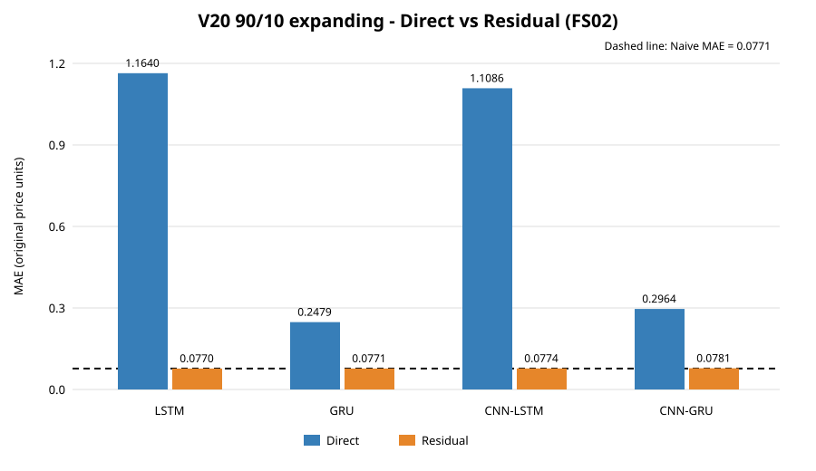

*Hình 10. MAE Direct/Residual cho LSTM, GRU, CNN-LSTM, CNN-GRU ở đúng V20 split 90/10, Expanding, FS02; đường đứt là Naive. Script đọc `grid_results.csv`, không dùng số suy đoán; `fig:direct_vs_residual_v20`.*

## 4. Tác động thay FS04_METALS_CU bằng FS06_WTI_CU — ghép cặp đúng mô hình và chiến lược

Định nghĩa `ΔMAE (%) = 100 × (MAE_WTI / MAE_Legacy14 − 1)`. **Âm = WTI giảm sai số, tốt hơn; dương = WTI tăng sai số, kém hơn**. Chỉ ghép các trường hợp trùng mô hình, split và strategy; bảng dưới còn ghi rõ nguồn. Với SA Reoptimized, chênh lệch bao gồm cả SA search mới.

### 4.1. Split 80/20

| Mô hình | Chiến lược | MAE Legacy14 | MAE WTI | ΔMAE | RMSE cũ | RMSE mới |
| --- | --- | --- | --- | --- | --- | --- |
| CNN-GRU Direct | Expanding | 0.214287 (V20) | 0.301326 (V22-N) | +40.62% | 0.273292 | 0.379359 |
| CNN-GRU Direct | Recency | 0.313767 (V20) | 0.321193 (V22-N) | +2.37% | 0.385948 | 0.400114 |
| CNN-GRU Direct | Rolling 756 | 0.594207 (V20) | 0.315794 (V22-N) | -46.85% | 0.717580 | 0.404259 |
| CNN-GRU Residual | Expanding | 0.074771 (V20) | 0.069742 (V22-N) | -6.73% | 0.114417 | 0.108045 |
| CNN-GRU Residual | Recency | 0.111344 (V20) | 0.068947 (V22-N) | -38.08% | 0.151494 | 0.107682 |
| CNN-GRU Residual | Rolling 756 | 0.095740 (V20) | 0.069534 (V22-N) | -27.37% | 0.135472 | 0.107919 |
| CNN-LSTM Direct | Expanding | 0.718548 (V20) | 0.438657 (V22-N) | -38.95% | 0.844535 | 0.556630 |
| CNN-LSTM Direct | Recency | 0.558670 (V20) | 0.435179 (V22-N) | -22.10% | 0.702984 | 0.550786 |
| CNN-LSTM Direct | Rolling 756 | 0.842083 (V20) | 0.636210 (V22-N) | -24.45% | 1.052927 | 0.781975 |
| CNN-LSTM Residual | Expanding | 0.068916 (V20) | 0.068972 (V22-N) | +0.08% | 0.108116 | 0.107827 |
| CNN-LSTM Residual | Recency | 0.068914 (V20) | 0.068931 (V22-N) | +0.02% | 0.107779 | 0.107935 |
| CNN-LSTM Residual | Rolling 756 | 0.069998 (V20) | 0.069118 (V22-N) | -1.26% | 0.108669 | 0.107833 |
| GRU Direct | Expanding | 0.196520 (V20) | 0.164666 (V22-N) | -16.21% | 0.258860 | 0.222705 |
| GRU Direct | Recency | 0.246072 (V20) | 0.156398 (V22-N) | -36.44% | 0.324673 | 0.209462 |
| GRU Direct | Rolling 756 | 0.687417 (V20) | 0.212751 (V22-N) | -69.05% | 0.842202 | 0.282181 |
| GRU Residual | Expanding | 0.068857 (V20) | 0.068966 (V22-N) | +0.16% | 0.107932 | 0.107862 |
| GRU Residual | Recency | 0.068933 (V20) | 0.068914 (V22-N) | -0.03% | 0.107941 | 0.107935 |
| GRU Residual | Rolling 756 | 0.133698 (V20) | 0.069751 (V22-N) | -47.83% | 0.175810 | 0.108199 |
| LSTM Direct | Expanding | 0.713145 (V20) | 0.531803 (V22-N) | -25.43% | 0.878396 | 0.662974 |
| LSTM Direct | Recency | 0.574219 (V20) | 0.528022 (V22-N) | -8.05% | 0.722827 | 0.673269 |
| LSTM Direct | Rolling 756 | 1.096387 (V20) | 0.424343 (V22-N) | -61.30% | 1.355998 | 0.550282 |
| LSTM Residual | Expanding | 0.068912 (V20) | 0.068840 (V22-N) | -0.10% | 0.108011 | 0.107996 |
| LSTM Residual | Recency | 0.068907 (V20) | 0.069815 (V22-N) | +1.32% | 0.108036 | 0.108448 |
| LSTM Residual | Rolling 756 | 0.076509 (V20) | 0.069943 (V22-N) | -8.58% | 0.116666 | 0.108243 |
| Ridge Residual | Expanding | 0.072588 (V20) | 0.069603 (V22-N) | -4.11% | 0.112238 | 0.108010 |
| Ridge Residual | Recency | 0.077906 (V20) | 0.071724 (V22-N) | -7.94% | 0.119160 | 0.109358 |
| Ridge Residual | Rolling 756 | 0.163842 (V20) | 0.076286 (V22-N) | -53.44% | 0.192049 | 0.112686 |
| LSTM Direct | Expanding | 0.713145 (V21-80) | 0.531802 (V22-S) | -25.43% | 0.878396 | 0.662974 |
| SA-LSTM Paper HP | Expanding | 0.760563 (V21-80) | 0.298955 (V22-S) | -60.69% | 1.002313 | 0.358768 |
| SA-LSTM Reoptimized | Expanding | 1.000423 (V21-80) | 0.223809 (V22-S) | -77.63% | 1.189193 | 0.297888 |
| SimpleRNN Direct | Expanding | 0.795791 (V21-80) | 0.837846 (V22-S) | +5.28% | 0.916974 | 0.994480 |

Có 31 cặp được ghép có số liệu tại split 80/20. Các cặp không có trong CSV không được nội suy.

### 4.2. Split 90/10

| Mô hình | Chiến lược | MAE Legacy14 | MAE WTI | ΔMAE | RMSE cũ | RMSE mới |
| --- | --- | --- | --- | --- | --- | --- |
| CNN-GRU Direct | Expanding | 0.313523 (V20) | 0.619798 (V22-N) | +97.69% | 0.381001 | 0.664925 |
| CNN-GRU Direct | Recency | 0.298726 (V20) | 0.643456 (V22-N) | +115.40% | 0.372347 | 0.689708 |
| CNN-GRU Direct | Rolling 756 | 0.483141 (V20) | 0.427192 (V22-N) | -11.58% | 0.527339 | 0.470401 |
| CNN-GRU Residual | Expanding | 0.090563 (V20) | 0.077229 (V22-N) | -14.72% | 0.117479 | 0.101285 |
| CNN-GRU Residual | Recency | 0.077522 (V20) | 0.077639 (V22-N) | +0.15% | 0.100867 | 0.101300 |
| CNN-GRU Residual | Rolling 756 | 0.098870 (V20) | 0.085898 (V22-N) | -13.12% | 0.122720 | 0.108409 |
| CNN-LSTM Direct | Expanding | 0.393469 (V20) | 0.888314 (V22-N) | +125.76% | 0.492822 | 0.952557 |
| CNN-LSTM Direct | Recency | 0.991953 (V20) | 0.886170 (V22-N) | -10.66% | 1.048918 | 0.953553 |
| CNN-LSTM Direct | Rolling 756 | 0.687898 (V20) | 0.873802 (V22-N) | +27.02% | 0.810581 | 0.945043 |
| CNN-LSTM Residual | Expanding | 0.077245 (V20) | 0.077638 (V22-N) | +0.51% | 0.100856 | 0.101076 |
| CNN-LSTM Residual | Recency | 0.077304 (V20) | 0.078023 (V22-N) | +0.93% | 0.101023 | 0.101646 |
| CNN-LSTM Residual | Rolling 756 | 0.081200 (V20) | 0.085373 (V22-N) | +5.14% | 0.103617 | 0.107714 |
| GRU Direct | Expanding | 0.240815 (V20) | 0.243208 (V22-N) | +0.99% | 0.302923 | 0.287070 |
| GRU Direct | Recency | 0.273153 (V20) | 0.235421 (V22-N) | -13.81% | 0.325727 | 0.275645 |
| GRU Direct | Rolling 756 | 0.357864 (V20) | 0.256292 (V22-N) | -28.38% | 0.398964 | 0.292692 |
| GRU Residual | Expanding | 0.076951 (V20) | 0.077463 (V22-N) | +0.67% | 0.100810 | 0.101052 |
| GRU Residual | Recency | 0.077055 (V20) | 0.077851 (V22-N) | +1.03% | 0.100969 | 0.101376 |
| GRU Residual | Rolling 756 | 0.077182 (V20) | 0.081939 (V22-N) | +6.16% | 0.101018 | 0.104597 |
| LSTM Direct | Expanding | 0.247410 (V20) | 0.324937 (V22-N) | +31.34% | 0.304620 | 0.381590 |
| LSTM Direct | Recency | 0.659060 (V20) | 1.236604 (V22-N) | +87.63% | 0.772684 | 1.296919 |
| LSTM Direct | Rolling 756 | 0.958465 (V20) | 0.346713 (V22-N) | -63.83% | 1.000966 | 0.382468 |
| LSTM Residual | Expanding | 0.076978 (V20) | 0.077037 (V22-N) | +0.08% | 0.100948 | 0.100980 |
| LSTM Residual | Recency | 0.078692 (V20) | 0.078856 (V22-N) | +0.21% | 0.103507 | 0.102206 |
| LSTM Residual | Rolling 756 | 0.077756 (V20) | 0.080271 (V22-N) | +3.23% | 0.101509 | 0.103472 |
| Ridge Residual | Expanding | 0.081707 (V20) | 0.077737 (V22-N) | -4.86% | 0.106728 | 0.101669 |
| Ridge Residual | Recency | 0.085664 (V20) | 0.081044 (V22-N) | -5.39% | 0.112437 | 0.104682 |
| Ridge Residual | Rolling 756 | 0.084002 (V20) | 0.094420 (V22-N) | +12.40% | 0.108523 | 0.116679 |
| LSTM Direct | Expanding | 0.247409 (V21) | 0.324940 (V22-S) | +31.34% | 0.304619 | 0.381594 |
| LSTM Direct | Recency | 0.659060 (V21) | 1.236605 (V22-S) | +87.63% | 0.772684 | 1.296920 |
| LSTM Direct | Rolling 756 | 0.958466 (V21) | 0.321192 (V22-S) | -66.49% | 1.000967 | 0.350564 |
| SA-LSTM Paper HP | Expanding | 0.470929 (V21) | 0.184634 (V22-S) | -60.79% | 0.527551 | 0.225723 |
| SA-LSTM Paper HP | Recency | 0.705350 (V21) | 0.294741 (V22-S) | -58.21% | 0.769216 | 0.346242 |
| SA-LSTM Paper HP | Rolling 756 | 0.773310 (V21) | 0.575763 (V22-S) | -25.55% | 0.842719 | 0.634142 |
| SA-LSTM Reoptimized | Expanding | 0.510467 (V21) | 0.358921 (V22-S) | -29.69% | 0.591630 | 0.415277 |
| SA-LSTM Reoptimized | Recency | 0.735621 (V21) | 0.326683 (V22-S) | -55.59% | 0.825336 | 0.376388 |
| SA-LSTM Reoptimized | Rolling 756 | 0.977821 (V21) | 0.496288 (V22-S) | -49.25% | 1.034595 | 0.552808 |
| SimpleRNN Direct | Expanding | 0.831186 (V21) | 0.818738 (V22-S) | -1.50% | 0.886049 | 0.900169 |
| SimpleRNN Direct | Recency | 1.045665 (V21) | 1.009153 (V22-S) | -3.49% | 1.113621 | 1.089029 |
| SimpleRNN Direct | Rolling 756 | 1.115149 (V21) | 0.859431 (V22-S) | -22.93% | 1.185744 | 0.937179 |

Có 39 cặp được ghép có số liệu tại split 90/10. Các cặp không có trong CSV không được nội suy.

### 4.3. Split 92.5/7.5

| Mô hình | Chiến lược | MAE Legacy14 | MAE WTI | ΔMAE | RMSE cũ | RMSE mới |
| --- | --- | --- | --- | --- | --- | --- |
| CNN-GRU Direct | Expanding | 0.443855 (V20) | 0.719336 (V22-N) | +62.07% | 0.504454 | 0.750956 |
| CNN-GRU Direct | Recency | 0.351300 (V20) | 0.633058 (V22-N) | +80.20% | 0.400391 | 0.672985 |
| CNN-GRU Direct | Rolling 756 | 0.470120 (V20) | 0.571354 (V22-N) | +21.53% | 0.529660 | 0.608944 |
| CNN-GRU Residual | Expanding | 0.080471 (V20) | 0.076010 (V22-N) | -5.54% | 0.105340 | 0.099649 |
| CNN-GRU Residual | Recency | 0.079462 (V20) | 0.081707 (V22-N) | +2.82% | 0.103679 | 0.106210 |
| CNN-GRU Residual | Rolling 756 | 0.076120 (V20) | 0.079791 (V22-N) | +4.82% | 0.100282 | 0.102662 |
| CNN-LSTM Direct | Expanding | 0.618529 (V20) | 1.030310 (V22-N) | +66.57% | 0.711877 | 1.071730 |
| CNN-LSTM Direct | Recency | 0.798469 (V20) | 1.025076 (V22-N) | +28.38% | 0.893468 | 1.065589 |
| CNN-LSTM Direct | Rolling 756 | 0.849618 (V20) | 0.522778 (V22-N) | -38.47% | 0.939924 | 0.560252 |
| CNN-LSTM Residual | Expanding | 0.076109 (V20) | 0.075054 (V22-N) | -1.39% | 0.099989 | 0.098459 |
| CNN-LSTM Residual | Recency | 0.076140 (V20) | 0.075275 (V22-N) | -1.14% | 0.099782 | 0.098951 |
| CNN-LSTM Residual | Rolling 756 | 0.076066 (V20) | 0.077000 (V22-N) | +1.23% | 0.098508 | 0.099843 |
| GRU Direct | Expanding | 0.408172 (V20) | 0.268112 (V22-N) | -34.31% | 0.463556 | 0.303433 |
| GRU Direct | Recency | 0.381128 (V20) | 0.182461 (V22-N) | -52.13% | 0.425980 | 0.215549 |
| GRU Direct | Rolling 756 | 0.379187 (V20) | 0.369189 (V22-N) | -2.64% | 0.429467 | 0.397711 |
| GRU Residual | Expanding | 0.075205 (V20) | 0.075198 (V22-N) | -0.01% | 0.098704 | 0.098460 |
| GRU Residual | Recency | 0.075708 (V20) | 0.075028 (V22-N) | -0.90% | 0.099996 | 0.098307 |
| GRU Residual | Rolling 756 | 0.075867 (V20) | 0.082713 (V22-N) | +9.02% | 0.100204 | 0.103863 |
| LSTM Direct | Expanding | 0.292570 (V20) | 0.318708 (V22-N) | +8.93% | 0.339832 | 0.370594 |
| LSTM Direct | Recency | 0.959042 (V20) | 1.120221 (V22-N) | +16.81% | 1.027179 | 1.164206 |
| LSTM Direct | Rolling 756 | 1.147674 (V20) | 0.351619 (V22-N) | -69.36% | 1.170163 | 0.379217 |
| LSTM Residual | Expanding | 0.076541 (V20) | 0.075094 (V22-N) | -1.89% | 0.100764 | 0.098551 |
| LSTM Residual | Recency | 0.076629 (V20) | 0.075120 (V22-N) | -1.97% | 0.100968 | 0.098612 |
| LSTM Residual | Rolling 756 | 0.075741 (V20) | 0.075551 (V22-N) | -0.25% | 0.098783 | 0.098938 |
| Ridge Residual | Expanding | 0.082249 (V20) | 0.076510 (V22-N) | -6.98% | 0.107058 | 0.099999 |
| Ridge Residual | Recency | 0.090000 (V20) | 0.080297 (V22-N) | -10.78% | 0.115616 | 0.103246 |
| Ridge Residual | Rolling 756 | 0.085453 (V20) | 0.092756 (V22-N) | +8.55% | 0.108047 | 0.114818 |
| LSTM Direct | Expanding | 0.292571 (V21) | 0.318782 (V22-S) | +8.96% | 0.339834 | 0.370703 |
| SA-LSTM Paper HP | Expanding | 0.541731 (V21) | 0.194868 (V22-S) | -64.03% | 0.585612 | 0.236334 |
| SA-LSTM Reoptimized | Expanding | 0.352332 (V21) | 0.366077 (V22-S) | +3.90% | 0.409124 | 0.411546 |
| SimpleRNN Direct | Expanding | 0.724220 (V21) | 0.975897 (V22-S) | +34.75% | 0.772906 | 1.013056 |

Có 31 cặp được ghép có số liệu tại split 92.5/7.5. Các cặp không có trong CSV không được nội suy.

### 4.4. Split 95/5

| Mô hình | Chiến lược | MAE Legacy14 | MAE WTI | ΔMAE | RMSE cũ | RMSE mới |
| --- | --- | --- | --- | --- | --- | --- |
| CNN-GRU Direct | Expanding | 0.419085 (V20) | 0.558294 (V22-N) | +33.22% | 0.446224 | 0.580681 |
| CNN-GRU Direct | Recency | 0.460504 (V20) | 0.408640 (V22-N) | -11.26% | 0.496450 | 0.438568 |
| CNN-GRU Direct | Rolling 756 | 0.526928 (V20) | 0.622279 (V22-N) | +18.10% | 0.551093 | 0.645350 |
| CNN-GRU Residual | Expanding | 0.072810 (V20) | 0.073054 (V22-N) | +0.34% | 0.097681 | 0.096493 |
| CNN-GRU Residual | Recency | 0.075763 (V20) | 0.072810 (V22-N) | -3.90% | 0.097734 | 0.096709 |
| CNN-GRU Residual | Rolling 756 | 0.072839 (V20) | 0.074883 (V22-N) | +2.81% | 0.097354 | 0.096766 |
| CNN-LSTM Direct | Expanding | 0.884860 (V20) | 0.950946 (V22-N) | +7.47% | 0.913996 | 0.964782 |
| CNN-LSTM Direct | Recency | 0.697727 (V20) | 0.923828 (V22-N) | +32.41% | 0.734079 | 0.939854 |
| CNN-LSTM Direct | Rolling 756 | 0.910641 (V20) | 0.959533 (V22-N) | +5.37% | 0.934973 | 0.974685 |
| CNN-LSTM Residual | Expanding | 0.072917 (V20) | 0.073456 (V22-N) | +0.74% | 0.096419 | 0.096595 |
| CNN-LSTM Residual | Recency | 0.074450 (V20) | 0.074737 (V22-N) | +0.38% | 0.097025 | 0.097229 |
| CNN-LSTM Residual | Rolling 756 | 0.073683 (V20) | 0.074180 (V22-N) | +0.67% | 0.096634 | 0.096942 |
| GRU Direct | Expanding | 0.370773 (V20) | 0.285936 (V22-N) | -22.88% | 0.390730 | 0.311670 |
| GRU Direct | Recency | 0.384643 (V20) | 0.249627 (V22-N) | -35.10% | 0.413438 | 0.274234 |
| GRU Direct | Rolling 756 | 0.352270 (V20) | 0.521993 (V22-N) | +48.18% | 0.371524 | 0.545712 |
| GRU Residual | Expanding | 0.072622 (V20) | 0.072882 (V22-N) | +0.36% | 0.096631 | 0.096631 |
| GRU Residual | Recency | 0.072507 (V20) | 0.072619 (V22-N) | +0.16% | 0.096463 | 0.096531 |
| GRU Residual | Rolling 756 | 0.072720 (V20) | 0.078619 (V22-N) | +8.11% | 0.097324 | 0.099497 |
| LSTM Direct | Expanding | 0.662176 (V20) | 0.551285 (V22-N) | -16.75% | 0.684761 | 0.571203 |
| LSTM Direct | Recency | 0.854903 (V20) | 1.166861 (V22-N) | +36.49% | 0.869833 | 1.180903 |
| LSTM Direct | Rolling 756 | 1.130368 (V20) | 0.598023 (V22-N) | -47.09% | 1.142445 | 0.615654 |
| LSTM Residual | Expanding | 0.072619 (V20) | 0.073211 (V22-N) | +0.81% | 0.096367 | 0.096610 |
| LSTM Residual | Recency | 0.073271 (V20) | 0.073393 (V22-N) | +0.17% | 0.096492 | 0.096674 |
| LSTM Residual | Rolling 756 | 0.074773 (V20) | 0.075774 (V22-N) | +1.34% | 0.096963 | 0.097801 |
| Ridge Residual | Expanding | 0.074357 (V20) | 0.074315 (V22-N) | -0.06% | 0.098943 | 0.097327 |
| Ridge Residual | Recency | 0.085730 (V20) | 0.082883 (V22-N) | -3.32% | 0.106248 | 0.104497 |
| Ridge Residual | Rolling 756 | 0.078320 (V20) | 0.095167 (V22-N) | +21.51% | 0.100768 | 0.115561 |
| LSTM Direct | Expanding | 0.662176 (V21) | 0.551285 (V22-S) | -16.75% | 0.684761 | 0.571203 |
| SA-LSTM Paper HP | Expanding | 0.600953 (V21) | 0.200803 (V22-S) | -66.59% | 0.625768 | 0.235800 |
| SA-LSTM Reoptimized | Expanding | 0.541005 (V21) | 0.325427 (V22-S) | -39.85% | 0.569432 | 0.360107 |
| SimpleRNN Direct | Expanding | 0.902960 (V21) | 0.941332 (V22-S) | +4.25% | 0.916224 | 0.952494 |

Có 31 cặp được ghép có số liệu tại split 95/5. Các cặp không có trong CSV không được nội suy.

## 5. Xếp hạng chiến lược theo mô hình và theo split

Để tránh kết luận từ một lần thắng, đếm số lần mỗi chiến lược đạt **MAE nhỏ nhất trong ba chiến lược trên cùng một mô hình + features + split + nguồn**. Chỉ tính nhóm có đủ cả 3 chiến lược (không tính Naive). Đây là **thống kê mô tả**, không phải kiểm định độc lập.

| Nguồn | Số bộ so sánh đủ 3 strategy | Expanding thắng | Rolling thắng | Recency thắng |
| --- | --- | --- | --- | --- |
| V20 | 108 | 61 | 19 | 28 |
| V21 | 16 | 7 | 1 | 8 |
| V21 bổ sung 80/20 | 16 | 10 | 0 | 6 |
| V22 Non-SA | 36 | 18 | 5 | 13 |
| V22 SA | 4 | 2 | 1 | 1 |

**Cập nhật V24:** 12 lượt bổ sung khép kín 6 cặp split–feature–model của nhóm SA-LSTM tại FS04/FS06. Bảng thắng chiến lược ở trên là thống kê theo những phiên bản gốc, không được cộng thêm V24 như 6 nhóm độc lập nếu chúng đã có Expanding ở V21/V22; xem thống kê đầy đủ theo nhóm tại §7.5.

**Lưu ý:** Ba chiến lược thay đổi lượng/trọng số dữ liệu train; chiến lược có số lần thắng nhiều nhất chưa chắc tối ưu cho mọi giai đoạn thị trường. Các split holdout 80–95% có giai đoạn test lồng nhau, không độc lập.

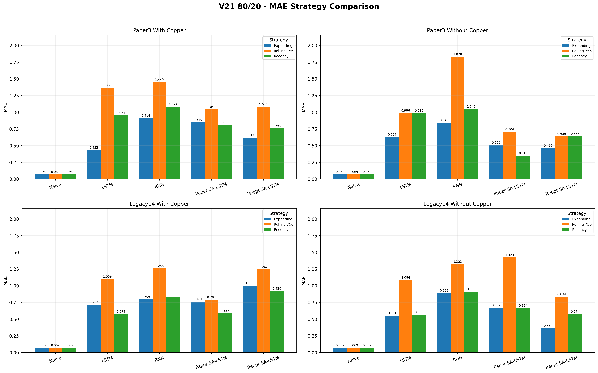

*Hình 11. MAE V21 tại split 80/20 theo model, strategy và bốn nhóm feature. Naive không đổi theo strategy vì không fitted; nguồn `holdout_80_results.csv`; `fig:v21_strategy_mae`.*

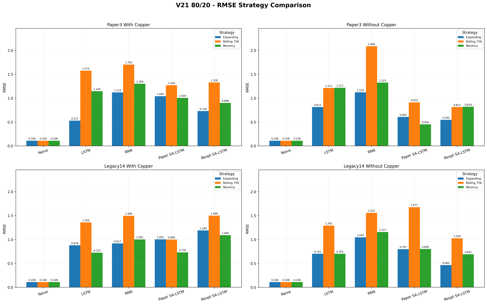

*Hình 12. RMSE trên cùng protocol với Hình 11; metric này nhấn mạnh lỗi lớn hơn MAE. Hai hình chỉ so sánh trong cùng panel/date range; `fig:v21_strategy_rmse`.*

## 6. So sánh theo từng kiến trúc: MAE tốt nhất giữa các bộ input

Ở mỗi split, mỗi nhóm mô hình được gom về cùng tên kiến trúc. Chọn kết quả fitted có MAE nhỏ nhất trong các feature sets và strategies **đã thực nghiệm**, ghi cụ thể feature và version (hậu nghiệm).

| Split | Mô hình | MAE tốt nhất (nguồn) | RMSE | Features | Chiến lược |
| --- | --- | --- | --- | --- | --- |
| 80/20 | CNN-GRU Direct | 0.214287 (V20) | 0.273292 | FS04_METALS_CU | Expanding |
| 80/20 | CNN-GRU Residual | 0.068947 (V22-N) | 0.107682 | FS06_WTI_CU | Recency |
| 80/20 | CNN-LSTM Direct | 0.384733 (V20) | 0.473176 | FS01_CU | Recency |
| 80/20 | CNN-LSTM Residual | 0.068841 (V20) | 0.108019 | FS01_CU | Recency |
| 80/20 | GRU Direct | 0.141899 (V20) | 0.191724 | FS01_CU | Recency |
| 80/20 | GRU Residual | 0.068780 (V20) | 0.107853 | FS02_PAPER_CU | Expanding |
| 80/20 | LSTM Direct | 0.110100 (V20) | 0.161307 | FS01_CU | Expanding |
| 80/20 | LSTM Residual | 0.068840 (V22-N) | 0.107996 | FS06_WTI_CU | Expanding |
| 80/20 | Ridge Residual | 0.069408 (V20) | 0.108075 | FS01_CU | Expanding |
| 80/20 | SA-LSTM Paper HP | 0.298955 (V22-S) | 0.358768 | FS06_WTI_CU | Expanding |
| 80/20 | SA-LSTM Reoptimized | 0.223809 (V22-S) | 0.297888 | FS06_WTI_CU | Expanding |
| 80/20 | SimpleRNN Direct | 0.795791 (V21-80) | 0.916974 | FS04_METALS_CU | Expanding |
| 90/10 | CNN-GRU Direct | 0.296379 (V20) | 0.359605 | FS02_PAPER_CU | Expanding |
| 90/10 | CNN-GRU Residual | 0.077229 (V22-N) | 0.101285 | FS06_WTI_CU | Expanding |
| 90/10 | CNN-LSTM Direct | 0.393469 (V20) | 0.492822 | FS04_METALS_CU | Expanding |
| 90/10 | CNN-LSTM Residual | 0.077000 (V20) | 0.100895 | FS01_CU | Rolling 756 |
| 90/10 | GRU Direct | 0.205153 (V20) | 0.243488 | FS01_CU | Recency |
| 90/10 | GRU Residual | 0.076951 (V20) | 0.100810 | FS04_METALS_CU | Expanding |
| 90/10 | LSTM Direct | 0.247409 (V21) | 0.304619 | FS04_METALS_CU | Expanding |
| 90/10 | LSTM Residual | 0.076978 (V20) | 0.100948 | FS04_METALS_CU | Expanding |
| 90/10 | Ridge Residual | 0.077306 (V20) | 0.101190 | FS01_CU | Expanding |
| 90/10 | SA-LSTM Paper HP | 0.184634 (V22-S) | 0.225723 | FS06_WTI_CU | Expanding |
| 90/10 | SA-LSTM Reoptimized | 0.326683 (V22-S) | 0.376388 | FS06_WTI_CU | Recency |
| 90/10 | SimpleRNN Direct | 0.608387 (V21) | 0.710083 | FS05_METALS_EXO | Recency |
| 92.5/7.5 | CNN-GRU Direct | 0.351300 (V20) | 0.400391 | FS04_METALS_CU | Recency |
| 92.5/7.5 | CNN-GRU Residual | 0.075340 (V20) | 0.098272 | FS01_CU | Recency |
| 92.5/7.5 | CNN-LSTM Direct | 0.522778 (V22-N) | 0.560252 | FS06_WTI_CU | Rolling 756 |
| 92.5/7.5 | CNN-LSTM Residual | 0.075050 (V20) | 0.098426 | FS01_CU | Recency |
| 92.5/7.5 | GRU Direct | 0.182461 (V22-N) | 0.215549 | FS06_WTI_CU | Recency |
| 92.5/7.5 | GRU Residual | 0.075028 (V22-N) | 0.098307 | FS06_WTI_CU | Recency |
| 92.5/7.5 | LSTM Direct | 0.247864 (V20) | 0.280534 | FS01_CU | Rolling 756 |
| 92.5/7.5 | LSTM Residual | 0.075094 (V22-N) | 0.098551 | FS06_WTI_CU | Expanding |
| 92.5/7.5 | Ridge Residual | 0.075285 (V20) | 0.098422 | FS01_CU | Expanding |
| 92.5/7.5 | SA-LSTM Paper HP | 0.194868 (V22-S) | 0.236334 | FS06_WTI_CU | Expanding |
| 92.5/7.5 | SA-LSTM Reoptimized | 0.352332 (V21) | 0.409124 | FS04_METALS_CU | Expanding |
| 92.5/7.5 | SimpleRNN Direct | 0.724220 (V21) | 0.772906 | FS04_METALS_CU | Expanding |
| 95/5 | CNN-GRU Direct | 0.408640 (V22-N) | 0.438568 | FS06_WTI_CU | Recency |
| 95/5 | CNN-GRU Residual | 0.072575 (V20) | 0.096666 | FS02_PAPER_CU | Expanding |
| 95/5 | CNN-LSTM Direct | 0.659669 (V20) | 0.679916 | FS01_CU | Recency |
| 95/5 | CNN-LSTM Residual | 0.072625 (V20) | 0.096669 | FS01_CU | Expanding |
| 95/5 | GRU Direct | 0.167929 (V20) | 0.194203 | FS01_CU | Recency |
| 95/5 | GRU Residual | 0.072357 (V20) | 0.096414 | FS02_PAPER_CU | Recency |
| 95/5 | LSTM Direct | 0.404888 (V20) | 0.428586 | FS01_CU | Rolling 756 |
| 95/5 | LSTM Residual | 0.072517 (V20) | 0.096496 | FS02_PAPER_CU | Expanding |
| 95/5 | Ridge Residual | 0.073684 (V20) | 0.096928 | FS01_CU | Expanding |
| 95/5 | SA-LSTM Paper HP | 0.200803 (V22-S) | 0.235800 | FS06_WTI_CU | Expanding |
| 95/5 | SA-LSTM Reoptimized | 0.325427 (V22-S) | 0.360107 | FS06_WTI_CU | Expanding |
| 95/5 | SimpleRNN Direct | 0.902960 (V21) | 0.916224 | FS04_METALS_CU | Expanding |

**Cảnh báo:** Bảng này không so sánh công bằng độ ổn định giữa các kiến trúc vì số lượng cấu hình được thử khác nhau và lựa chọn tốt nhất đã quan sát test.

## 7. SA-LSTM: kết quả tìm hyperparameters và so sánh phương pháp

V22 dùng SA search mới cho bộ WTI (16 evaluations, seed SA 2026, search trên validation của reference split 80/20). Cấu hình được manifest xác nhận: **LSTM units 47/127, LR 0.000050478806754686805** (V22 SA). Trong V21, Reoptimized dùng cache trước đó; không nên gọi đó là SA search mới ở V21.

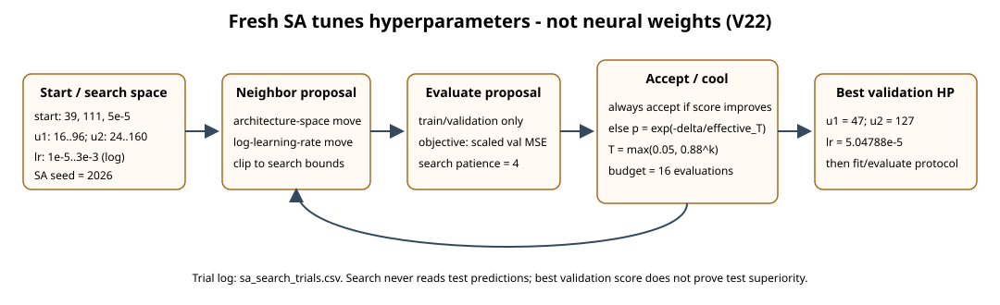

*Hình 13. SA đề xuất hàng xóm trong không gian `units_1`, `units_2`, log-learning-rate; objective là validation MSE đã scale, cooling `max(0.05,0.88^k)`, budget 16. SA tối ưu hyperparameters, không tối ưu trực tiếp neural weights. Nguồn: V22 Fresh-SA cell 12 và `fresh_sa_best_hp.json`; `fig:sa_search_protocol`.*

*Hình 14. Best-so-far validation MSE qua 16 evaluations trên FS06. Đường giảm không phải test loss và không chứng minh global optimum; nguồn từng trial `sa_search_trials.csv`; `fig:sa_search_convergence`.*

### 7.1. Đối chiếu cùng bộ WTI: LSTM thường, SimpleRNN, Paper HP và SA tối ưu mới

**Split 80/20:**

| Mô hình | Strategy | MAE | RMSE | DA (%) |
| --- | --- | --- | --- | --- |
| SA-LSTM Reoptimized | Expanding | 0.223809 (V22-S) | 0.297888 | 51.29 |
| SA-LSTM Paper HP | Expanding | 0.298955 (V22-S) | 0.358768 | 48.89 |
| LSTM Direct | Expanding | 0.531802 (V22-S) | 0.662974 | 47.60 |
| SimpleRNN Direct | Expanding | 0.837846 (V22-S) | 0.994480 | 46.49 |

**Split 90/10:**

| Mô hình | Strategy | MAE | RMSE | DA (%) |
| --- | --- | --- | --- | --- |
| SA-LSTM Paper HP | Expanding | 0.184634 (V22-S) | 0.225723 | 51.66 |
| SA-LSTM Paper HP | Recency | 0.294741 (V22-S) | 0.346242 | 49.08 |
| LSTM Direct | Rolling 756 | 0.321192 (V22-S) | 0.350564 | 46.86 |
| LSTM Direct | Expanding | 0.324940 (V22-S) | 0.381594 | 48.34 |
| SA-LSTM Reoptimized | Recency | 0.326683 (V22-S) | 0.376388 | 46.86 |
| SA-LSTM Reoptimized | Expanding | 0.358921 (V22-S) | 0.415277 | 48.34 |
| SA-LSTM Reoptimized | Rolling 756 | 0.496288 (V22-S) | 0.552808 | 46.86 |
| SA-LSTM Paper HP | Rolling 756 | 0.575763 (V22-S) | 0.634142 | 46.86 |
| SimpleRNN Direct | Expanding | 0.818738 (V22-S) | 0.900169 | 46.49 |
| SimpleRNN Direct | Rolling 756 | 0.859431 (V22-S) | 0.937179 | 46.49 |
| SimpleRNN Direct | Recency | 1.009153 (V22-S) | 1.089029 | 46.49 |
| LSTM Direct | Recency | 1.236605 (V22-S) | 1.296920 | 46.49 |

**Split 92.5/7.5:**

| Mô hình | Strategy | MAE | RMSE | DA (%) |
| --- | --- | --- | --- | --- |
| SA-LSTM Paper HP | Expanding | 0.194868 (V22-S) | 0.236334 | 53.43 |
| LSTM Direct | Expanding | 0.318782 (V22-S) | 0.370703 | 50.00 |
| SA-LSTM Reoptimized | Expanding | 0.366077 (V22-S) | 0.411546 | 48.04 |
| SimpleRNN Direct | Expanding | 0.975897 (V22-S) | 1.013056 | 46.57 |

**Split 95/5:**

| Mô hình | Strategy | MAE | RMSE | DA (%) |
| --- | --- | --- | --- | --- |
| SA-LSTM Paper HP | Expanding | 0.200803 (V22-S) | 0.235800 | 47.79 |
| SA-LSTM Reoptimized | Expanding | 0.325427 (V22-S) | 0.360107 | 46.32 |
| LSTM Direct | Expanding | 0.551285 (V22-S) | 0.571203 | 44.85 |
| SimpleRNN Direct | Expanding | 0.941332 (V22-S) | 0.952494 | 44.85 |

### 7.2. Diễn giải

Kết quả SA-LSTM được diễn giải theo MAE và RMSE thực đo. Khác biệt giữa Paper HP và SA-optimized cho biết hành vi của **hai bộ hyperparameters**, không chứng minh thuật toán SA luôn tốt hơn hoặc tệ hơn; giới hạn 16 trials không chứng minh tối ưu toàn cục.

### 7.3. Ma trận SA-LSTM hoàn chỉnh: FS04_METALS_CU và FS06_WTI_CU

V24 bổ sung 12 lượt huấn luyện: **FS06 tại 80/20 + Rolling/Recency** và **FS04 tại 92.5/7.5, 95/5 + Rolling/Recency**, mỗi điều kiện có Paper SA-LSTM và Reoptimized SA-LSTM. Kết hợp V21/V22/V23/V24, ma trận hiện có **48/48 tổ hợp** (= 2 feature sets × 2 mô hình × 4 split × 3 strategies). Đây là tính đầy đủ trong **phạm vi ma trận này**, không có nghĩa mọi kiến trúc/feature khác đều được thử cùng số cấu hình.

**Cách đọc:** Các cột MAE/RMSE phản ánh giá gốc, thấp hơn là tốt hơn. `ΔMAE = (MAE_FS06 / MAE_FS04 − 1) × 100%`; dấu âm nghĩa là FS06 giảm sai số. Mỗi giá trị được gắn phiên bản ngay sau số. Với Reoptimized SA-LSTM, so sánh FS04–FS06 còn chịu ảnh hưởng thay đổi HP từ cache V21 sang SA search V22.

| Split | Mô hình | Chiến lược | FS04 MAE (nguồn) | FS06 MAE (nguồn) | ΔMAE | FS04 RMSE | FS06 RMSE |
| --- | --- | --- | ---: | ---: | ---: | ---: | ---: |
| 80% | Paper SA-LSTM | Expanding | 0.760563 (V21-80) | 0.298955 (V22-S) | -60.69% | 1.002313 (V21-80) | 0.358768 (V22-S) |
| 80% | Paper SA-LSTM | Rolling 756 | 0.786877 (V21-80) | 0.362865 (V24) | -53.89% | 0.999258 (V21-80) | 0.453969 (V24) |
| 80% | Paper SA-LSTM | Recency | 0.586941 (V21-80) | 0.270155 (V24) | -53.97% | 0.730317 (V21-80) | 0.343050 (V24) |
| 80% | Reoptimized SA-LSTM | Expanding | 1.000423 (V21-80) | 0.223809 (V22-S) | -77.63% | 1.189193 (V21-80) | 0.297888 (V22-S) |
| 80% | Reoptimized SA-LSTM | Rolling 756 | 1.241647 (V21-80) | 0.714540 (V24) | -42.45% | 1.498696 (V21-80) | 0.849762 (V24) |
| 80% | Reoptimized SA-LSTM | Recency | 0.919743 (V21-80) | 0.790009 (V24) | -14.11% | 1.089346 (V21-80) | 0.919403 (V24) |
| 90% | Paper SA-LSTM | Expanding | 0.470929 (V21) | 0.184634 (V22-S) | -60.79% | 0.527551 (V21) | 0.225723 (V22-S) |
| 90% | Paper SA-LSTM | Rolling 756 | 0.773310 (V21) | 0.575763 (V22-S) | -25.55% | 0.842719 (V21) | 0.634142 (V22-S) |
| 90% | Paper SA-LSTM | Recency | 0.705350 (V21) | 0.294741 (V22-S) | -58.21% | 0.769216 (V21) | 0.346242 (V22-S) |
| 90% | Reoptimized SA-LSTM | Expanding | 0.510467 (V21) | 0.358921 (V22-S) | -29.69% | 0.591630 (V21) | 0.415277 (V22-S) |
| 90% | Reoptimized SA-LSTM | Rolling 756 | 0.977821 (V21) | 0.496288 (V22-S) | -49.25% | 1.034595 (V21) | 0.552808 (V22-S) |
| 90% | Reoptimized SA-LSTM | Recency | 0.735621 (V21) | 0.326683 (V22-S) | -55.59% | 0.825336 (V21) | 0.376388 (V22-S) |
| 92.5% | Paper SA-LSTM | Expanding | 0.541731 (V21) | 0.194868 (V22-S) | -64.03% | 0.585612 (V21) | 0.236334 (V22-S) |
| 92.5% | Paper SA-LSTM | Rolling 756 | 0.921059 (V24) | 0.617974 (V23) | -32.91% | 0.948284 (V24) | 0.663797 (V23) |
| 92.5% | Paper SA-LSTM | Recency | 0.647322 (V24) | 0.372534 (V23) | -42.45% | 0.684491 (V24) | 0.414969 (V23) |
| 92.5% | Reoptimized SA-LSTM | Expanding | 0.352332 (V21) | 0.366077 (V22-S) | +3.90% | 0.409124 (V21) | 0.411546 (V22-S) |
| 92.5% | Reoptimized SA-LSTM | Rolling 756 | 1.147863 (V24) | 0.533281 (V23) | -53.54% | 1.175830 (V24) | 0.581772 (V23) |
| 92.5% | Reoptimized SA-LSTM | Recency | 1.013799 (V24) | 0.384123 (V23) | -62.11% | 1.047389 (V24) | 0.425460 (V23) |
| 95% | Paper SA-LSTM | Expanding | 0.600953 (V21) | 0.200803 (V22-S) | -66.59% | 0.625768 (V21) | 0.235800 (V22-S) |
| 95% | Paper SA-LSTM | Rolling 756 | 0.923211 (V24) | 0.556494 (V23) | -39.72% | 0.939639 (V24) | 0.580171 (V23) |
| 95% | Paper SA-LSTM | Recency | 0.633038 (V24) | 0.383168 (V23) | -39.47% | 0.656933 (V24) | 0.413952 (V23) |
| 95% | Reoptimized SA-LSTM | Expanding | 0.541005 (V21) | 0.325427 (V22-S) | -39.85% | 0.569431 (V21) | 0.360107 (V22-S) |
| 95% | Reoptimized SA-LSTM | Rolling 756 | 0.887907 (V24) | 0.475157 (V23) | -46.49% | 0.904274 (V24) | 0.502146 (V23) |
| 95% | Reoptimized SA-LSTM | Recency | 0.589372 (V24) | 0.325904 (V23) | -44.70% | 0.618123 (V24) | 0.359242 (V23) |

### 7.4. Kiểm toán riêng 12 kết quả V24 — đủ MAE, RMSE, MAPE và R²

Các metrics được **tính lại từ 3.528 dòng** trong `holdout_missing_predictions.csv`, sau đó đối chiếu với `holdout_missing_results.csv` cho từng `(ratio, feature_set, model, scheme)`; sai số so sánh ở dung sai 2×10⁻⁶. Dữ liệu V24 dùng seed 42, lookback 22, horizon 1, dataset cùng SHA-256 với báo cáo trước.

| Split | Feature | Mô hình | Scheme | N test | MAE | RMSE | MAPE (%) | R² |
| --- | --- | --- | --- | ---: | ---: | ---: | ---: | ---: |
| 80% | FS06_WTI_CU | Paper SA-LSTM | recency_weighted | 542 | 0.270155 | 0.343050 | 4.827 | 0.8315 |
| 80% | FS06_WTI_CU | Paper SA-LSTM | rolling_756 | 542 | 0.362865 | 0.453969 | 6.311 | 0.7050 |
| 80% | FS06_WTI_CU | Reoptimized SA-LSTM | recency_weighted | 542 | 0.790009 | 0.919403 | 13.730 | -0.2101 |
| 80% | FS06_WTI_CU | Reoptimized SA-LSTM | rolling_756 | 542 | 0.714540 | 0.849762 | 12.323 | -0.0337 |
| 92.5% | FS04_METALS_CU | Paper SA-LSTM | recency_weighted | 204 | 0.647322 | 0.684491 | 10.217 | -2.6864 |
| 92.5% | FS04_METALS_CU | Paper SA-LSTM | rolling_756 | 204 | 0.921059 | 0.948284 | 14.575 | -6.0754 |
| 92.5% | FS04_METALS_CU | Reoptimized SA-LSTM | recency_weighted | 204 | 1.013799 | 1.047389 | 15.993 | -7.6315 |
| 92.5% | FS04_METALS_CU | Reoptimized SA-LSTM | rolling_756 | 204 | 1.147863 | 1.175830 | 18.150 | -9.8783 |
| 95% | FS04_METALS_CU | Paper SA-LSTM | recency_weighted | 136 | 0.633038 | 0.656933 | 9.714 | -11.2123 |
| 95% | FS04_METALS_CU | Paper SA-LSTM | rolling_756 | 136 | 0.923211 | 0.939639 | 14.198 | -23.9848 |
| 95% | FS04_METALS_CU | Reoptimized SA-LSTM | recency_weighted | 136 | 0.589372 | 0.618123 | 9.034 | -9.8120 |
| 95% | FS04_METALS_CU | Reoptimized SA-LSTM | rolling_756 | 136 | 0.887907 | 0.904274 | 13.643 | -22.1395 |

### 7.5. Nhận xét có kiểm soát theo chiến lược và features

- **Paper SA-LSTM:** số lần chiến lược có MAE thấp nhất trong 8 cặp split–feature: Expanding 6/8, Rolling 756 0/8, Recency 2/8. Đây chỉ là thống kê mô tả trên các kỳ test lồng nhau, không phải kiểm định độc lập.
- **Reoptimized SA-LSTM:** số lần chiến lược có MAE thấp nhất trong 8 cặp split–feature: Expanding 6/8, Rolling 756 0/8, Recency 2/8. Đây chỉ là thống kê mô tả trên các kỳ test lồng nhau, không phải kiểm định độc lập.
- **Đổi FS04 → FS06:** FS06 có MAE thấp hơn trong 23/24 cặp tương ứng, và cao hơn trong 1/24 cặp. Kết quả không nhất quán theo mô hình, chiến lược và giai đoạn; không thể chỉ dựa vào Spearman mức giá để khẳng định WTI tốt hơn.
- **Giới hạn công bằng:** Các lượt holdout V24 bổ sung ô thiếu nhưng không chuẩn hóa toàn bộ ngân sách tối ưu, random seed và biểu diễn target giữa SA-LSTM với các kiến trúc Direct/Residual. Không diễn giải chênh lệch MAE là tác động riêng của SA hoặc của WTI.

## 8. Walk-forward: V23 (2024–2026), V20 (2018–2026)

Thực nghiệm chỉ với 3 mô hình WTI: Residual-GRU, Residual-LSTM, Reoptimized SA-LSTM. Dùng **cùng 542 phiên** (07/10/2024–13/11/2026), seeds 41–45, `RETRAIN_EVERY=63`, 9 folds (8×63 phiên và 1×38). Tổng 135 lượt fit và 8.130 dòng dự báo. Mỗi fold fit từ đầu trong training history; một phần lịch sử gần origin dùng validation, không fit dữ liệu trong block test. SA HP giữ cố định từ V22, không chạy search ở mỗi fold. Phạm vi này **không trùng** walk-forward V20 từ 2018–2026 (2.214 phiên); tuyệt đối không so trực tiếp MAE giữa hai giai đoạn.

### 8.1. Từng seed và MAE/RMSE (V23)

| Model | Seed | MAE | RMSE | Naive MAE | Skill vs Naive |
| --- | --- | --- | --- | --- | --- |
| Residual-GRU | 41 | 0.068950 | 0.108020 | 0.069001 | +0.074% |
| Residual-GRU | 42 | 0.069089 | 0.108033 | 0.069001 | -0.127% |
| Residual-GRU | 43 | 0.069346 | 0.108287 | 0.069001 | -0.499% |
| Residual-GRU | 44 | 0.069117 | 0.108236 | 0.069001 | -0.168% |
| Residual-GRU | 45 | 0.068995 | 0.108007 | 0.069001 | +0.010% |
| Residual-LSTM | 41 | 0.069010 | 0.108008 | 0.069001 | -0.013% |
| Residual-LSTM | 42 | 0.069053 | 0.108068 | 0.069001 | -0.075% |
| Residual-LSTM | 43 | 0.069139 | 0.108061 | 0.069001 | -0.199% |
| Residual-LSTM | 44 | 0.069280 | 0.108522 | 0.069001 | -0.403% |
| Residual-LSTM | 45 | 0.069414 | 0.108386 | 0.069001 | -0.598% |
| Reoptimized SA-LSTM | 41 | 0.230471 | 0.298832 | 0.069001 | -234.008% |
| Reoptimized SA-LSTM | 42 | 0.202721 | 0.273849 | 0.069001 | -193.792% |
| Reoptimized SA-LSTM | 43 | 0.209556 | 0.274835 | 0.069001 | -203.698% |
| Reoptimized SA-LSTM | 44 | 0.178116 | 0.254883 | 0.069001 | -158.133% |
| Reoptimized SA-LSTM | 45 | 0.218425 | 0.287161 | 0.069001 | -216.551% |

### 8.2. Kết quả trung bình nhiều seeds (không thay thế kiểm định)

| Mô hình | MAE trung bình | SD MAE giữa seeds | RMSE trung bình | Seeds thắng Naive |
| --- | --- | --- | --- | --- |
| Residual-GRU | 0.069100 | 0.000154 | 0.108117 | 2/5 |
| Residual-LSTM | 0.069179 | 0.000167 | 0.108209 | 0/5 |
| Reoptimized SA-LSTM | 0.207858 | 0.019601 | 0.277912 | 0/5 |

*Hình 15. MAE V23 aligned 80/20 theo seeds 41–45 cho Residual-GRU, Residual-LSTM và Reoptimized SA-LSTM; đường đứt là Naive. Nguồn `wf_seed_summary.csv`; `fig:walkforward_mae_by_seed`.*

### 8.3. Kiểm định DM-HAC vs Naive (absolute loss; Newey–West lag 5)

`d_t=|y−ŷ_model|−|y−ŷ_naive|`, `d̄<0` nghiêng về mô hình, p-value hai phía. Nhiều seeds cùng chia sẻ test dates, không phải 5 tập test độc lập; kết quả chưa chỉnh multiple testing.

| Model | Seed | Mean loss diff | p-value (2 phía) |
| --- | --- | --- | --- |
| Residual-GRU | 41 | -0.000051 | 0.493343 |
| Residual-GRU | 42 | +0.000088 | 0.189622 |
| Residual-GRU | 43 | +0.000344 | 0.0567291 |
| Residual-GRU | 44 | +0.000116 | 0.397776 |
| Residual-GRU | 45 | -0.000007 | 0.931544 |
| Residual-LSTM | 41 | +0.000009 | 0.874817 |
| Residual-LSTM | 42 | +0.000052 | 0.598004 |
| Residual-LSTM | 43 | +0.000137 | 0.207789 |
| Residual-LSTM | 44 | +0.000278 | 0.190898 |
| Residual-LSTM | 45 | +0.000412 | 0.122574 |
| Reoptimized SA-LSTM | 41 | +0.161469 | 1.16255e-22 |
| Reoptimized SA-LSTM | 42 | +0.133719 | 8.06097e-18 |
| Reoptimized SA-LSTM | 43 | +0.140555 | 4.22525e-20 |
| Reoptimized SA-LSTM | 44 | +0.109114 | 1.7364e-12 |
| Reoptimized SA-LSTM | 45 | +0.149423 | 2.37241e-20 |

### 8.4. Theo từng fold (trung bình 5 seeds; không gộp đều 9 fold để tính MAE tổng)

| Fold | Bắt đầu | Kết thúc | n phiên | Residual-GRU MAE | Residual-LSTM MAE | SA-LSTM MAE |
| --- | --- | --- | --- | --- | --- | --- |
| 1 | 2024-10-07 | 2025-01-06 | 63 | 0.041246 | 0.041045 | 0.130602 |
| 2 | 2025-01-07 | 2025-04-07 | 63 | 0.066384 | 0.066539 | 0.209103 |
| 3 | 2025-04-08 | 2025-07-04 | 63 | 0.060036 | 0.060706 | 0.148476 |
| 4 | 2025-07-07 | 2025-10-01 | 63 | 0.073553 | 0.073552 | 0.335969 |
| 5 | 2025-10-02 | 2025-12-29 | 63 | 0.068968 | 0.068937 | 0.150386 |
| 6 | 2025-12-30 | 2026-03-27 | 63 | 0.097913 | 0.097901 | 0.169261 |
| 7 | 2026-03-30 | 2026-06-25 | 63 | 0.081988 | 0.081840 | 0.283881 |
| 8 | 2026-06-26 | 2026-09-22 | 63 | 0.062681 | 0.062522 | 0.238213 |
| 9 | 2026-09-23 | 2026-11-13 | 38 | 0.069145 | 0.069826 | 0.202836 |

### 8.5. Walk-forward V20, giữ riêng theo giai đoạn

V20 đánh giá Residual-GRU + FS02_PAPER_CU trên **2.214 phiên 2018–2026**, 5 seeds, retrain 63 phiên, sử dụng DM-HAC. Không dùng phép so sánh chênh MAE V20 và V23 để khẳng định WTI tốt hơn, vì khác đoạn thời gian và có thể khác giao thức học. Các kết luận V20 trước đây: seeds 43–44 Naive tốt hơn ở mức 5%; các seeds khác chưa thấy khác biệt ở mức 5%. Nguồn: `dm_hac_by_seed.csv` (V20).

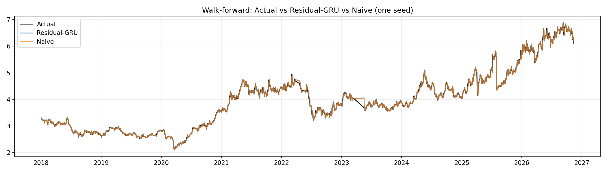

*Hình 16. Timeline V20 2018–2026 của một seed. Hình minh họa dự báo one-step bám sát level; kết luận theo giai đoạn phải đọc `wf_by_year.csv`, và không so trực tiếp với V23 2024–2026; `fig:walkforward_timeline_v20`.*

## 9. Thảo luận chung

### 9.1. Điều gì thay đổi khi dùng WTI?

Sự thay đổi theo MAE không có dấu nhất quán giữa các mô hình: có mô hình Direct/SA giảm rõ rệt, trong khi một số CNN/Direct hoặc Residual kém hơn. Điều này phù hợp với việc tương quan mức giá đơn biến không định lượng được thông tin dự báo có điều kiện của mạng trên 22 phiên. **Không suy ra quan hệ nhân quả** chỉ bằng bảng trước/sau.

### 9.2. Vì sao Residual thường nằm gần Naive?

Residual học phần chênh lệch rồi cộng lại mức giá phiên trước, nên nếu `Δhat` nhỏ thì giá dự báo gần Naive. Các giá trị MAE gần nhau chỉ là hiện tượng đo được; để kết luận nguyên nhân cần audit phân phối delta dự báo, tương quan với delta thực và thử nghiệm trên nhiều giai đoạn.

### 9.3. Ý nghĩa của xếp hạng

“Tốt nhất” trong báo cáo luôn có nghĩa **MAE thấp nhất trong tập cấu hình đã chạy tại một split/điều kiện cụ thể, loại Naive khỏi cuộc xếp hạng fitted**. Không có tuyên bố “mô hình X thắng ổn định” nếu chưa có kiểm định phù hợp với chuỗi thời gian và một holdout chưa từng dùng để chọn cấu hình.

## 10. Giới hạn, kiểm tra hợp lệ và khả năng tái lập

1. V20/V22 Non-SA có giao thức gần nhau để quan sát thay feature; V21/V22 SA Reoptimized **không phải ablation thuần feature** vì SA được dò lại. Nhóm Non-SA và SA-series khác ngân sách epochs/chi tiết training nên so sánh chéo là mô tả, không nhân quả.

2. Các split 80/20, 90/10, 92.5/7.5 và 95/5 có test periods khác nhau; không so sánh MAE qua splits như thí nghiệm chỉ thay tỷ lệ train.

3. Ma trận SA-LSTM **FS04/FS06 hiện đủ 48/48 ô** sau V24; trước đây thiếu Rolling/Recency ở một số split. Tuy nhiên walk-forward V23 chỉ có ba mô hình chọn trước (Residual-GRU, Residual-LSTM, SA-LSTM tối ưu lại FS06), **chưa bao phủ mọi mô hình và feature set**, và không thay thế các đối chứng đồng ngân sách điều chỉnh siêu tham số.

4. EDA Spearman cao trên mức giá có thể chứa cùng xu hướng dài hạn; lagged returns mới gần câu hỏi dự báo biến động tiếp theo hơn. Tuy vậy correlations lag-1 yếu không loại trừ tương tác phi tuyến và nhiều lag.

5. Kết quả trên holdout đã được quan sát để lựa chọn best model/feature: có selection bias. Cần validation hoặc nested walk-forward và test chưa dùng để chọn mô hình để xác nhận.

6. Phải audit as-of market close/nguồn dữ liệu để tránh dùng giá ngoại sinh chưa thực sự khả dụng tại forecast origin; hiện chưa thể khẳng định loại bỏ rủi ro này chỉ từ ngày trong CSV.

7. Số liệu MAE/RMSE gốc không tự chứng minh sự khác biệt có ý nghĩa thống kê; không gắn các DM p-values của V20 sang V22 hoặc SA-series.

### 10.1. Kiểm toán dữ liệu và tái lập V24

- SHA-256 dataset trong `experiment_manifest.json` V24: `9580ede12d474c8f990556842d551dac176b3c16b2d6a4bffb7dc41dd54bf600` (2.710 phiên, 13/01/2016–13/11/2026), trùng fingerprint đã công bố ở V20/V21.
- 12 lượt fitted = 2 mô hình × (2 chiến lược FS06 ở 80/20 + 2 chiến lược FS04 ở 92.5% + 2 chiến lược FS04 ở 95%). Đúng 3.528 hàng dự báo; mỗi cấu hình có 542, 204 hoặc 136 mốc tương ứng.
- Các cột `Date`, `actual`, `pred`, `naive` được giữ trong CSV để tái tính MAE, RMSE, MAPE, R² và để kiểm tra căn chỉnh dự báo. Mọi hàng dùng `HORIZON=1`; `Naive` không tính vào bảng xếp hạng fitted.
- `Paper SA-LSTM`: 39/111 units, LR 0.00005. `Reoptimized SA-LSTM` FS04: 22/83 units, LR 0.000655 (cache V21); FS06: 47/127 units, LR 0.000050478806754686805 (SA search V22, 16 trials). V24 **không chạy SA search mới**.
- Các chỉ số test được giữ theo nguồn. Kết quả đứng đầu trong mỗi split được chọn sau khi xem test nên chỉ mang tính mô tả khám phá; để kiểm tra khẳng định mô hình tốt hơn một cách tổng quát, cần cố định mô hình bằng validation và dùng đoạn test độc lập.

### 10.2. Những điều đã bao phủ và những điều chưa được chứng minh

| Yêu cầu | Tình trạng đến V24 | Giới hạn diễn giải |
| --- | --- | --- |
| FS04 vs FS06 ở 4 split × 3 strategies × 2 SA-LSTM | **Đủ 48/48 ô** | HP Reoptimized khác nhau theo FS; không phải ablation thuần feature |
| Non-SA Direct/Residual theo 4 split và 3 strategies | Có các bộ FS01/02/04/06 | Không phải mọi phương pháp đều sử dụng cùng số lượng bộ features |
| EDA Spearman trên giá và biến động có lag | Có phân tích | Không xác minh đóng góp dự báo tương lai một cách nhân quả |
| Walk-forward V23 cùng 542 timestamps và 5 seeds | Có cho Residual-GRU, Residual-LSTM và Reoptimized SA-LSTM | Không có walk-forward cùng giai đoạn cho mọi kiến trúc |
| Walk-forward V20 (2018–2026) | Có cho Residual-GRU FS02 | Không so sánh trực tiếp MAE với walk-forward V23 2024–2026 |
| DM-HAC và nhiều seeds | Có trong các thí nghiệm walk-forward được liệt kê | Không suy rộng sang mọi SA-LSTM/Direct |
| So sánh cùng ngân sách tuning, cùng target, cùng seed | **Chưa hoàn toàn** | Không kết luận nguyên nhân riêng của thuật toán SA/kiến trúc |
| Kiểm toán khả dụng theo giờ của ngoại sinh | **Chưa xác minh đầy đủ** | Không khẳng định loại trừ mọi dạng look-ahead từ thị trường |
| Đánh giá trên test độc lập chưa dùng để chọn model | **Chưa có** | Không khẳng định kết quả xếp hạng hậu nghiệm là ưu thế tổng quát hóa |

### 10.3. Giới hạn và hành động kiểm toán EDA V26

- **Granger:** `06_granger_returns.csv` chứa 20 lỗi `verbose`; cần bỏ tham số và chạy lại nếu báo cáo muốn dùng kết luận Granger. Không được ghi 20 kết quả này là “không có ý nghĩa”.
- **Mốc train EDA:** 12/11/2024 sau điểm bắt đầu test 80/20 (07/10/2024); phải chạy lại EDA trên tập train đúng của split 80/20 nếu dùng kết quả EDA để chọn biến trước test.
- **Khoảng ngày và WTI:** cần đối soát nguồn 19/28/66 ngày không có dữ liệu và biến động WTI cực đoan; ZIP V26 chưa có đủ metadata lịch sàn/giờ đóng cửa để chứng minh point-in-time availability.
- **Diễn giải kiểm định:** ADF/KPSS, ZA/CUSUM và Brown–Forsythe có giả định, sức mạnh và đối tượng khác nhau; không suy diễn thành kết luận chắc chắn về random walk, concept drift hoặc quan hệ nhân quả.

## 11. Kết luận Module 1 và định hướng các module tiếp theo

Qua các kết quả thực nghiệm của **Module 1 — dự báo giá đồng một phiên trước**, nhóm nhận thấy các mô hình học **sai phân (Residual)**, đặc biệt Residual-GRU và Residual-LSTM, thường đạt MAE thấp hơn các cấu hình SA-LSTM dự báo mức giá trực tiếp trong các thí nghiệm đã thực hiện. Khi gộp các tập đặc trưng và chiến lược đã khảo sát (không tính Naive vào xếp hạng mô hình fitted), **Residual-GRU** đứng đầu tại split **80/20** với **MAE 0.068780** (FS02_PAPER_CU, Expanding; V20), **90/10** với **MAE 0.076951** (FS04_METALS_CU, Expanding; V20), **92.5/7.5** với **MAE 0.075028** (FS06_WTI_CU, Recency; V22-N) và **95/5** với **MAE 0.072357** (FS02_PAPER_CU, Recency; V20). Những kết quả này cho thấy Residual-GRU **dẫn đầu bảng xếp hạng holdout trong phạm vi Module 1**, **không có nghĩa** nó luôn vượt trội ở mọi điều kiện hay là mô hình tốt nhất của toàn bộ kế hoạch nghiên cứu.

Sau khi hoàn thiện 48/48 tổ hợp SA-LSTM bằng V24, nhóm có thể đối chiếu cả ba chiến lược ở bốn tỷ lệ train trên hai bộ FS04 và FS06, nhưng không xem đó là chứng cứ mọi họ mô hình đã được chuẩn hóa hoàn toàn. Về tập đặc trưng, việc thay nhóm FS04_METALS_CU bằng FS06_WTI_CU giúp giảm MAE ở một số cấu hình, đặc biệt một số phiên bản SA-LSTM, nhưng không tạo cải thiện nhất quán cho tất cả mô hình Residual và chiến lược. Việc thay hai biến Gold, Silver bằng WTI đồng thời làm thay đổi số biến đầu vào; ở nhánh SA tối ưu lại còn thay đổi siêu tham số. Do đó, kết quả chỉ cho phép nhận xét về **cấu hình thực nghiệm hoàn chỉnh**, chưa chứng minh riêng tác động của WTI hoặc SA. Các tỷ lệ holdout có giai đoạn test lồng nhau, vì vậy không kết luận tỷ lệ train nào tối ưu tuyệt đối chỉ từ mức MAE khác nhau giữa các split.

Kết quả walk-forward bổ sung trên **542 phiên (2024–2026)** và **5 seeds**, retrain mỗi **63 phiên**, cho thấy Residual-GRU có MAE trung bình khoảng **0.06910**, Residual-LSTM khoảng **0.06918**, trong khi Naive khoảng **0.06900** (V23). Như vậy, mặc dù Residual-GRU đứng đầu nhóm mô hình fitted trong walk-forward này, nhóm **chưa có bằng chứng thống kê ở ngưỡng 5%** để khẳng định cải thiện ổn định so với Naive. Đây là khác biệt giữa *xếp hạng mô hình được huấn luyện* và *chứng minh giá trị dự báo vượt baseline*. Các kết luận cũng chưa được mở rộng sang các mô hình mới mà nhóm dự kiến đánh giá trong những module tiếp theo.

Trong thời gian tới, nhóm sẽ sử dụng Module 1 như một **mốc đối chứng có kiểm toán** để tiếp tục khảo sát những họ mô hình và chiến lược khác trên cùng bài toán, tập dữ liệu và quy trình đánh giá theo thời gian. Ưu tiên gồm lựa chọn biến bằng validation đúng thời gian, ablation từng biến, đánh giá qua nhiều giai đoạn thị trường, kiểm định chênh lệch sai số trên cùng timestamp và đối chiếu chi phí tính toán. Chỉ sau khi có kết quả từ các module còn lại, nhóm mới xác định mô hình/chiến lược đáng ưu tiên cho đề tài tổng thể và xem xét ứng dụng hỗ trợ quyết định; **không coi Module 1 là kết luận cuối cùng của toàn bộ nghiên cứu**.

## Phụ lục A. Truy xuất dữ liệu theo phiên bản

| Nhãn nguồn | Artifact gốc | CSV dùng cho số liệu | Số hàng |
| --- | --- | --- | --- |
| V20 | 17-11-Copper-NonSA-Fair-Full-Protocol-V20(2).zip | grid_results.csv | 360 |
| V21 | copper_sa_lstm_h1_ablation_v21_results(1).zip | results_h1_ablation.csv | 100 |
| V21 bổ sung 80/20 | copper_v21_addon_80_wf_plots(2).zip | holdout_80_results.csv | 60 |
| V22 Non-SA | []18-11- Copper_NonSA_V22_WTI_Only_Kaggle.zip | grid_results.csv | 120 |
| V22 SA | []18-11copper_sa_lstm_wti_only_v22_results.zip | results_h1_ablation.csv | 30 |
| V23 | 20 -11 - copper_v23_gapfill_results.zip | holdout_missing_results.csv | 20 |
| V24 | 20-11 -copper_v24_sa_missing_results.zip | holdout_missing_results.csv | 12 |

**Tổng dữ liệu bảng holdout đã hợp nhất V20–V24:** 702 hàng = 670 (V20–V22) + 20 (V23) + 12 (V24). Một phần là những lần lặp lại Naive theo feature/strategy; không được gọi 702 lượt fit mạng. Trong 12 lượt V24 đều là fitted SA-LSTM.

**Tài liệu tham khảo:** Chen et al. (2023), *Copper price prediction using LSTM recurrent neural network integrated simulated annealing algorithm*, PLOS ONE; Diebold & Mariano (1995), *Comparing Predictive Accuracy*; Newey & West (1987), HAC covariance. Thông tin xuất bản của Chen cần đối chiếu metadata trước khi nộp.

- `(V23)` `20 -11 - copper_v23_gapfill_results.zip`: bổ sung FS06 92.5/95 holdout và walk-forward 542 phiên / 5 seeds.
- `(V24)` `20-11 -copper_v24_sa_missing_results.zip`: 12 fitted holdout còn thiếu cho hai SA-LSTM; 3.528 dòng dự báo, manifest có dataset SHA-256 và cấu hình HP.
- `Mythos_Copper_Module1_AllModels_MAE_RMSE_MAPE_R2_V24.csv`: bảng truy xuất 702 tổ hợp, số liệu tính từ dự báo gốc.

### Phụ lục B. Nguồn bảng kiểm định và hình EDA V26

- `manifest.json`, `01_quality.csv`, `01_date_gaps.csv`, `01_quality_summary.csv`: mẫu, ngày, chất lượng.
- `02_returns_distribution_JB.csv`, `02_copper_returns.png`, `02_copper_returns_hist.png`: phân phối và ngoại lệ.
- `03_adf_kpss.csv`: ADF/KPSS trên levels/differences/returns.
- `04_lb_arch.csv`, `04_copper_rolling_volatility.png`: tự tương quan và phương sai có điều kiện.
- `05_spearman_levels_train.csv`, `05_lagged_returns_correlations_FDR.csv`, `05_spearman_r_heatmap.png`, `05_pearson_r_heatmap.png`: tương quan và độ trễ.
- `06_granger_returns.csv`: **20 lỗi, không có kết quả thống kê hợp lệ**.
- `07_cusum_mean_returns.csv`, `07_zivot_andrews_break_unit_root.csv`, `07_brown_forsythe_variance_halves.csv`, `07_vif.csv`, `07_cointegration_exploratory.csv`: kiểm định thay đổi cấu trúc, đa cộng tuyến, đồng liên kết.
- Các ảnh gắn trong Markdown trỏ vào `copper-forecasting/docs/assets/` hoặc `copper-forecasting/results/`. Năm SVG dẫn xuất có provenance tại `docs/assets/generated/visual_provenance.csv` và được tạo lại bằng `copper-forecasting/scripts/build_visual_evidence.ps1`; không có hình nào dùng số liệu suy đoán.
