# Module 1 — Visual evidence catalog

Tài liệu này chỉ dùng hình và bảng đã tạo từ các lần chạy thực nghiệm. Ngoại lệ được ghi rõ: (i) các member V26/V21-add-on được giải nén nguyên trạng từ ZIP để Markdown có thể nhúng; (ii) Hình 4a và Hình 7 là SVG dựng **trực tiếp từ giá trị đã lưu trong CSV**, không dùng dữ liệu suy đoán; (iii) ba sơ đồ phương pháp P1–P3 mô tả đúng code notebook, không phải kết quả định lượng. Tất cả SVG dẫn xuất được tạo lại bằng `../scripts/build_visual_evidence.ps1`; provenance máy đọc ở `assets/generated/visual_provenance.csv`.

## Bảng chọn nhanh

| Nhu cầu trình bày | Hình nên dùng | Cảnh báo khi nói |
|---|---|---|
| Pipeline, kiến trúc, SA | P1–P3 | Sơ đồ bám code, không phải kết quả định lượng |
| Mức giá, returns, volatility | 1–3 | Hình mô tả mẫu; không chứng minh tính dừng hay quan hệ nhân quả |
| Correlation mức giá và lagged returns | 4a, 4–5 | Correlation không phải causal/predictive performance |
| Actual vs Predicted; Naive vs fitted | 6 | Đường gần nhau không thay thế MAE/RMSE/DM-HAC |
| Direct vs Residual | 7 | Chỉ đúng cho V20, 90/10, expanding, FS02 |
| Feature set và strategy theo MAE/RMSE | 8–10 | Không so các panel khác test dates/protocol |
| Simulated Annealing | 11 | Đây là best validation MSE qua trial, không phải test loss |
| Walk-forward theo seed và thời gian | 12–13 | Seed plot và timeline có phạm vi khác nhau; không trộn số |

## 0. Sơ đồ phương pháp bám sát code

### Hình P1 — Pipeline thực nghiệm chống leakage

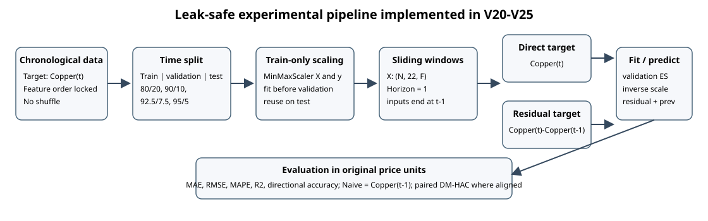

*Hình P1. Dữ liệu theo thứ tự thời gian đi qua split, scaler fit trên train, cửa sổ 22 phiên, hai target Direct/Residual và đánh giá trên đơn vị giá gốc.*

- **Nguồn code:** V20 cell 2/8/10/14/18; V21 cell 6/8/10.
- **Cấu hình thể hiện:** `LOOKBACK=22`, `HORIZON=1`, MinMaxScaler X/y fit trước validation, Naive=`Copper(t-1)`, residual reconstruction=`prev+delta`.
- **Hỗ trợ:** giải thích protocol và điểm chống leakage. **Không hỗ trợ:** không khẳng định mọi notebook tái lập bit-for-bit hay mọi model dùng cùng ngân sách.
- **LaTeX:** đầu phần phương pháp; `\label{fig:leak_safe_pipeline}`.

### Hình P2 — CNN-LSTM/CNN-GRU code-faithful

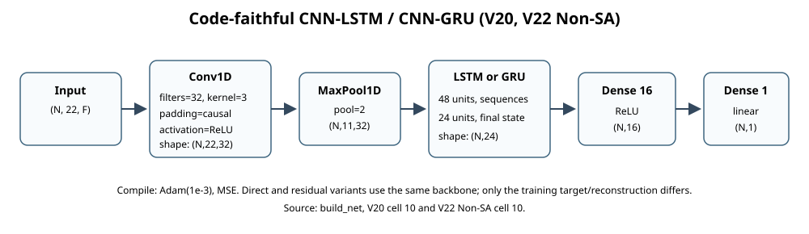

*Hình P2. Backbone CNN-recurrent thực tế: Conv1D causal 32 filters/kernel 3, MaxPool 2, recurrent 48→24, Dense 16→1.*

- **Nguồn code:** `build_net`, V20 cell 10 và V22 Non-SA cell 10.
- **Input/output:** `(N,22,F)` → `(N,1)`; sau pool là `(N,11,32)`; Direct/Residual dùng cùng backbone.
- **Hỗ trợ:** giải thích shape, causal padding và capacity. **Không hỗ trợ:** không đại diện Paper-SA/Prior-SA builder khác.
- **LaTeX:** mục kiến trúc mô hình; `\label{fig:cnn_recurrent_code_architecture}`.

### Hình P3 — Fresh SA search protocol

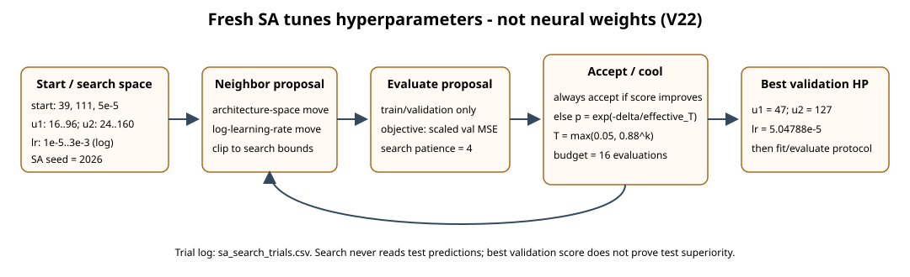

*Hình P3. SA V22 tìm units/LR trên validation, có neighbor, acceptance probability, cooling và budget 16 evaluations.*

- **Nguồn code:** V22 Fresh-SA cell 12; best HP đối chiếu `results/18-11- Copper_SA-LSTM-standalone-V22/copper_sa_lstm_wti_only_v22/fresh_sa_best_hp.json`.
- **Cấu hình thể hiện:** search space `u1=16..96`, `u2=24..160`, LR `1e-5..3e-3`; seed 2026; `T=max(0.05,0.88^k)`; best FS06 47/127 và LR `5.04788e-5`.
- **Hỗ trợ:** SA tối ưu hyperparameters, không phải neural weights. **Không hỗ trợ:** không chứng minh global optimum hay test superiority.
- **LaTeX:** mục Simulated Annealing; `\label{fig:sa_search_protocol}`.

## 1. Phân phối giá, returns và rolling volatility

### Hình 1 — Mức giá tương đối, Copper returns và volatility 22 phiên

*Hình 1. Ba lớp mô tả chuỗi thời gian trong V20: mức giá được scale theo 80% đầu, simple return của Copper và độ lệch chuẩn rolling 22 phiên.*

- **Ảnh gốc:** `results/17-11-Copper-NonSA-Fair-Full-Protocol-V20/eda_levels_returns_volatility.png`.
- **CSV nguồn/kiểm chứng:** `results/17-11-Copper-NonSA-Fair-Full-Protocol-V20/quality.csv`; các thống kê correlation liên quan ở `spearman_training_only.csv` và `lagged_correlations_training_only.csv`. Chuỗi điểm gốc được đọc trong V20 cell 4/6 nhưng không được export thành CSV riêng trong bundle.
- **Diễn giải:** các chuỗi giá có scale và xu thế khác nhau; Copper return dao động quanh 0 với một số cú sốc; volatility 22 phiên thay đổi theo thời gian.
- **Hỗ trợ:** cần scale từng feature bằng scaler fit trên train; cần đánh giá rủi ro regime/volatility clustering. **Không hỗ trợ:** giá cùng đi lên không chứng minh biến ngoại sinh dự báo Copper; spike không tự động là lỗi dữ liệu.
- **LaTeX:** đặt sau phần mô tả dữ liệu/EDA, trước bảng kiểm định; `\label{fig:copper_levels_returns_volatility}`.

### Hình 2 — Phân phối Copper simple returns trong mẫu EDA V26

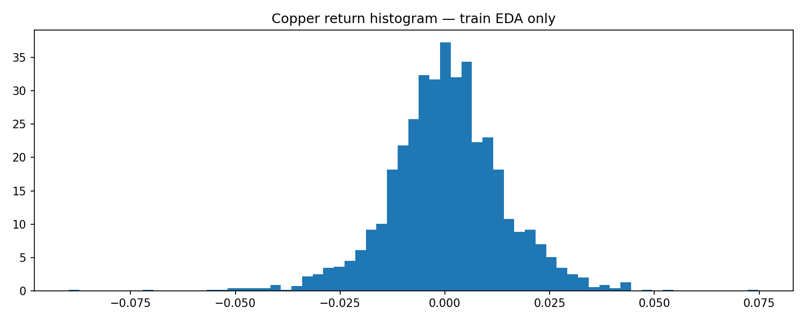

*Hình 2. Histogram mật độ của Copper simple returns trên 2.195 dòng EDA, kết thúc 12/11/2024.*

- **Ảnh gốc:** ZIP `results/copper_v26_comprehensive_eda_results.zip`, member `02_copper_returns_hist.png`; bản nhúng `docs/assets/v26/02_copper_returns_hist.png`.
- **CSV nguồn:** `docs/assets/v26/02_returns_distribution_JB.csv`; phạm vi mẫu/hash ở `docs/assets/v26/manifest.json`.
- **Diễn giải:** phân phối tập trung quanh 0 nhưng có đuôi và độ nhọn không phù hợp giả định Gaussian đơn giản; CSV cho JB p-value thay vì suy từ hình.
- **Hỗ trợ:** báo cáo Jarque–Bera bác bỏ chuẩn trong mẫu V26 và nên dùng metric/kiểm định chịu ảnh hưởng outlier một cách thận trọng. **Không hỗ trợ:** không cho phép xóa mọi điểm ở đuôi hoặc tuyên bố distribution cụ thể khác.
- **LaTeX:** tiểu mục distribution/outliers; `\label{fig:copper_return_distribution}`.

### Hình 3 — Rolling volatility 22 phiên, mẫu EDA V26

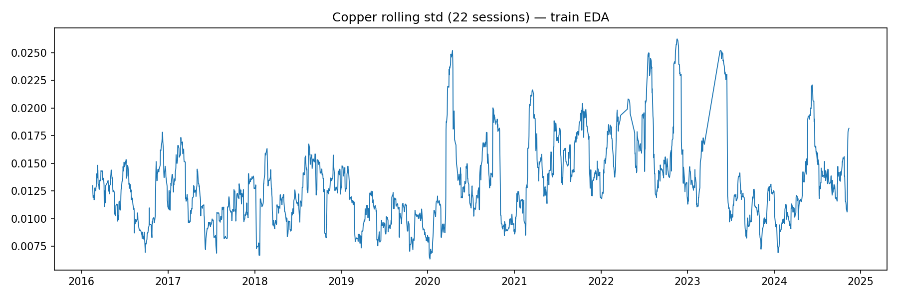

*Hình 3. Độ lệch chuẩn rolling 22 phiên của Copper simple returns trên tập EDA V26.*

- **Ảnh gốc:** ZIP V26, member `04_copper_rolling_volatility.png`; bản nhúng `docs/assets/v26/04_copper_rolling_volatility.png`.
- **CSV nguồn:** `docs/assets/v26/04_lb_arch.csv` cho Ljung–Box trên returns/returns² và ARCH-LM; `manifest.json` cho phạm vi mẫu.
- **Diễn giải:** biên độ volatility có những giai đoạn tăng/giảm kéo dài, phù hợp trực quan với clustering.
- **Hỗ trợ:** kết hợp với p-value returns²/ARCH-LM để nói có bằng chứng phương sai có điều kiện thay đổi trong mẫu. **Không hỗ trợ:** không tự chứng minh một đặc tả GARCH cụ thể đúng, và không phải dự báo volatility ngoài mẫu.
- **LaTeX:** sau bảng Ljung–Box/ARCH-LM; `\label{fig:copper_rolling_volatility}`.

## 2. Correlation và lagged correlation

### Hình 4a — Spearman correlation heatmap của mức giá

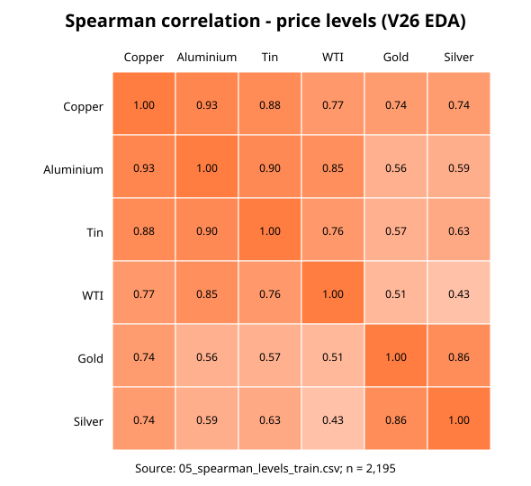

*Hình 4a. Ma trận Spearman của sáu chuỗi mức giá trên 2.195 quan sát đầu của mẫu V26; SVG được dựng trực tiếp từ bảng correlation đã export.*

- **Ảnh gốc:** không có PNG mức giá trong ZIP; bản nhúng dẫn xuất `docs/assets/generated/spearman_levels_heatmap.svg`, tạo bởi script Task B.
- **CSV nguồn:** `docs/assets/v26/05_spearman_levels_train.csv`; mỗi số in trong ô là hệ số CSV làm tròn hai chữ số.
- **Diễn giải:** các mức giá đồng biến mạnh trong mẫu, nổi bật Copper–Aluminium 0,928 và Copper–Tin 0,883; đây có thể phản ánh xu thế chung của level.
- **Hỗ trợ:** giải thích vì sao cần phân biệt correlation mức giá với correlation returns trễ. **Không hỗ trợ:** không chứng minh nhân quả, không bảo đảm biến ngoại sinh tăng chất lượng dự báo, và không khắc phục non-stationarity.
- **LaTeX:** đầu mục EDA/correlation trước hai heatmap trễ; `\label{fig:spearman_price_levels}`.

### Hình 4 — Lagged Spearman correlation trên returns

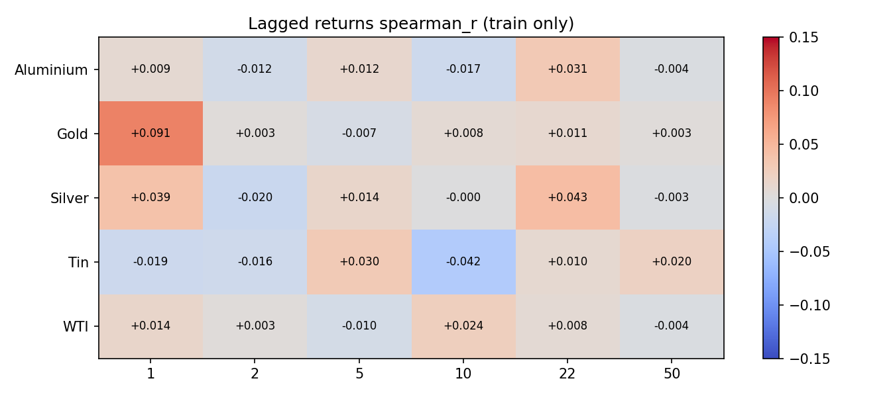

*Hình 4. Spearman correlation giữa returns ngoại sinh trễ 1, 2, 5, 10, 22, 50 phiên và Copper return hiện tại, chỉ trên mẫu EDA.*

- **Ảnh gốc:** ZIP V26, member `05_spearman_r_heatmap.png`; bản nhúng `docs/assets/v26/05_spearman_r_heatmap.png`.
- **CSV nguồn:** `docs/assets/v26/05_lagged_returns_correlations_FDR.csv` (hệ số, p-value và hiệu chỉnh FDR).
- **Diễn giải:** phần lớn hệ số nhỏ; ô Gold lag 1 nổi bật tương đối nhưng phải đọc cùng p-value/FDR trong CSV.
- **Hỗ trợ:** phân biệt correlation mức giá với nội dung dự báo từ biến động trễ; feature selection không nên dựa vào heatmap đơn lẻ. **Không hỗ trợ:** không chứng minh nhân quả, không chứng minh tăng MAE ngoài mẫu.
- **LaTeX:** EDA/feature rationale; `\label{fig:lagged_spearman_returns}`.

### Hình 5 — Lagged Pearson correlation trên returns

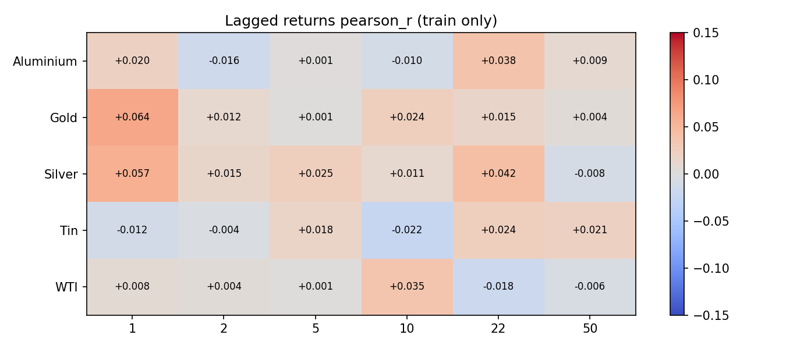

*Hình 5. Pearson correlation tuyến tính giữa returns ngoại sinh trễ và Copper return hiện tại trên cùng mẫu/lags của Hình 4.*

- **Ảnh gốc:** ZIP V26, member `05_pearson_r_heatmap.png`; bản nhúng `docs/assets/v26/05_pearson_r_heatmap.png`.
- **CSV nguồn:** `docs/assets/v26/05_lagged_returns_correlations_FDR.csv`.
- **Diễn giải:** hệ số tuyến tính cũng nhỏ và thay đổi theo lag/biến; sự khác nhau với Spearman cho thấy kết luận phụ thuộc measure.
- **Hỗ trợ:** cần báo cáo cả Pearson và Spearman cùng multiple-testing correction. **Không hỗ trợ:** không được chọn lag sau khi nhìn test rồi gọi đó là bằng chứng out-of-sample.
- **LaTeX:** đặt cạnh Hình 4 trong một figure hai panel; `\label{fig:lagged_pearson_returns}`.

**Provenance note:** ZIP V26 không có heatmap mức giá riêng; Hình 4a vì vậy được gắn rõ là hình dẫn xuất từ CSV, còn Hình 4–5 là PNG nguyên gốc trong ZIP.

## 3. Dự báo thực tế, Naive và Direct/Residual

### Hình 6 — Actual vs Predicted: Residual-GRU, Ridge residual và Naive

*Hình 6. Copper thực tế và dự báo H=1 của Residual-GRU, Ridge residual và Naive trên split 80/20, expanding, FS02.*

- **Ảnh gốc:** `results/17-11-Copper-NonSA-Fair-Full-Protocol-V20/actual_pred_0.8_copper_paper3.png`.
- **CSV nguồn:** `grid_predictions.csv` cho từng ngày; `grid_results.csv`/`fair_table_0.800.csv` cho MAE/RMSE; `residual_audit.csv` cho delta.
- **Diễn giải:** các đường residual và Naive gần nhau vì dự báo giá được tái dựng bằng giá phiên trước cộng delta dự báo nhỏ; sự chồng lấp thị giác cần metric paired để phân biệt.
- **Hỗ trợ:** Residual-GRU gần Naive; one-step persistence là baseline mạnh. **Không hỗ trợ:** không thể kết luận hai phương pháp bằng nhau chỉ bằng mắt, không thể suy significance nếu chưa xem DM-HAC.
- **LaTeX:** phần kết quả chính sau bảng holdout; `\label{fig:actual_predicted_residual_naive}`.

### Hình 7 — Direct vs Residual trên cùng kiến trúc

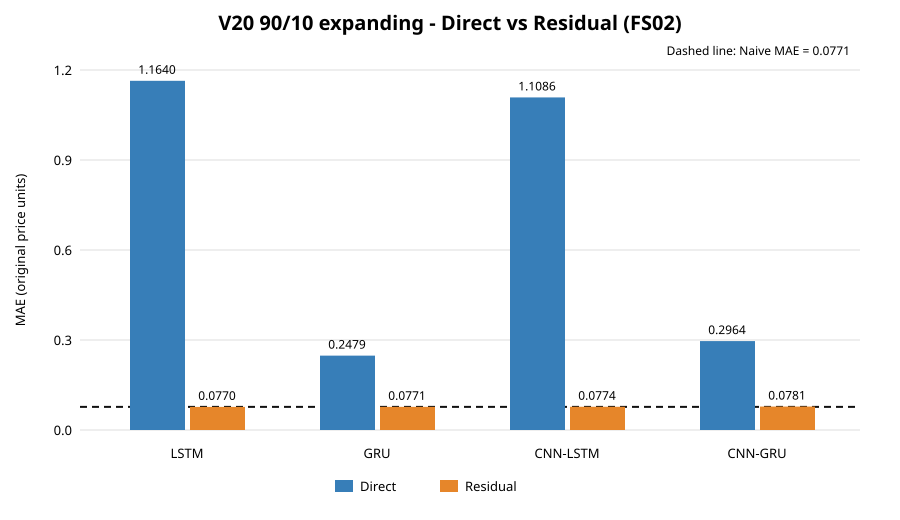

*Hình 7. MAE của bốn kiến trúc Direct/Residual trong đúng một protocol V20: split 90/10, expanding, FS02; đường đứt là Naive.*

- **Ảnh gốc:** SVG dẫn xuất `docs/assets/generated/direct_vs_residual_v20_90_expanding.svg`, dựng trực tiếp từ CSV bởi script Task B; không có PNG Direct-vs-Residual tương ứng trong artifact gốc.
- **CSV nguồn:** `results/17-11-Copper-NonSA-Fair-Full-Protocol-V20/grid_results.csv`, filter `ratio=0.9`, `scheme=expanding`, `feature_set=copper_paper3`.
- **Diễn giải:** cùng backbone nhưng objective khác làm Direct và Residual có scale/optimization problem khác nhau; trong cấu hình này nhóm residual sát Naive, còn Direct cao hơn rõ rệt.
- **Hỗ trợ:** objective/target transformation ảnh hưởng MAE dù kiến trúc tương ứng giống nhau. **Không hỗ trợ:** không khái quát Residual luôn thắng ở mọi split/feature/seed; đây không phải kết quả walk-forward.
- **LaTeX:** phần Direct vs Residual; `\label{fig:direct_vs_residual_v20}`.

## 4. MAE/RMSE theo feature set và strategy

### Hình 8 — MAE theo strategy và feature group, V21 80/20

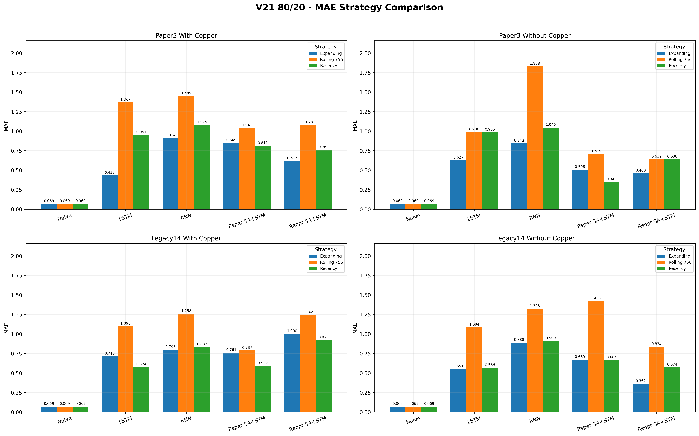

*Hình 8. MAE của Naive, LSTM, RNN, Paper SA-LSTM và Reoptimized SA-LSTM theo Expanding, Rolling-756, Recency trên bốn nhóm feature V21.*

- **Ảnh gốc:** ZIP `results/17-11-Copper-NonSA-Fair-Full-Protocol-V20/copper_v21_addon_80_wf_plots.zip`, member `plots/80_strategy_mae_all_features.png`; bản nhúng dưới `docs/assets/v21_addon/`.
- **CSV nguồn:** `docs/assets/v21_addon/holdout_80_results.csv`; provenance/signature ở `visualization_manifest.json` và `configuration_signature.txt`.
- **Diễn giải:** hiệu năng thay đổi đáng kể theo model, strategy và việc có Copper history; Naive không đổi theo strategy vì không fitted.
- **Hỗ trợ:** phải so model trên cùng panel/protocol; strategy là yếu tố thực nghiệm thực sự. **Không hỗ trợ:** bar thấp nhất không chứng minh tổng quát hóa và không cho phép so với test period khác.
- **LaTeX:** results/strategy sensitivity; `\label{fig:v21_strategy_mae}`.

### Hình 9 — RMSE theo strategy và feature group, V21 80/20

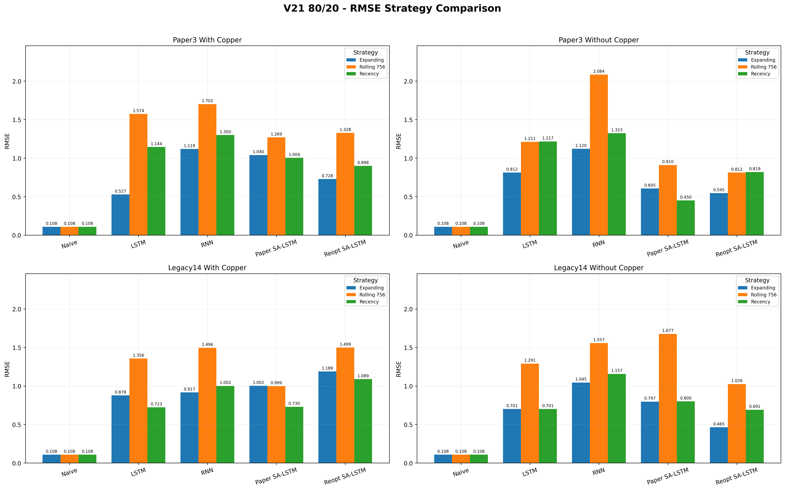

*Hình 9. RMSE tương ứng Hình 8, nhấn mạnh mạnh hơn các lỗi lớn.*

- **Ảnh gốc:** cùng ZIP add-on, member `plots/80_strategy_rmse_all_features.png`; bản nhúng `docs/assets/v21_addon/plots/80_strategy_rmse_all_features.png`.
- **CSV nguồn:** `docs/assets/v21_addon/holdout_80_results.csv`.
- **Diễn giải:** thứ hạng/độ cách biệt có thể khác MAE vì RMSE bình phương sai số; cần báo cả hai thay vì chọn metric thuận lợi.
- **Hỗ trợ:** đánh giá robustness đối với lỗi lớn. **Không hỗ trợ:** RMSE không mô tả direction accuracy hay significance.
- **LaTeX:** đặt cạnh Hình 8; `\label{fig:v21_strategy_rmse}`.

### Hình 10 — Feature ablation của nhánh SA-LSTM V21

*Hình 10. MAE theo feature set cho các model nhánh SA-LSTM ở protocol V21; dùng để xem ảnh hưởng có/không có lịch sử Copper.*

- **Ảnh gốc:** `results/17-11-SA-LSTM-standalone-V21/copper_sa_lstm_h1_ablation_v21/feature_ablation_mae.png`.
- **CSV nguồn:** cùng thư mục: `results_h1_ablation.csv`, `copper_lag_ablation.csv`; bảng 90/10 expanding ở `main_comparison_90_expanding.csv`.
- **Diễn giải:** feature set là danh sách biến trong cùng window/target, không phải dataset độc lập; kết quả có/không Copper cần đọc theo đúng model/strategy.
- **Hỗ trợ:** lịch sử Copper có ảnh hưởng lớn đến bài toán one-step. **Không hỗ trợ:** không tách riêng causal contribution của Gold/Silver/WTI và không chứng minh thêm feature luôn tốt.
- **LaTeX:** ablation study; `\label{fig:v21_feature_ablation}`.

## 5. SA hyperparameter search

### Hình 11 — Hội tụ best validation MSE của Fresh SA

*Hình 11. Best-so-far validation MSE (scaled) qua 16 evaluations của Fresh SA trên FS06; search chỉ dùng train/validation.*

- **Ảnh gốc:** `results/18-11- Copper_SA-LSTM-standalone-V22/copper_sa_lstm_wti_only_v22/sa_search_convergence.png`.
- **CSV nguồn:** cùng thư mục `sa_search_trials.csv`; best config `fresh_sa_best_hp.json`; phạm vi `experiment_manifest.json`.
- **Diễn giải:** đường bậc thang giảm khi tìm được proposal tốt hơn và giữ nguyên khi không cải thiện; đây là objective validation, không phải neural-weight trajectory.
- **Hỗ trợ:** SA tối ưu `units_1`, `units_2`, learning rate và có proposal/acceptance history. **Không hỗ trợ:** không chứng minh global optimum, không chứng minh SA-LSTM tốt hơn baseline trên test.
- **LaTeX:** methodology SA hoặc appendix search trace; `\label{fig:sa_search_convergence}`.

## 6. Walk-forward theo seed và giai đoạn

### Hình 12 — MAE theo năm seed trong aligned 80/20 walk-forward

*Hình 12. MAE của Residual-GRU, Residual-LSTM và Reoptimized SA-LSTM theo seeds 41–45; đường đứt là Naive trên cùng aligned 80/20 window.*

- **Ảnh gốc:** `results/20 -11 - copper_v23_gapfill_results/copper_v23_gapfill/wf_mae_by_seed.png`.
- **CSV nguồn:** cùng thư mục `wf_seed_summary.csv`, `wf_fold_metrics.csv`, `wf_predictions.csv`; paired test `wf_dm_hac_by_seed.csv`.
- **Diễn giải:** Residual-GRU/LSTM gần Naive ở mọi seed, trong khi Reoptimized SA-LSTM biến thiên và kém hơn rõ trong run này.
- **Hỗ trợ:** cần multi-seed và paired comparison; SA tuning không bảo đảm chiến thắng ngoài mẫu. **Không hỗ trợ:** không so trực tiếp với WF V20 2018–2026 nếu dates/protocol không trùng.
- **LaTeX:** robustness/multi-seed; `\label{fig:walkforward_mae_by_seed}`.

### Hình 13 — Walk-forward Actual vs Residual-GRU vs Naive theo thời gian

*Hình 13. Chuỗi dự báo walk-forward của một seed trong V20 từ 2018–2026, đối chiếu Actual, Residual-GRU và Naive.*

- **Ảnh gốc:** `results/17-11-Copper-NonSA-Fair-Full-Protocol-V20/wf_actual_vs_pred.png`.
- **CSV nguồn:** cùng thư mục `walk_forward_predictions.csv`, `walk_forward_fold_metrics.csv`, `wf_by_year.csv`, `dm_hac_by_seed.csv`.
- **Diễn giải:** dự báo one-step bám sát level vì cả Residual-GRU và Naive neo vào giá phiên trước; các giai đoạn/fold được kiểm tra định lượng bằng `wf_by_year.csv`.
- **Hỗ trợ:** mô hình được đánh giá qua nhiều regime và refit theo lịch 63 phiên. **Không hỗ trợ:** hình một seed không đại diện uncertainty toàn bộ seed và không cho thấy epochs.
- **LaTeX:** walk-forward evaluation; `\label{fig:walkforward_timeline_v20}`.

## 7. Bằng chứng kiểm định không có hình riêng

Không dựng đồ thị p-value mới. Khi trình bày, dùng Hình 2–5 làm trực giác và dẫn trực tiếp các CSV sau:

| Kiểm định | CSV đã chạy | Hình hỗ trợ ngữ cảnh | Giới hạn phát biểu |
|---|---|---|---|
| Jarque–Bera | `assets/v26/02_returns_distribution_JB.csv` | 2 | Bác bỏ chuẩn trong mẫu, không nhận diện distribution duy nhất |
| ADF + KPSS | `assets/v26/03_adf_kpss.csv` | 1 | Mẫu phù hợp non-stationary ở level/stationary sau biến đổi; chưa chứng minh tuyệt đối I(1) |
| Ljung–Box + ARCH-LM | `assets/v26/04_lb_arch.csv` | 3 | Phụ thuộc mean/variance theo lag đã chọn, không tự chọn GARCH |
| CUSUM | `assets/v26/07_cusum_mean_returns.csv` | 1, 3 | Kiểm tra ổn định mean returns theo đặc tả đã chạy |
| Zivot–Andrews | `assets/v26/07_zivot_andrews_break_unit_root.csv` | 1 | Unit-root test có một break nội sinh; không phải mọi structural break |
| Brown–Forsythe | `assets/v26/07_brown_forsythe_variance_halves.csv` | 3 | So sánh variance hai nửa cố định, không định vị mọi regime |
| Engle–Granger | `assets/v26/07_cointegration_exploratory.csv` | 1 | Bằng chứng exploratory, nhạy hướng hồi quy; không chứng minh causal |

## 8. Mapping artifact gốc → file nhúng

| Nguồn bất biến | Đích trong `docs/assets/` | Trạng thái |
|---|---|---|
| `results/copper_v26_comprehensive_eda_results.zip` / toàn bộ member | `assets/v26/` | Giải nén nguyên trạng: 5 PNG, 14 CSV, manifest |
| `.../copper_v21_addon_80_wf_plots.zip` / toàn bộ member | `assets/v21_addon/` | Giải nén nguyên trạng: 10 PNG, 2 CSV, manifest/signature |
| `assets/v26/05_spearman_levels_train.csv` | `assets/generated/spearman_levels_heatmap.svg` | Script dẫn xuất; mỗi ô đọc trực tiếp từ CSV |
| `results/.../grid_results.csv` (filter V20 90/10 expanding FS02) | `assets/generated/direct_vs_residual_v20_90_expanding.svg` | Script dẫn xuất; giá trị/bar và Naive đọc trực tiếp từ CSV |
| Notebook cells ghi trong provenance | `assets/generated/leak_safe_pipeline.svg`, `cnn_lstm_gru_architecture.svg`, `sa_search_protocol.svg` | Sơ đồ code-faithful, không chứa kết quả suy đoán |

Các hình còn lại nhúng trực tiếp bằng đường dẫn `../results/...`, nên không có bản copy. Việc giải nén không thay đổi ZIP/artifact gốc. Chạy lại toàn bộ SVG Task B bằng PowerShell: `./scripts/build_visual_evidence.ps1` từ project root hoặc truyền `-ProjectRoot`.

## 9. Checklist sử dụng trong báo cáo

- Mọi caption ghi rõ split, strategy, feature set, horizon và phạm vi train/test khi có.
- Không đọc giá trị chính xác từ pixel; dùng CSV nguồn.
- Không gọi V26 là train-only độc lập cho split 80/20: mốc EDA 12/11/2024 muộn hơn test start 07/10/2024.
- Không đặt Hình 12 cạnh Hình 13 để so MAE trực tiếp nếu chưa căn đúng date range/protocol.
- Không gọi Naive là fitted model; không gọi SA search là tối ưu neural weights.

## 10. Tra cứu 16 hình đã đặt trực tiếp trong báo cáo Mythos

Đường dẫn dưới đây tính từ `Module1/Mythos_Copper_Module1_V20_V26.md`. Với hình dẫn xuất, script là `copper-forecasting/scripts/build_visual_evidence.ps1`; các PNG còn lại là artifact nguyên gốc hoặc member ZIP được giải nén nguyên trạng. Nguồn và giới hạn diễn giải chi tiết nằm ở các mục phía trên.

| Hình trong Mythos | Đường dẫn ảnh từ báo cáo | CSV/nguồn gốc hoặc script | Nhãn LaTeX |
|---|---|---|---|
| 1 | `copper-forecasting/docs/assets/generated/leak_safe_pipeline.svg` | Script; V20 cells 2/8/10/14/18, V21 cells 6/8/10 | `fig:leak_safe_pipeline` |
| 2 | `copper-forecasting/docs/assets/v26/02_copper_returns.png` | V26 ZIP; `02_returns_distribution_JB.csv` | `fig:copper_returns_v26` |
| 3 | `copper-forecasting/docs/assets/v26/02_copper_returns_hist.png` | V26 ZIP; `02_returns_distribution_JB.csv` | `fig:copper_return_distribution` |
| 4 | `copper-forecasting/docs/assets/v26/04_copper_rolling_volatility.png` | V26 ZIP; `04_lb_arch.csv` | `fig:copper_rolling_volatility` |
| 5 | `copper-forecasting/docs/assets/generated/spearman_levels_heatmap.svg` | Script; `05_spearman_levels_train.csv` | `fig:spearman_price_levels` |
| 6 | `copper-forecasting/docs/assets/v26/05_spearman_r_heatmap.png` | V26 ZIP; `05_lagged_returns_correlations_FDR.csv` | `fig:lagged_spearman_returns` |
| 7 | `copper-forecasting/docs/assets/v26/05_pearson_r_heatmap.png` | V26 ZIP; `05_lagged_returns_correlations_FDR.csv` | `fig:lagged_pearson_returns` |
| 8 | `copper-forecasting/docs/assets/generated/cnn_lstm_gru_architecture.svg` | Script; V20/V22 Non-SA `build_net`, cell 10 | `fig:cnn_recurrent_code_architecture` |
| 9 | `copper-forecasting/results/17-11-Copper-NonSA-Fair-Full-Protocol-V20/actual_pred_0.8_copper_paper3.png` | V20 `grid_predictions.csv` | `fig:actual_predicted_residual_naive` |
| 10 | `copper-forecasting/docs/assets/generated/direct_vs_residual_v20_90_expanding.svg` | Script; V20 `grid_results.csv`, 90/10 Expanding FS02 | `fig:direct_vs_residual_v20` |
| 11 | `copper-forecasting/docs/assets/v21_addon/plots/80_strategy_mae_all_features.png` | V21 add-on ZIP; `holdout_80_results.csv` | `fig:v21_strategy_mae` |
| 12 | `copper-forecasting/docs/assets/v21_addon/plots/80_strategy_rmse_all_features.png` | V21 add-on ZIP; `holdout_80_results.csv` | `fig:v21_strategy_rmse` |
| 13 | `copper-forecasting/docs/assets/generated/sa_search_protocol.svg` | Script; V22-SA cell 12, `fresh_sa_best_hp.json` | `fig:sa_search_protocol` |
| 14 | `copper-forecasting/results/18-11- Copper_SA-LSTM-standalone-V22/copper_sa_lstm_wti_only_v22/sa_search_convergence.png` | V22-SA `sa_search_trials.csv` | `fig:sa_search_convergence` |
| 15 | `copper-forecasting/results/20 -11 - copper_v23_gapfill_results/copper_v23_gapfill/wf_mae_by_seed.png` | V23 `wf_seed_summary.csv` | `fig:walkforward_mae_by_seed` |
| 16 | `copper-forecasting/results/17-11-Copper-NonSA-Fair-Full-Protocol-V20/wf_actual_vs_pred.png` | V20 `walk_forward_predictions.csv`, `wf_by_year.csv` | `fig:walkforward_timeline_v20` |
