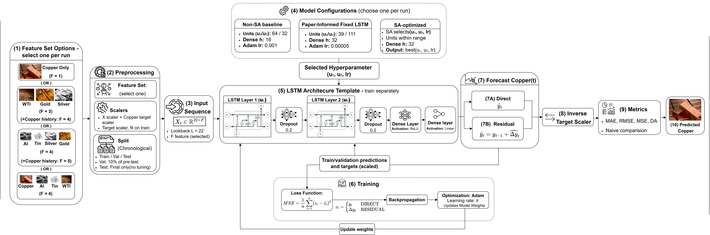
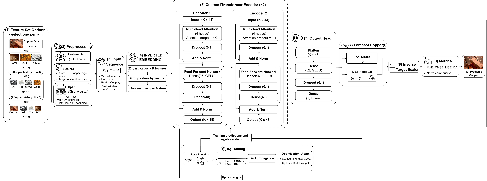
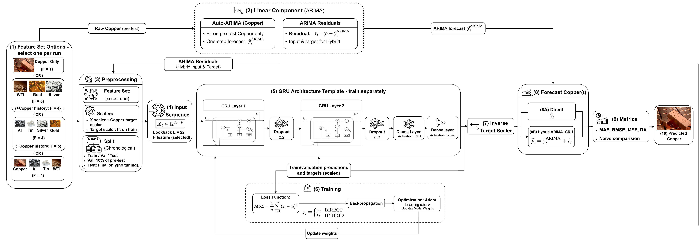

# Tổng hợp Pipeline Toàn Nhóm (8 Kiến trúc Chính)

Thư mục này tổng hợp đầy đủ **8 sơ đồ pipeline** cho toàn bộ các mô hình Deep Learning / Hybrid chính của 5 thành viên trong dự án **Copper Futures Price Forecasting** (định dạng PNG độ phân giải cao ~5.5K–6.1K, thống nhất bố cục và ký hiệu toán học).

| # | Tệp sơ đồ | Mô hình / Phương pháp | Nguồn mã nguồn |
|---:|---|---|---|
| 1 | `01_Pineline-LSTM-SA-LSTM.png` | **LSTM & SA-LSTM** (`Non-SA`, `Paper-Informed Fixed`, `SA-optimized`) | `Module1/` (`V20–V25`) |
| 2 | `02_Pineline-GRU.png` | **GRU Baseline** (`Direct` & `Residual`) | `Module1/` (`V20, V22, V23, V25`) |
| 3 | `03_Pineline-CNN-LSTM.png` | **Causal 1D CNN–LSTM** (`Conv1D(32, k=3) → MaxPool1D(2) → LSTM(48→24)`) | `Module1/` (`V20, V22, V23, V25`) |
| 4 | `04_Pineline-CNN-GRU.png` | **Causal 1D CNN–GRU** (`Conv1D(32, k=3) → MaxPool1D(2) → GRU(48→24)`) | `Module1/` (`V20, V22, V23, V25`) |
| 5 | `05_Pineline-iTransformer.png` | **iTransformer** (`Inverted Embedding + 2× Encoder`, `Direct` & `Residual`) | `Vi Task/` (`FS01–FS06`) |
| 6 | `06_Pineline-TPE-LSTM.png` | **TPE–LSTM (Optuna)** (`TPE-optimized`, `Direct` & `Residual`) | `TPE+LSTM/` |
| 7 | `07_Pineline-WalkForward-LSTM-Quan.png` | **Walk-Forward LSTM** (`Static`, `Expanding`, `Rolling W=756, S=40`) | `quan task/` |
| 8 | `08_Pineline-Hybrid-ARIMA-GRU-Huy.png` | **Hybrid ARIMA–GRU** (`Auto-ARIMA` tuyến tính + `GRU(64→32)` học phần dư) | `huy task/` |

---

## Xem nhanh các sơ đồ

### 1. LSTM & SA-LSTM

### 2. GRU Baseline

### 3. Causal 1D CNN–LSTM

### 4. Causal 1D CNN–GRU

### 5. iTransformer

### 6. TPE–LSTM (Optuna)

### 7. Walk-Forward LSTM (Quân)

### 8. Hybrid ARIMA–GRU (Huy)

