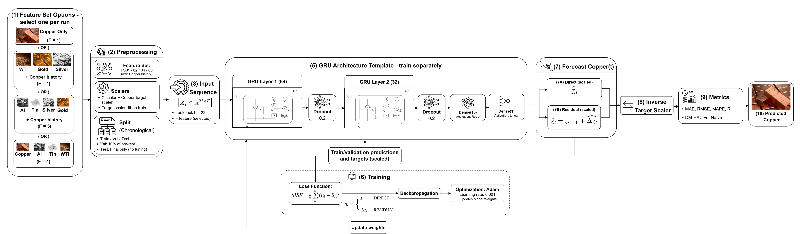
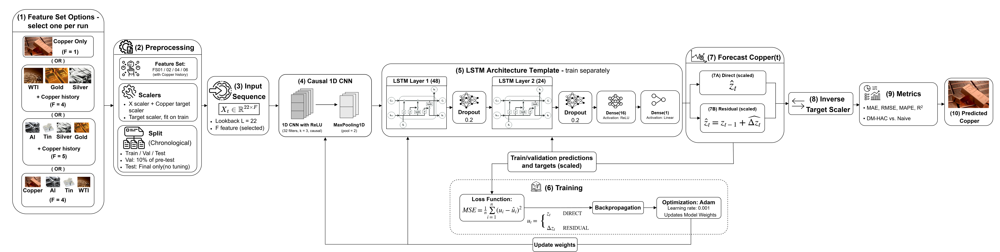
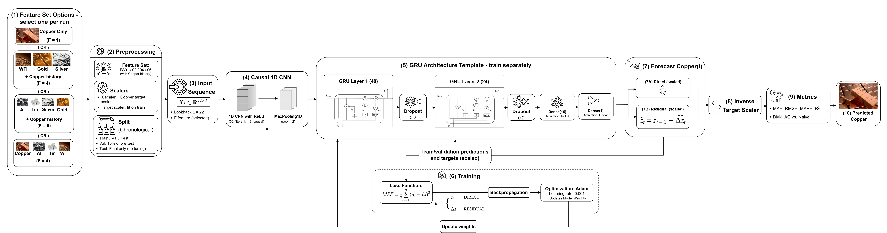
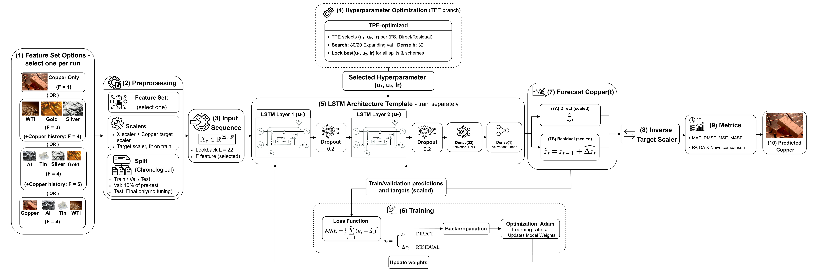
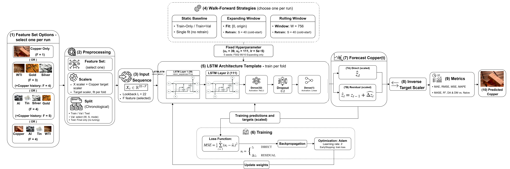

# Tổng hợp Pipeline Toàn Nhóm (8 Kiến trúc Chính)

Thư mục này tổng hợp đầy đủ **8 sơ đồ pipeline** cho toàn bộ các mô hình Deep Learning / Hybrid chính của 5 thành viên trong dự án **Copper Futures Price Forecasting** (định dạng PNG độ phân giải cao ~5.5K–6.1K, đã đối chiếu trực tiếp từng notebook, đồng bộ chuẩn in đậm/gạch đầu dòng theo mẫu LSTM và kiểm tra khối `(9) Metrics` khớp 100% từng hàm đánh giá trong code).

| # | Tệp sơ đồ | Mô hình / Phương pháp | Phạm vi bộ biến, mục tiêu & giao thức chính xác theo code | `(9) Metrics` khớp đúng notebook | Nguồn mã nguồn |
|---:|---|---|---|---|---|
| 1 | `01_Pineline-LSTM-SA-LSTM.png` | **LSTM & SA-LSTM** | **Non-SA (`64/32, h=16, lr=0.001`)**: `FS01/02/04/06` · `Direct & Residual` (NB 03). **Paper Fixed (`39/111, h=32, lr=5e-5`) & SA-optimized**: `FS02–FS06` · `Direct` (NB 02). Ký hiệu thang scaled (`zₜ, Δzₜ = zₜ − zₜ₋₁, ẑₜ = zₜ₋₁ + Δẑₜ`) trước `Inverse Target Scaler`, `Dense(h, ReLU) → Dense(1, Linear)`. | `MAE, RMSE, MAPE, R²` · `DM-HAC vs. Naive` | `Module1/offical-notebooks/` (`02`, `03`, `04`) |
| 2 | `02_Pineline-GRU.png` | **GRU Baseline** | `GRU(64) → Drop(0.2) → GRU(32) → Drop(0.2) → Dense(16, ReLU) → Dense(1, Linear)`, `Adam(0.001)`, `Direct & Residual (scaled zₜ / Δzₜ)`, chạy đúng 4 bộ có Copper (`FS01/02/04/06`). | `MAE, RMSE, MAPE, R²` · `DM-HAC vs. Naive` | `Module1/offical-notebooks/03_*` |
| 3 | `03_Pineline-CNN-LSTM.png` | **Causal 1D CNN–LSTM** | `Conv1D(32, k=3, causal, ReLU) → MaxPool1D(2) → LSTM(48→24) → Dense(16, ReLU) → Dense(1, Linear)`, `Adam(0.001)`, `Direct & Residual (scaled zₜ / Δzₜ)`, chạy đúng 4 bộ có Copper (`FS01/02/04/06`). | `MAE, RMSE, MAPE, R²` · `DM-HAC vs. Naive` | `Module1/offical-notebooks/03_*` |
| 4 | `04_Pineline-CNN-GRU.png` | **Causal 1D CNN–GRU** | `Conv1D(32, k=3, causal, ReLU) → MaxPool1D(2) → GRU(48→24) → Dense(16, ReLU) → Dense(1, Linear)`, `Adam(0.001)`, `Direct & Residual (scaled zₜ / Δzₜ)`, chạy đúng 4 bộ có Copper (`FS01/02/04/06`). | `MAE, RMSE, MAPE, R²` · `DM-HAC vs. Naive` | `Module1/offical-notebooks/03_*` |
| 5 | `05_Pineline-iTransformer.png` | **iTransformer** | Đánh số tuần tự `(1) → (11)`: `Inverted Embedding (22→48) + 2× Encoder (4 heads, key_dim=12)` — `train separately`, `Direct & Residual (scaled zₜ / Δzₜ)`, `Train/validation predictions and targets (scaled)`, `Adam(0.0003)` *(Full Grid `FS01–FS06`: `5 seeds 41–45, max 65 epochs`, xuất raw predictions; tách biệt với Fair `K=5`: `seed 42, max 100 epochs`)*. | `MAE, RMSE, MSE, MAPE, R², DA` · `DM-HAC vs. Naive` *(khối `(10)`)* | `Vi Task/` |
| 6 | `06_Pineline-TPE-LSTM.png` | **TPE–LSTM (TPE branch)** | Nhánh `TPE` tìm `(u₁, u₂, lr)` riêng theo từng `(FS, Direct/Residual)` trên `80/20 Expanding val` (`Dense(32, ReLU) → Dense(1, Linear)`), khóa cấu hình tốt nhất cho toàn bộ split & strategy còn lại; ký hiệu thang scaled `zₜ / Δzₜ` *(notebook có nhánh đối chứng song song SA-LSTM)*. | `MAE, RMSE, MSE, MASE, R², DA` · `Naive comparison` | `TPE+LSTM/final-tpe-lstm.ipynb` |
| 7 | `07_Pineline-WalkForward-LSTM-Quan.png` | **Walk-Forward LSTM** | `LSTM(39, return_sequences=True) → LSTM(111) → Dense(32, ReLU) → Drop(0.2) → Dense(1, Linear)`, `lr=5e-5`, `W=756, S=40`, `cold_start`. `Val` chọn `(W, S, mode)`, scaler `fit per fold`, `EarlyStopping` theo **train loss** (`monitor="loss"`), `Direct & Residual (scaled zₜ / Δzₜ)`; `5 seeds` chỉ cho `FS02 90/10 Expanding`. | `MAE, RMSE, MSE, MAPE, MASE, R², DA` · `DM vs. Naive` | `quan task/copper_rolling_expanding_quan.ipynb` |
| 8 | `08_Pineline-Hybrid-ARIMA-GRU-Huy.png` | **Hybrid ARIMA–GRU** | `Auto-ARIMA` fit trên Copper trước test → phần dư `rₜ = yₜ − ŷₜᴬᴿᴵᴹᴬ` là target Hybrid *(chỉ thay cột `Copper` trong `X` khi có Copper, không đưa vào `X` ở `FS03/05`)* → `GRU(64→32) → Dense(16, ReLU) → Dense(1, Linear)`, `Adam(0.001)` → `(7) Inverse Target Scaler` *(tách riêng: Direct dùng inverse Copper scaler, Hybrid dùng inverse Residual scaler)* → `(8) Forecast Copper(t) (raw)` *(Hybrid cộng `ŷₜᴬᴿᴵᴹᴬ + r̂ₜ` trên thang giá gốc)*. | `MAE, RMSE, MAPE, R², DA` · `DM test vs. Naive & ARIMA` | `huy task/copper_hybrid_arima_gru_huy.ipynb` |

---

## Xem nhanh các sơ đồ

### 1. LSTM & SA-LSTM

### 2. GRU Baseline

### 3. Causal 1D CNN–LSTM

### 4. Causal 1D CNN–GRU

### 5. iTransformer

### 6. TPE–LSTM (Optuna)

### 7. Walk-Forward LSTM (Quân)

### 8. Hybrid ARIMA–GRU (Huy)

