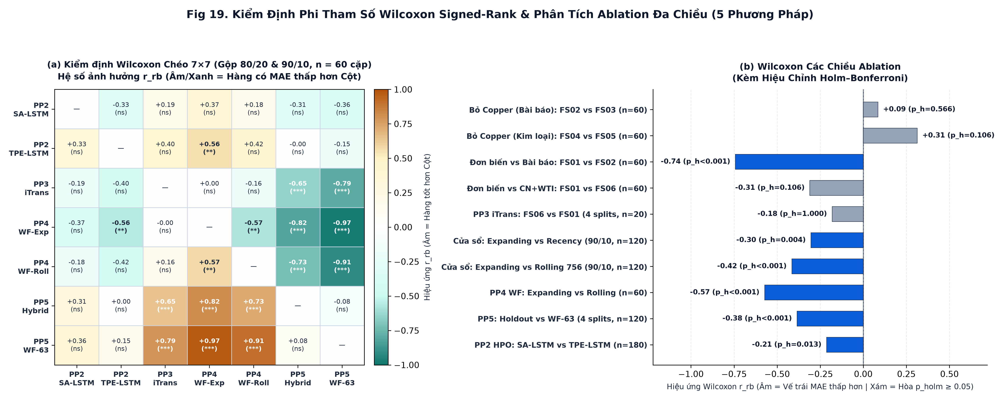
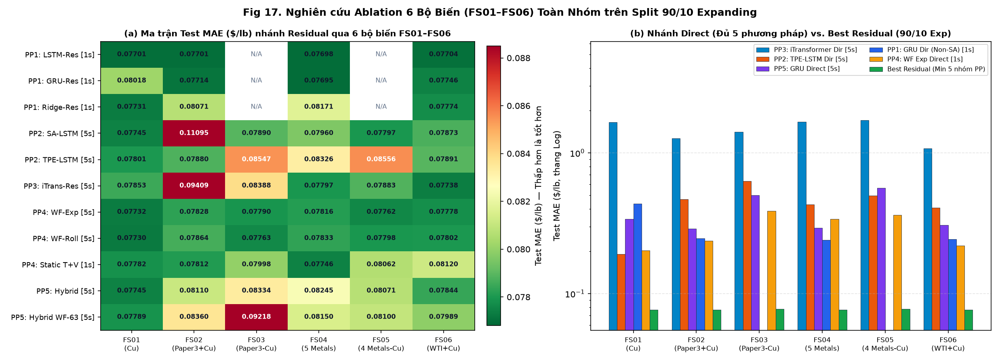

# Thống Kê Chỉ Số, Kiểm Định Diebold–Mariano, Wilcoxon & Phân Tích Ablation Toàn Nhóm (5 Phương Pháp: PP1–PP5)

> **Nguyên tắc tổng hợp & minh bạch giao thức:**  
> Tài liệu này tổng hợp kết quả thực nghiệm cập nhật đến commit `35a1f6d` của **5 phương pháp dự báo giá đồng (`Copper Close`, đơn vị USD/lb)** trên cùng bộ dữ liệu, cùng 6 tập đặc trưng (`FS01`–`FS06`) và cùng các mốc chia thời gian (`80/20`, `90/10`, `92.5/7.5`, `95/5`). Mọi mô hình tham gia đều được đánh giá trực tiếp thông qua **chỉ số sai số (`MAE`, `RMSE`, `DA`)**, **độ ổn định đa hạt giống (`5 seeds: 41–45`)**, **kiểm định Diebold–Mariano (`DM-HAC`)** trên chuỗi sai số ngày, **kiểm định phi tham số Wilcoxon Signed-Rank (kèm hiệu chỉnh Holm–Bonferroni)** trên toàn lưới thực nghiệm, và **phân tích Ablation đa chiều**.

---

## 1. Dữ Liệu Chung & Bối Cảnh Thực Nghiệm

| Thuộc tính | Giá trị xác minh |
| :--- | :--- |
| **Chuỗi mục tiêu** | Giá đóng cửa hợp đồng tương lai Đồng (`Close`, USD/lb) |
| **Kích thước & Giai đoạn** | **2.710 phiên giao dịch** (`13/01/2016 → 13/11/2026`) |
| **Tính toàn vẹn tệp dữ liệu** | Local CRLF SHA-256: `9580ede12d474c8f990556842d551dac176b3c16b2d6a4bffb7dc41dd54bf600` Kaggle LF SHA-256: `a761a9082de36ad8724597ff1518e24bbf1a61676bd3164676e7f4218d275d83` Sai lệch giá trị số tối đa giữa hai bản: **`0.00e+00`** |
| **4 mốc chia Train/Test** | `80/20` ($N_{\text{test}} = 542$, `07/10/2024 → 13/11/2026`) `90/10` ($N_{\text{test}} = 271$, `29/10/2025 → 13/11/2026`, mốc chính) `92.5/7.5` ($N_{\text{test}} = 204$) `95/5` ($N_{\text{test}} = 136$) |
| **6 tập đặc trưng (`FS01`–`FS06`)** | `FS01` (`Copper`); `FS02` (`Copper, WTI, Gold, Silver` — tập bài báo); `FS03` (`WTI, Gold, Silver` — ngoại sinh bài báo); `FS04` (`Copper, Aluminium, Tin, Silver, Gold`); `FS05` (`Aluminium, Tin, Silver, Gold`); `FS06` (`Copper, Aluminium, Tin, WTI`) |

### Quy ước 5 Phương Pháp (PP1–PP5)

| Mã | Nhóm phương pháp | Các kiến trúc & biến thể đại diện trong tổng hợp |
| :--- | :--- | :--- |
| **PP1** | Mạng hồi quy chuẩn & tuyến tính (`Non-SA & SA-LSTM`) | `LSTM Residual`, `GRU Residual`, `Ridge Residual` (4 tập FS: `FS01`, `FS02`, `FS04`, `FS06`); các nhánh `Direct` (`GRU/LSTM`, `Paper SA-LSTM`, `Reopt SA-LSTM`); mở rộng `WF 5-seed` trên `80/20 FS06` (`WF GRU-Res`, `WF LSTM-Res`, retrain mỗi 63 phiên) |
| **PP2** | Tối ưu siêu tham số (`HPO SA vs TPE`) | `SA-LSTM` và `TPE-LSTM` (cả hai nhánh `Residual` và `Direct`, đầy đủ 6 tập `FS01`–`FS06`, 5 seeds `41–45`) |
| **PP3** | Kiến trúc Transformer chuỗi thời gian (`iTransformer`) | `iTransformer Residual` và `iTransformer Direct` (6 tập `FS01`–`FS06`, 5 seeds `41–45`) |
| **PP4** | Học tăng tiến Walk-Forward (`Walk-Forward LSTM`) | `WF Expanding`, `WF Rolling (W=756, S=40)`, và đối chứng `Static (Train+Val)` / `Static (Train-Only)` (6 tập `FS01`–`FS06`, 5 seeds cho `WF` và 1 seed cho `Static`) |
| **PP5** | Mô hình lai tuyến tính–phi tuyến (`Hybrid ARIMA-GRU`) | `Hybrid ARIMA-GRU` chạy đầy đủ cả **Holdout (`Expanding`/`Recency`/`Rolling`)** lẫn **`Walk-Forward 63` (9 folds × 5 seeds, retrain mỗi 63 phiên)** trên 6 tập `FS01`–`FS06` (`4` mốc chia), cùng đối chứng `ARIMA` thuần (`FS01`) và `GRU Direct` (`Holdout` & `WF-63`, 6 FS × 5 seeds) |

---

## 2. Thống Kê Chỉ Số Hiệu Năng Qua Các Giao Thức & Mốc Chia

> [!IMPORTANT]
> **Minh bạch giao thức đánh giá (Protocol Transparency):**  
> Các mô hình trong bảng tổng hợp không chạy chung một giao thức tái huấn luyện và số seed duy nhất. Do đó, mọi chỉ số đều gắn thẻ rõ ràng gồm: **`Holdout 1-seed (42)`**, **`Deterministic (1-run)`**, **`Holdout TB 5-seed (41–45)`**, **`WF TB 5-seed (41–45)`**, **`WF-63 TB 5-seed (41–45)`**, **`WF 1-seed (42)`**, và **`5s-Ens`** (trung bình dự báo 5 seed trước khi tính sai số). Khi so sánh chéo, cần đọc song song cả `MAE` điểm, độ lệch chuẩn `± std` giữa 5 seed, và giao thức huấn luyện tương ứng.

### 2.1 Bảng xếp hạng nhánh Residual — Mốc chính 90/10 (`Expanding` / `Walk-Forward`, $N_{\text{test}} = 271$)

Nguồn chi tiết: [group_ablation_6_feature_sets_all_members.csv](group_ablation_6_feature_sets_all_members.csv) (23 dòng tổng hợp = 11 dòng `Residual` + 12 dòng `Direct`).

| Hạng (Best FS) | Phương pháp & Mô hình | Giao thức | Best FS | Best MAE (`$/lb`) | RMSE tại Best FS | DA tại Best FS (`%`) | Mean MAE qua các FS (`± std`) | Số FS |
| :---: | :--- | :--- | :---: | :---: | :---: | :---: | :---: | :---: |
| 1 | **PP1:** `GRU Residual (Non-SA)` | `Holdout 1-seed (42)` | `FS04` | **0.07695** | 0.10081 | 52.77% | `0.07793 ± 0.00151` | 4 |
| 2 | **PP1:** `LSTM Residual (Non-SA)` | `Holdout 1-seed (42)` | `FS04` | **0.07698** | 0.10095 | 52.77% | `0.07701 ± 0.00002` | 4 |
| 3 | **PP4:** `WF Rolling Residual` | `WF TB 5-seed (41–45)` | `FS01` | **0.07730** `(± 0.00013)` | 0.10142 | 49.59% | `0.07798 ± 0.00048` | 6 |
| 4 | **PP1:** `Ridge Residual (Linear)` | `Deterministic (1-run)` | `FS01` | **0.07731** | 0.10119 | 47.60% | `0.07937 ± 0.00217` | 4 |
| 5 | **PP4:** `WF Expanding Residual` | `WF TB 5-seed (41–45)` | `FS01` | **0.07732** `(± 0.00018)` | 0.10140 | 49.96% | `0.07784 ± 0.00035` | 6 |
| 6 | **PP3:** `iTransformer Residual` | `Holdout TB 5-seed (41–45)` | `FS06` | **0.07738** `(± 0.00041)` | 0.10132 | 52.47% | `0.08178 ± 0.00647` | 6 |
| 7 | **PP2:** `SA-LSTM Residual` | `Holdout TB 5-seed (41–45)` | `FS01` | **0.07745** `(± 0.00061)` | 0.10116 | 48.86% | `0.08393 ± 0.01325` | 6 |
| 8 | **PP5:** `Hybrid ARIMA-GRU (Holdout)` | `Holdout TB 5-seed (41–45)` | `FS01` | **0.07745** `(± 0.00063)` | 0.10142 | 48.71% | `0.08058 ± 0.00227` | 6 |
| 9 | **PP4:** `Static (Train+Val) Residual` | `Holdout 1-seed (42)` | `FS04` | **0.07746** | 0.10070 | 48.33% | `0.07920 ± 0.00159` | 6 |
| 10 | **PP5:** `Hybrid ARIMA-GRU WF-63` | `WF-63 TB 5-seed (41–45)` | `FS01` | **0.07789** `(± 0.00051)` | 0.10195 | 48.27% | `0.08268 ± 0.00502` | 6 |
| 11 | **PP2:** `TPE-LSTM Residual` | `Holdout TB 5-seed (41–45)` | `FS01` | **0.07801** `(± 0.00082)` | 0.10148 | 47.23% | `0.08167 ± 0.00350` | 6 |

### 2.2 Nhánh Direct (Dự báo trực tiếp mức giá) — Mốc 90/10

Toàn bộ **12 mô hình thuộc nhánh `Direct`** trải rộng trên cả 5 phương pháp đều cho sai số `MAE` lớn hơn đáng kể so với nhánh `Residual` (~`0.185` đến `1.707 USD/lb` tùy cấu hình):

| Phương pháp & Mô hình Direct | Giao thức | `FS01` | `FS02` | `FS03` | `FS04` | `FS05` | `FS06` | Mean qua các FS |
| :--- | :--- | :---: | :---: | :---: | :---: | :---: | :---: | :---: |
| **PP4:** `WF Expanding Direct` | `WF 1-seed (42)` | **0.20265** | 0.23696 | 0.38606 | 0.33844 | 0.36182 | 0.21921 | **0.29086** |
| **PP1:** `GRU Direct (Non-SA)` | `Holdout 1-seed (42)` | 0.43711 | 0.24789 | — | **0.24082** | — | 0.24321 | **0.29226** |
| **PP4:** `WF Rolling Direct` | `WF 1-seed (42)` | **0.27394** | 0.28371 | 0.46075 | 0.34973 | 0.41410 | 0.27422 | **0.34274** |
| **PP5:** `GRU Direct WF-63` | `WF-63 TB 5-seed (41–45)` | **0.20215** | 0.27021 | 0.58067 | 0.23471 | 0.53061 | 0.24992 | **0.34471** |
| **PP5:** `GRU Direct (Holdout)` | `Holdout TB 5-seed (41–45)` | 0.33809 | **0.29023** | 0.49914 | 0.29322 | 0.56456 | 0.30650 | **0.38196** |
| **PP2:** `TPE-LSTM Direct` | `Holdout TB 5-seed (41–45)` | **0.19139** | 0.46929 | 0.62901 | 0.43094 | 0.49614 | 0.40812 | **0.43748** |
| **PP2:** `SA-LSTM Direct` | `Holdout TB 5-seed (41–45)` | **0.26750** | 0.38674 | 0.40847 | 0.82644 | 0.48140 | 0.35898 | **0.45492** |
| **PP1:** `Paper SA-LSTM Direct` | `Holdout 1-seed (42)` | — | 0.97807 | 0.54072 | 0.47093 | 0.46499 | **0.18463** | **0.52787** |
| **PP1:** `LSTM Direct (Non-SA)` | `Holdout 1-seed (42)` | 0.44672 | 1.16396 | — | **0.24741** | — | 0.32494 | **0.54576** |
| **PP1:** `Reopt SA-LSTM Direct` | `Holdout 1-seed (42)` | — | 0.87742 | 0.59561 | 0.51047 | 0.46660 | **0.35892** | **0.56180** |
| **PP4:** `Static (Train-Only) Direct` | `Holdout 1-seed (42)` | 0.49280 | 1.55159 | **0.31990** | 1.32269 | 0.56377 | 0.55846 | **0.80154** |
| **PP3:** `iTransformer Direct` | `Holdout TB 5-seed (41–45)` | 1.65695 | 1.27131 | 1.40987 | 1.66197 | 1.70735 | **1.07955** | **1.46450** |

### 2.3 Độ ổn định đa mốc chia (`80/20 → 90/10 → 92.5/7.5 → 95/5`)

Nguồn chi tiết: [group_cross_ratio_4_splits_all_members.csv](group_cross_ratio_4_splits_all_members.csv) (68 dòng qua 4 mốc chia).

| Mô hình (Feature Set & Giao thức) | `80/20` | `90/10` | `92.5/7.5` | `95/5` | Mean ± Std (4 splits) |
| :--- | :---: | :---: | :---: | :---: | :---: |
| **PP5:** `ARIMA` (`FS01`, Holdout `auto_arima`) | 0.06900 | 0.07708 | 0.07456 | 0.07258 | **0.07331 ± 0.00341** |
| **PP5:** `ARIMA WF-63` (`FS01`, `WF-63 auto_arima`) | 0.06894 | 0.07694 | 0.07505 | 0.07279 | **0.07343 ± 0.00344** |
| **PP1:** `GRU Residual` (`FS02`, 1-seed) | **0.06878** | 0.07714 | 0.07521 | 0.07277 | **0.07348 ± 0.00361** |
| **PP1:** `LSTM Residual` (`FS01`, 1-seed) | 0.06920 | **0.07701** | 0.07536 | 0.07273 | **0.07358 ± 0.00341** |
| **PP2:** `SA-LSTM Residual` (`FS01`, TB 5-seed) | 0.06921 | 0.07745 | 0.07520 | 0.07291 | **0.07369 ± 0.00352** |
| **PP2:** `TPE-LSTM Residual` (`FS01`, TB 5-seed) | 0.06980 | 0.07801 | 0.07567 | 0.07335 | **0.07421 ± 0.00350** |
| **PP3:** `iTransformer Residual` (`FS01`, TB 5-seed) | 0.06982 | 0.07853 | 0.07573 | 0.07372 | **0.07445 ± 0.00366** |
| **PP5:** `Hybrid ARIMA-GRU` (`FS01`, Holdout 5s) | 0.07275 | 0.07745 | **0.07476** | 0.07284 | **0.07445 ± 0.00220** |
| **PP5:** `Hybrid ARIMA-GRU WF-63` (`FS01`, WF-63 5s) | 0.07108 | 0.07789 | 0.07621 | 0.07421 | **0.07485 ± 0.00293** |
| **PP3:** `iTransformer Residual` (`FS06`, TB 5-seed) | 0.07254 | 0.07738 | 0.07600 | 0.07552 | **0.07536 ± 0.00204** |
| **PP4:** `Static (T+V) Residual` (`FS02`, 1-seed) | 0.07505 | 0.07812 | 0.07684 | **0.07213** | **0.07554 ± 0.00260** |
| **PP4:** `WF Expanding Residual` (`FS02`, 1-seed) | 0.07108 | 0.07852 | 0.07714 | 0.07573 | **0.07562 ± 0.00323** |
| **PP2:** `TPE-LSTM Residual` (`FS02`, TB 5-seed) | 0.08117 | 0.07880 | 0.07564 | 0.07494 | **0.07764 ± 0.00289** |
| **PP4:** `WF Rolling Residual` (`FS02`, 1-seed) | 0.07344 | 0.08026 | 0.08032 | 0.07865 | **0.07817 ± 0.00325** |
| **PP3:** `iTransformer Residual` (`FS02`, TB 5-seed) | 0.07067 | 0.09409 | 0.07777 | 0.07375 | **0.07907 ± 0.01043** |
| **PP2:** `SA-LSTM Residual` (`FS02`, TB 5-seed) | 0.09176 | 0.11095 | 0.08456 | 0.07858 | **0.09146 ± 0.01407** |

- **Xu hướng theo tỷ lệ chia:** Sai số `MAE` của nhánh `Residual` ở mốc `80/20` tập trung quanh `0.06878–0.07505`, tăng nhẹ lên vùng `0.07701–0.08026` ở mốc `90/10` do biến động giá cuối mẫu, rồi hạ dần về `0.07213–0.07865` ở `95/5`. Trong đó `PP3 iTransformer (FS06)` (`std = 0.00204`) và `PP5 Hybrid Holdout (FS01)` (`std = 0.00220`) dao động qua 4 mốc chia thấp nhất; với `PP5 WF-63`, `MAE` ở `80/20` tốt hơn `PP5 Holdout` (`0.07108` vs `0.07275`), còn tại `90/10`, `92.5/7.5`, `95/5` thì `Holdout` lại nhỉnh hơn nhẹ.

### 2.4 Tổng hợp 5-Seed (`41–45`) & Hiệu ứng Ensemble (`5s-Ens`) ở mốc 90/10 và 80/20

Nguồn chi tiết: [group_multiseed_5seeds_summary.csv](group_multiseed_5seeds_summary.csv) (86 dòng đa hạt giống thuộc nhánh `Residual` trên cả 5 phương pháp, gồm cả `PP5 WF-63`).

- **Bổ sung PP1 Walk-Forward 5-seed trên `80/20 FS06` (`RETRAIN_EVERY = 63`):**  
  `PP1 WF GRU-Res` đạt `MAE_mean = 0.06910 ± 0.00015`, `Ensemble_5seed_MAE = 0.06907` (`+0.044%`); `PP1 WF LSTM-Res` đạt `MAE_mean = 0.06918 ± 0.00017`, `Ensemble_5seed_MAE = 0.06913` (`+0.069%`).
- **Cập nhật PP5 (`Holdout` vs `WF-63`) đa hạt giống:**
  - Tại `80/20` (`542` phiên), `PP5 WF-63` giảm sai số trung bình 5 seed so với `PP5 Holdout` ở cả 6 tập FS (`Mean_80_20 = 0.07313` vs `0.07576`; ví dụ `FS01: 0.07108` vs `0.07275`, `FS02: 0.07387` vs `0.07837`, `FS03: 0.07785` vs `0.08314`), do lịch sử ngắn hơn ở mốc `80/20` hưởng lợi từ việc retrain mỗi 63 phiên.
  - Ngược lại tại `90/10` (`271` phiên), `PP5 Holdout` ổn định hơn `PP5 WF-63` (`Mean_90_10 = 0.08058` vs `0.08268`, đặc biệt trên `FS03: 0.08334` vs `0.09218`).
- **Giá trị `Ensemble_5seed_MAE` thấp nhất theo từng FS ở mốc `90/10`:**
  - `FS01`: `PP4 WF-Rolling` (`0.07719`), `PP4 WF-Expanding` (`0.07727`), `PP2 SA-LSTM` (`0.07729`), `PP5 Hybrid Holdout` (`0.07733`).
  - `FS02`: `PP2 TPE-LSTM` (`0.07717`, gain `+2.062%`).
  - `FS03`: `PP4 WF-Rolling` (`0.07702`), `PP2 SA-LSTM` (`0.07707`), `PP4 WF-Expanding` (`0.07717`).
  - `FS04`: `PP4 WF-Expanding` (`0.07755`, gain `+0.780%`).
  - `FS05`: `PP2 SA-LSTM` (`0.07691`, gain `+1.354%`).
  - `FS06`: `PP3 iTransformer` (`0.07684`, gain `+0.703%`).
- **Tác động khử phương sai của `5s-Ens`:** Trung bình cộng dự báo 5 seed giảm mạnh độ lệch ở các cấu hình nhạy ngoại sinh như `PP2 SA-LSTM (FS02)` (`0.11095 → 0.08085`, **+27.125%** ở `90/10`) và `PP5 Hybrid Holdout` ở `80/20` trên `FS02` (`0.07837 → 0.06981`, **+10.917%**) và `FS03` (`0.08314 → 0.07413`, **+10.835%**).

---

## 3. Kiểm Định Ý Nghĩa Thống Kê (`DM-HAC` & `Wilcoxon Signed-Rank`)

### 3.1 Kiểm định Diebold–Mariano theo từng cặp mô hình (`DM-HAC`, `L1` Loss)

Nguồn chi tiết: [group_significance_dm_tests_complete.csv](group_significance_dm_tests_complete.csv) (**627 dòng kiểm định mô hình–với–mô hình, 0 nulls**).

- **Mốc chính `90/10` (`N = 271`):**
  - `PP1 LSTM Residual (Holdout 1-seed)` **hòa thống kê (`p >= 0.05`)** với `PP4 WF Expanding` (`4/4` FS), `PP4 WF Rolling` (`4/4` FS), và `PP3 iTransformer` trên `FS06` (`p = 0.4996`), nhưng vượt có ý nghĩa trước `PP5 Hybrid Holdout` trên `2/4` tập (`FS04: p = 0.0091`, `FS06: p = 0.0346`) và trước `PP5 Hybrid WF-63` trên `3/4` tập (`FS02: p = 0.0019`, `FS04: p = 0.0056`, `FS06: p = 0.0021`).
  - `PP4 WF Expanding` vượt có ý nghĩa trước `PP2 SA-LSTM` tại `FS02` (`p = 0.0100`), hòa `6/6` tập với `PP2 TPE-LSTM` và `PP5 Hybrid Holdout`, và vượt `PP5 Hybrid WF-63` trên `2/6` tập (`FS03: p = 0.0003`, `FS06: p = 0.0095`).
  - Nội bộ `PP5` ở `90/10`: `PP5 Hybrid Holdout` thắng `PP5 Hybrid WF-63` trên `3/6` tập (`FS02: p = 0.0461`, `FS03: p = 0.0000`, `FS06: p = 0.0171`), hòa `3/6` tập còn lại.
- **Mốc `80/20` (`N = 542`, lực kiểm định cao hơn):**
  - Trên `FS06` (nơi đủ cả 5 phương pháp 5-seed), `PP1 WF GRU-Res` vượt `PP4 WF Rolling` (`p = 0.0440`), `PP5 Hybrid Holdout` (`p = 0.0005`), và `PP5 Hybrid WF-63` (`p = 0.0001`), đồng thời **hòa thống kê** với `PP1 WF LSTM-Res`, `PP2 SA-LSTM`, `PP2 TPE-LSTM`, `PP3 iTransformer`, và `PP4 WF Expanding`.
  - Qua 6 tập FS ở `80/20`: `PP4 WF Expanding` vượt `PP2 TPE-LSTM` trên `3/6` tập (`FS02–FS04`), vượt `PP5 Hybrid Holdout` trên `4/6` tập (`FS01`, `FS03`, `FS04`, `FS06`), vượt `PP5 Hybrid WF-63` trên `4/6` tập (`FS01–FS03`, `FS06`), và vượt `PP4 WF Rolling` tại `FS02` (`p = 0.0288`).
  - Nội bộ `PP5` ở `80/20` (bằng `5s-Ens`): `PP5 WF-63` thắng `Holdout` ở `FS01` (`p = 0.0018`), `Holdout` thắng lại ở `FS02` (`p = 0.0102`) và `FS05` (`p = 0.0486`), hòa `3/6` tập.
- **Nội bộ `PP2` (`SA-LSTM` vs `TPE-LSTM`, 180 cặp seed + 36 cặp `5s-Ens`):**  
  Cấp từng seed: `88/180 (48.9%)` hòa, `54/180 (30.0%)` `SA` thắng, `38/180 (21.1%)` `TPE` thắng; ở `80/20` (`5s-Ens`) `SA-LSTM` vượt `TPE-LSTM` `4/6` tập (`FS01–FS04`, `p <= 0.0035`).
- **Kiểm định `Residual` vs `Direct` ở mốc `90/10` (`39/39` cặp trên cả 5 phương pháp + `PP5 WF-63`):**  
  **`39/39 (100%)`** cặp đều đạt `p = 0.0000` (`DM_L1 ∈ [-19.61, -6.28]`), khẳng định mục tiêu `Residual` áp đảo tuyệt đối trước `Direct`.

### 3.2 Kiểm Định Phi Tham Số Wilcoxon Signed-Rank — Xếp Hạng Hiệu Quả Phương Pháp

Nguồn chi tiết: [group_wilcoxon_signed_rank_tests.csv](group_wilcoxon_signed_rank_tests.csv) (**131 phép kiểm định theo 5 họ thí nghiệm, 0 nulls**), thực hiện trên các cặp `(FS × Seed)` từ dữ liệu từng hạt giống gốc (`41–45`), kèm hiệu chỉnh đa kiểm định **Holm–Bonferroni (`p_holm`)** và hệ số ảnh hưởng rank-biserial **$r_{\text{rb}} = (W^+ - W^-)/(W^+ + W^-)$** (giá trị âm cho thấy vế `A` có `MAE` thấp hơn vế `B`).

#### Bảng 3.2A: Xếp hạng Hiệu quả Giữa các Phương pháp theo Kiểm định Wilcoxon `7×7` (`Pooled 80/20 + 90/10`, `n = 60` cặp/so sánh, `α = 5%` sau Holm)

> **Lưu ý về phạm vi phủ lưới của PP1:** Ma trận Wilcoxon `7×7` đánh giá công bằng 7 cấu hình chạy đủ lưới **6 FS × 5 seeds (`41–45`)** ở cả `80/20` và `90/10` (`60` cặp mỗi phép so sánh). Riêng **PP1** chạy `Holdout 1-seed (42)` trên 4 FS ở `90/10` (nên cho điểm MAE rất thấp tại 1 seed nhưng không đủ 30 cặp 5-seed ở `90/10`) và chỉ có `WF 5-seed` trên `FS06` ở `80/20` (`n=5` seeds quá nhỏ cho kiểm định Wilcoxon đa FS, được đối chiếu trực tiếp qua `DM-HAC` ở mục 3.1).

| Hạng hiệu quả (Net Score) | Phương pháp & Mô hình | Chiến lược | Mean MAE (`80/20`) | Mean MAE (`90/10`) | Mean MAE gộp (`± std`) | Kết quả Wilcoxon (`W / T / L`) | Nhận định thống kê sau Holm |
| :---: | :--- | :---: | :---: | :---: | :---: | :---: | :--- |
| **1** | **PP4:** `WF Expanding` | `expanding` | **0.06991** | **0.07784** | **0.07388 ± 0.00406** | **4W / 2T / 0L** | **Hiệu quả cao & ổn định nhất:** không thua mô hình nào; thắng có ý nghĩa trước `PP2 TPE-LSTM` (`p_h=0.00223`), `PP4 WF-Roll` (`p_h=0.00172`), `PP5 Holdout` (`p_h<0.00001`), và `PP5 WF-63` (`p_h<0.00001`); hòa `PP3 iTrans` (`p_h=1.000`) & `PP2 SA-LSTM` (`p_h=0.153`). |
| **2** | **PP3:** `iTransformer` | `expanding` | 0.07047 | 0.08178 | `0.07612 ± 0.01232` | **2W / 4T / 0L** | **Hiệu quả kiến trúc mới hàng đầu:** bất bại trong `7×7` (`0L`), thắng cả hai nhánh `PP5 Holdout` (`p_h=0.00022`) và `PP5 WF-63` (`p_h<0.00001`), hòa với `PP4 WF-Exp` (`r_rb=0.000, p_h=1.000`) nhưng phương sai giữa các FS lớn hơn (`std=0.01232`). |
| **3** | **PP4:** `WF Rolling` | `rolling_756` | 0.07074 | 0.07798 | `0.07436 ± 0.00376` | **2W / 3T / 1L** | **Ổn định bậc nhất về `std` (`0.00376`):** thắng cả hai nhánh `PP5` (`p_h <= 0.00002`), hòa `PP3` & `PP2`, chỉ thua chính `PP4 WF Expanding` ở mốc `80/20` (`p_h=0.00003`). |
| **4** | **PP2:** `SA-LSTM` | `expanding` | 0.07486 | 0.08393 | `0.07940 ± 0.01674` | **0W / 6T / 0L** | **Nhóm giữa ổn định trung tính:** hòa tất cả 6 đối thủ trên mẫu gộp `n=60` sau hiệu chỉnh Holm; vượt nhẹ `PP2 TPE-LSTM` khi xét đủ 180 cặp `Residual` (`p_h=0.01325`), nhưng có biên độ nhiễu seed cao trên `FS02`. |
| **5** | **PP2:** `TPE-LSTM` | `expanding` | 0.08026 | 0.08167 | `0.08096 ± 0.01632` | **0W / 5T / 1L** | Hòa phần lớn các phương pháp sau Holm, chỉ thua có ý nghĩa trước `PP4 WF Expanding` (`p_h=0.00223`). |
| **6–7** | **PP5:** `Hybrid WF-63` | `walk_forward_63` | 0.07313 | 0.08268 | `0.07790 ± 0.00653` | **0W / 3T / 3L** | Cải thiện so với `Holdout` ở `80/20` (`0.07313` vs `0.07576`), nhưng bị tụt lại ở `90/10` (`0.08268`); hòa với `PP2` & `PP5 Holdout`, thua `PP4 WF-Exp`, `PP4 WF-Roll`, và `PP3 iTrans` (`p_h<0.00001`). |
| **6–7** | **PP5:** `Hybrid ARIMA-GRU` | `expanding` | 0.07576 | 0.08058 | `0.07817 ± 0.00701` | **0W / 3T / 3L** | Hòa `PP2 SA-LSTM`, `PP2 TPE-LSTM`, và `PP5 WF-63` (`p_h>=0.292`); thua `PP4 WF-Exp` (`p_h<0.00001`), `PP4 WF-Roll` (`p_h=0.00002`), và `PP3 iTrans` (`p_h=0.00022`). Tuy nhiên trên gộp đủ **4 mốc chia (`n=120`)**, `PP5 Holdout` thắng `PP5 WF-63` (`p_h=0.00026`). |

#### Bảng 3.2B: Tổng hợp 5 họ kiểm định Wilcoxon Signed-Rank (Toàn bộ 131 phép kiểm định)

| Họ kiểm định & Phạm vi | Cặp đối chiếu (`A vs B`) | Số cặp `n` | `W` | `p_value` | `p_holm` | `r_rb` | Kết luận (`α = 5%` sau Holm) |
| :--- | :--- | :---: | :---: | :---: | :---: | :---: | :--- |
| **Mục tiêu (`90/10`, 5 PP)** | `Residual` vs `Direct` (matched FS) | 56 | 0.0 | 0.00000 | **0.00000** | `-1.000` | **`Residual` thấp hơn tuyệt đối** (`0.08025` vs `0.54401`) |
| **Mục tiêu (`90/10`, 5 mô hình 5s)** | `Residual` vs `Direct` (per-seed pooled) | 150 | 0.0 | 0.00000 | **0.00000** | `-1.000` | **`Residual` thấp hơn tuyệt đối** (`0.08213` vs `0.61671`) |
| **Chéo `90/10` (`7×7`)** | `PP4 WF-Exp` vs `PP5 Holdout` / `PP5 WF-63` | 30 | 70.0 / 14.0 | 0.00046 / 0.00000 | **0.00828 / 0.00000** | `-0.699 / -0.940` | **`PP4 WF-Exp` & `PP4 WF-Roll` thắng cả 2 nhánh `PP5`**; **`PP3` thắng `PP5 WF-63`** (`p_h=0.00210`) |
| **Chéo `80/20` (`7×7`)** | `PP4 WF-Exp` vs `PP4 WF-Roll` / `PP5` | 30 | 1.0–25.0 | `<=0.00000` | **`<=0.00003`** | `-0.892 → -0.996` | **`PP4 WF-Exp` thắng `PP4 WF-Roll` & 2 nhánh `PP5`**; **`PP3` thắng 2 nhánh `PP5`** (`p_h<=0.00022`) |
| **Chéo gộp `80/20+90/10`** | `PP4 WF-Exp` vs `PP2 TPE-LSTM` | 60 | 402.0 | 0.00016 | **0.00223** | `-0.561` | **`PP4 WF-Exp` thấp hơn có ý nghĩa** (`0.07388` vs `0.08096`) |
| **Chéo gộp `80/20+90/10`** | `PP3 iTrans` vs `PP4 WF-Exp` | 60 | 915.0 | 1.00000 | **1.00000** | `0.000` | **Hòa thống kê hoàn toàn** |
| **Ablation bộ biến (`n=60`)** | `FS01` vs `FS02` / `FS03` / `FS04` / `FS05` | 60 | 236–539 | `<=0.00564` | **`<=0.02256`** | `-0.742 → -0.411` | **`FS01` thấp hơn có ý nghĩa**; **`FS01` vs `FS06` Hòa (`p_h=0.10576`)** |
| **Bỏ Copper khỏi `X` (`n=60`)** | `FS02 vs FS03` / `FS04 vs FS05` | 60 | 837 / 629 | 0.5658 / 0.0353 | **0.5658 / 0.1058** | `+0.085 / +0.313` | **Hòa sau Holm** (bỏ Copper ở `X` không gây suy giảm đồng loạt trên nhánh `Residual`) |
| **Cửa sổ (`90/10`, 4 PP)** | `Expanding` vs `Recency` / `Rolling 756` | 120 | 2484.5 / 2123.5 | 0.00400 / 0.00008 | **0.00400 / 0.00024** | `-0.304 / -0.415` | **`Expanding` thấp hơn có ý nghĩa**; `Recency` vượt `Rolling 756` (`p_h=0.00320`) |
| **Nội bộ `PP5` (`4` splits)** | `PP5 Holdout` vs `PP5 WF-63` | 120 | 2235.0 | 0.00026 | **0.00026** | `-0.384` | **`PP5 Holdout` thấp hơn trên 4 splits** (`90/10` & `80/20` riêng lẻ đều **Hòa**) |
| **HPO `PP2` (`Residual`)** | `PP2 SA-LSTM` vs `PP2 TPE-LSTM` | 180 | 6411.0 | 0.01325 | **0.01325** | `-0.213` | **`SA-LSTM` nhỉnh hơn nhẹ trên toàn lưới**; từng mốc `90/10` & `80/20` **Hòa** |

---

## 4. Phân Tích Ablation Toàn Diện

### 4.1 Ablation theo 6 tập đặc trưng (`FS01` → `FS06`) trên mốc `90/10`

| Phương pháp & Mô hình | `FS01` | `FS02` | `FS03` | `FS04` | `FS05` | `FS06` | Biên độ dao động (`Max - Min`) |
| :--- | :---: | :---: | :---: | :---: | :---: | :---: | :---: |
| **PP1:** `LSTM Residual (1s)` | 0.07701 | 0.07701 | — | **0.07698** | — | 0.07704 | `0.00006` |
| **PP1:** `GRU Residual (1s)` | 0.08018 | 0.07714 | — | **0.07695** | — | 0.07746 | `0.00323` |
| **PP1:** `Ridge Residual (1-run)` | **0.07731** | 0.08071 | — | 0.08171 | — | 0.07774 | `0.00440` |
| **PP2:** `SA-LSTM Residual (5s)` | **0.07745** | 0.11095 | 0.07890 | 0.07960 | 0.07797 | 0.07873 | `0.03350` |
| **PP2:** `TPE-LSTM Residual (5s)` | **0.07801** | 0.07880 | 0.08547 | 0.08326 | 0.08556 | 0.07891 | `0.00755` |
| **PP3:** `iTransformer Residual (5s)` | 0.07853 | 0.09409 | 0.08388 | 0.07797 | 0.07883 | **0.07738** | `0.01671` |
| **PP4:** `WF Expanding Residual (5s)` | **0.07732** | 0.07828 | 0.07790 | 0.07816 | 0.07762 | 0.07778 | `0.00096` |
| **PP4:** `WF Rolling Residual (5s)` | **0.07730** | 0.07864 | 0.07763 | 0.07833 | 0.07798 | 0.07802 | `0.00134` |
| **PP4:** `Static (Train+Val) Res (1s)` | 0.07782 | 0.07812 | 0.07998 | **0.07746** | 0.08062 | 0.08120 | `0.00374` |
| **PP5:** `Hybrid ARIMA-GRU Holdout (5s)` | **0.07745** | 0.08110 | 0.08334 | 0.08245 | 0.08071 | 0.07844 | `0.00589` |
| **PP5:** `Hybrid ARIMA-GRU WF-63 (5s)` | **0.07789** | 0.08360 | 0.09218 | 0.08150 | 0.08100 | 0.07989 | `0.01429` |

- **Nhận xét Ablation `FS01`–`FS06`:**
  1. **Tập nền gọn (`FS01`) chiếm ưu thế ở mô hình tuần tự & lai:** Trong 11 dòng `Residual`, có **7 mô hình** (`PP1 Ridge`, `PP2 SA-LSTM`, `PP2 TPE-LSTM`, `PP4 WF Expanding`, `PP4 WF Rolling`, `PP5 Hybrid Holdout`, `PP5 Hybrid WF-63`) đạt MAE tốt nhất ngay tại **`FS01`**.
  2. **`FS06` & `FS04` cho hiệu quả tốt khi kiểm soát nhiễu:** `PP3 iTransformer` đạt cực tiểu tốt nhất ở **`FS06` (`0.07738 ± 0.00041`)**, và theo kiểm định Wilcoxon gộp `n=60`, `FS06` **hòa thống kê** với `FS01` (`p_h = 0.1058`) trong khi thắng `FS02` (`p_h = 0.00087`) và `FS04` (`p_h = 0.00104`).
  3. **Walk-Forward (`PP4`) triệt tiêu độ nhạy đặc trưng:** Biên độ dao động giữa 6 FS của `PP4 WF Expanding` chỉ là **`0.00096`** (`std = 0.00035`) và `PP4 WF Rolling` là **`0.00134`** (`std = 0.00048`).

### 4.2 Ablation theo Cửa sổ Huấn luyện (`Expanding` vs `Recency` vs `Rolling 756` trên 4 phương pháp, `90/10`)

Nguồn chi tiết: [group_ablation_multidim_summary.csv](group_ablation_multidim_summary.csv) (**41 dòng tổng hợp 3 chiều Ablation**, `0` nulls).

| Phương pháp (`5 seeds × 6 FS`, `90/10`) | `Expanding` (Mean ± Std) | `Recency-Weighted` (Δ vs Exp) | `Rolling 756` (Δ vs Exp) | Ý nghĩa Wilcoxon (`p_holm`) |
| :--- | :---: | :---: | :---: | :--- |
| **PP2:** `SA-LSTM Residual` | `0.08393 ± 0.01922` | `0.08531` (`+1.63%`) | `0.08481` (`+1.04%`) | Cả 3 cửa sổ **Hòa** sau Holm (`p_h >= 0.115`) |
| **PP2:** `TPE-LSTM Residual` | `0.08167 ± 0.00690` | `0.08438` (`+3.32%`) | `0.08375` (`+2.55%`) | `Expanding` vượt `Recency` (`p_h = 0.00402`) |
| **PP3:** `iTransformer Residual` | `0.08178 ± 0.01521` | **`0.07839 ± 0.00259`** (`-4.14%`) | `0.08446` (`+3.28%`) | `Recency` giảm mạnh `std`, Wilcoxon **Hòa** (`p_h >= 0.104`) |
| **PP5:** `Hybrid ARIMA-GRU Holdout` | `0.08058 ± 0.00442` | `0.08184` (`+1.56%`) | `0.10209` (`+26.69%`, `FS03=0.15510`) | `Expanding` & `Recency` vượt `Rolling 756` (`p_h <= 0.00022`) |

### 4.3 Ablation Chính sách Tái huấn luyện Walk-Forward (`PP4`, đối chứng `FS02 Direct`)

- **Độ dài cửa sổ trượt (`S = 40`, `cold_start`):** `W = 756` (`MAE = 0.28371`, `44.9s`) tốt hơn `W = 252` (`0.29233`, `35.8s`) và `W = 504` (`0.29514`, `41.4s`).
- **Chu kỳ tái huấn luyện (`Retrain Stride S`):** Với `WF Expanding`, cập nhật dày `S = 10` hạ `MAE` xuống `0.22756` nhưng tốn **`364.2s` (`28` lần retrain)**, trong khi `S = 40` cân bằng ở `0.23696` (`90.8s`, `7` lần retrain); chu kỳ thưa `S = 60` làm sai số tăng vọt (`0.32841` Expanding, `0.36364` Rolling).
- **Cập nhật trọng số (`cold_start` vs `warm_start`, `W=756, S=40`):** `cold_start` (`0.28371`, `44.9s`) ổn định hơn rõ rệt so với `warm_start` (`0.37394`, `+31.8%`, `25.8s`).

---

## 5. Tổng Kết So Sánh Trung Lập 5 Phương Pháp (`SWOT` Kỹ Thuật)

| Phương pháp | Điểm mạnh quan sát từ thực nghiệm | Hạn chế & Rủi ro kỹ thuật | Mức độ phủ giao thức hiện tại |
| :--- | :--- | :--- | :--- |
| **PP1** (`Non-SA & SA-LSTM`, `Ridge`, `WF V23`) | Cho các điểm `MAE` rất thấp ở `90/10` (`GRU Res 0.07695`, `LSTM Res 0.07698`), có đối chứng tuyến tính `Ridge (0.07731)` rõ ràng và `WF 5-seed` siêu ổn định ở `80/20 FS06` (`0.06910 ± 0.00015`, thắng `DM` trước `PP4 WF-Roll` & `PP5`). | Phần `FS01/02/04/06` chính tại `90/10` chạy `Holdout 1-seed (42)` (chưa phủ `FS03`, `FS05` và chưa chạy `5-seed` trên cả 6 FS). | Holdout `1-seed` (4 FS, 4 splits) + `WF 5-seed` (`80/20 FS06`). |
| **PP2** (`HPO SA vs TPE`) | Phủ đủ toàn bộ lưới thực nghiệm (`6 FS × 5 seeds × 4 splits` ở cả `Residual` và `Direct`), làm rõ hiệu ứng cải thiện phương sai của `5s-Ens` (giảm tới `+27.125%` ở `SA FS02`). | Dễ xuất hiện một vài seed kém trên `FS02/FS03` khiến `MAE_mean` tăng cao trước khi lấy ensemble (`SA FS02: 0.11095 ± 0.03938`); dùng `Holdout` tĩnh. | Đầy đủ nhất ở góc độ đa seed & HPO (`Holdout 5-seed`). |
| **PP3** (`iTransformer`) | Là kiến trúc đứng **hạng 2 Wilcoxon (`2W / 4T / 0L`)**, bất bại trong `7×7`, đạt cực tiểu tốt nhất ở tập đầy đủ `FS06` (`0.07738 ± 0.00041`; `5s-Ens = 0.07684`) và ổn định bậc nhất qua 4 mốc chia khi dùng `FS06` (`0.07536 ± 0.00204`). | Nhạy cảm mạnh nếu đưa sang nhánh `Direct` (`Mean MAE = 1.46450`), và từng seed trên `FS02` ở `90/10` có thể lệch pha (`0.09409 ± 0.03694`); chạy trên `Holdout`. | `Holdout 5-seed` đủ 6 FS và 4 splits (`FS01`–`FS06`). |
| **PP4** (`Walk-Forward LSTM`) | Đứng **hạng 1 Wilcoxon (`4W / 2T / 0L`, `WF Expanding`)**, đạt **biên độ ổn định giữa 6 tập đặc trưng tốt nhất** (`MeanFS 0.07784 ± 0.00035`) và `std` giữa 5 seed cực thấp (`0.00013–0.00122`). | Chưa chạy `WF 5-seed` trên tất cả 4 mốc chia (`80/20` và `90/10` có `5-seed` 6 FS; `92.5/7.5` và `95/5` dừng ở `1-seed FS02`); chi phí tái huấn luyện `WF` cao hơn `Holdout`. | `WF 5-seed` 6 FS ở `80/20` & `90/10`; `WF 1-seed` ở 4 splits. |
| **PP5** (`Hybrid ARIMA-GRU`) | Kết hợp thành phần tuyến tính (`ARIMA`) và phi tuyến (`GRU`); phủ đầy đủ **cả `Holdout` (3 cửa sổ) lẫn `WF-63` (5 seeds × 6 FS × 4 splits)**; độ biến động giữa 4 mốc chia ở `FS01 Holdout` rất thấp (`0.07445 ± 0.00220`) và `WF-63` cải thiện rõ ở mốc `80/20` (`0.07313`). | Nhạy ở `Rolling 756` (`FS03 = 0.15510`), và trên tổng thể `7×7` vẫn thua có ý nghĩa trước `PP4 WF` và `PP3 iTransformer` sau hiệu chỉnh Holm. | Đầy đủ `Holdout 5-seed` & `WF-63 5-seed` (6 FS × 4 splits). |

---

## 6. Danh Mục Tệp Tổng Hợp Trong Thư Mục

| Tệp | Vai trò & Quy mô xác minh |
| :--- | :--- |
| [THONG_KE_CHISO_SIGNIFICANCE_ABLATION.md](THONG_KE_CHISO_SIGNIFICANCE_ABLATION.md) | Báo cáo phân tích tổng hợp chính (tài liệu này). |
| [group_ablation_6_feature_sets_all_members.csv](group_ablation_6_feature_sets_all_members.csv) | Bảng `Ablation 6 FS` tại mốc `90/10` (`23 dòng × 32 cột`: `11 Residual` + `12 Direct`). |
| [group_cross_ratio_4_splits_all_members.csv](group_cross_ratio_4_splits_all_members.csv) | Bảng hiệu năng qua `4` mốc chia `80/20`, `90/10`, `92.5/7.5`, `95/5` (`68 dòng × 10 cột`). |
| [group_multiseed_5seeds_summary.csv](group_multiseed_5seeds_summary.csv) | Bảng tổng hợp `5-seed (41–45)` và hiệu ứng `Ensemble 5s-Ens` (`86 dòng × 11 cột`). |
| [group_significance_dm_tests_complete.csv](group_significance_dm_tests_complete.csv) | Toàn bộ phép kiểm định `Diebold–Mariano (DM-HAC)` mô hình–với–mô hình (`627 dòng × 12 cột`, `0 nulls`). |
| [group_wilcoxon_signed_rank_tests.csv](group_wilcoxon_signed_rank_tests.csv) | Kiểm định phi tham số `Wilcoxon Signed-Rank` kèm hiệu chỉnh `Holm–Bonferroni` & hiệu ứng `r_rb` (`131 dòng × 21 cột`, `0 nulls`). |
| [group_ablation_multidim_summary.csv](group_ablation_multidim_summary.csv) | Bảng tổng hợp `Ablation 3 chiều` (Mục tiêu, 6 Bộ biến, Cửa sổ & Chính sách WF, `41 dòng × 10 cột`, `0 nulls`). |
| [fig16_group_benchmark_all_5_members.png](fig16_group_benchmark_all_5_members.png) | Biểu đồ xếp hạng Top-2 nhánh `Residual` theo từng phương pháp (`90/10`) và đường cong qua 4 mốc chia. |
| [fig17_group_ablation_6_feature_sets.png](fig17_group_ablation_6_feature_sets.png) | Heatmap `Residual MAE` qua `FS01`–`FS06` (gồm cả `PP5 WF-63`) và đối chiếu thang log nhánh `Direct`. |
| [fig18_group_dm_significance_and_pros_cons.png](fig18_group_dm_significance_and_pros_cons.png) | Biểu đồ cột `DM_L1` chọn lọc & ma trận `DM_L1` `6×6` chéo giữa các đại diện phương pháp. |
| [fig19_group_wilcoxon_and_ablation.png](fig19_group_wilcoxon_and_ablation.png) | Ma trận kiểm định `Wilcoxon` chéo `7×7` (`n=60`) và thanh hiệu ứng `r_rb` qua các chiều Ablation. |
