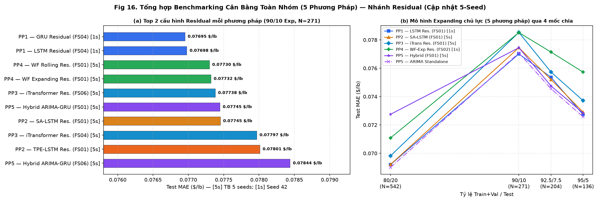
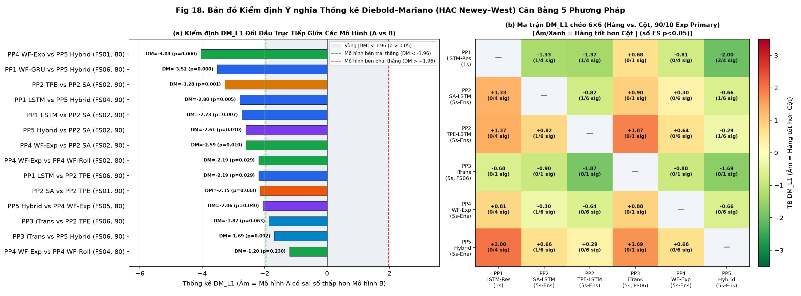

# Thống Kê Chỉ Số, Kiểm Định Diebold–Mariano & Phân Tích Ablation Toàn Nhóm (5 Phương Pháp: PP1–PP5)

> **Nguyên tắc tổng hợp & minh bạch giao thức:**  
> Tài liệu này tổng hợp kết quả thực nghiệm của **5 phương pháp dự báo giá đồng (`Copper Close`, đơn vị USD/lb)** trên cùng bộ dữ liệu, cùng 6 tập đặc trưng (`FS01`–`FS06`) và cùng các mốc chia thời gian (`80/20`, `90/10`, `92.5/7.5`, `95/5`). Mọi mô hình tham gia đều được đánh giá trực tiếp thông qua **chỉ số sai số tuyệt đối (`MAE`, `RMSE`, `DA`)**, **độ ổn định đa hạt giống (`5 seeds: 41–45`)**, **kiểm định thống kê Diebold–Mariano (`DM-HAC`) đôi một giữa các mô hình**, và **phân tích Ablation** — hoàn toàn giữ tính trung lập phương pháp và **không đưa ra khuyến nghị lựa chọn một mô hình duy nhất**.

---

## 1. Dữ Liệu Chung & Bối Cảnh Thực Nghiệm

| Thuộc tính | Giá trị xác minh |
| :--- | :--- |
| **Chuỗi mục tiêu** | Giá đóng cửa hợp đồng tương lai Đồng (`Close`, USD/lb) |
| **Kích thước & Giai đoạn** | **2.710 phiên giao dịch** (`13/01/2016 → 13/11/2026`) |
| **Tính toàn vẹn tệp dữ liệu** | Local CRLF SHA-256: `9580ede12d474c8f990556842d551dac176b3c16b2d6a4bffb7dc41dd54bf600` Kaggle LF SHA-256: `a761a9082de36ad8724597ff1518e24bbf1a61676bd3164676e7f4218d275d83` Sai lệch giá trị số tối đa giữa hai bản: **`0.00e+00`** |
| **4 mốc chia Train/Test** | `80/20` ($N_{\text{test}} = 542$, `07/10/2024 → 13/11/2026`) `90/10` ($N_{\text{test}} = 271$, `29/10/2025 → 13/11/2026`, mốc chính) `92.5/7.5` ($N_{\text{test}} = 204$) `95/5` ($N_{\text{test}} = 136$) |
| **6 tập đặc trưng (`FS01`–`FS06`)** | `FS01` (`Copper`); `FS02` (`Copper, WTI, Gold, Silver` — tập bài báo); `FS03` (`WTI, Gold, Silver` — ngoại sinh bài báo); `FS04` (`Copper, Aluminium, Tin, Silver, Gold`); `FS05` (`Aluminium, Tin, Silver, Gold`); `FS06` (`Copper, Aluminium, Tin, WTI`) |

### Quy ước 5 Phương Pháp (PP1–PP5)

| Mã | Nhóm phương pháp | Các kiến trúc & biến thể đại diện trong tổng hợp |
| :--- | :--- | :--- |
| **PP1** | Mạng hồi quy chuẩn & tuyến tính (`Non-SA & SA-LSTM`) | `LSTM Residual`, `GRU Residual`, `Ridge Residual` (4 tập FS: `FS01`, `FS02`, `FS04`, `FS06`); các nhánh `Direct` (`GRU/LSTM`, `Paper SA-LSTM`, `Reopt SA-LSTM`); mở rộng `WF 5-seed` trên `80/20 FS06` (`WF GRU-Res`, `WF LSTM-Res`) |
| **PP2** | Tối ưu siêu tham số (`HPO SA vs TPE`) | `SA-LSTM` và `TPE-LSTM` (cả hai nhánh `Residual` và `Direct`, đầy đủ 6 tập `FS01`–`FS06`, 5 seeds `41–45`) |
| **PP3** | Kiến trúc Transformer chuỗi thời gian (`iTransformer`) | `iTransformer Residual` và `iTransformer Direct` (6 tập `FS01`–`FS06`, 5 seeds `41–45`) |
| **PP4** | Học tăng tiến Walk-Forward (`Walk-Forward LSTM`) | `WF Expanding`, `WF Rolling`, và đối chứng `Static (Train+Val)` / `Static (Train-Only)` (6 tập `FS01`–`FS06`, 5 seeds cho `WF` và 1 seed cho `Static`) |
| **PP5** | Mô hình lai tuyến tính–phi tuyến (`Hybrid ARIMA-GRU`) | `Hybrid ARIMA-GRU` (6 tập `FS01`–`FS06`, 5 seeds `41–45`), đối chứng `ARIMA` thuần (`FS01`) và `GRU Direct` (6 tập FS, 5 seeds) |

---

## 2. Thống Kê Chỉ Số Hiệu Năng Across Giao Thức & Mốc Chia

> [!IMPORTANT]
> **Minh bạch giao thức đánh giá (Protocol Transparency):**  
> Các mô hình trong bảng tổng hợp không chạy chung một giao thức tái huấn luyện và số seed duy nhất. Do đó, mọi chỉ số đều gắn thẻ rõ ràng gồm: **`Holdout 1-seed (42)`**, **`Deterministic (1-run)`**, **`Holdout TB 5-seed (41–45)`**, **`WF TB 5-seed (41–45)`**, **`WF 1-seed (42)`**, và **`5s-Ens`** (trung bình dự báo 5 seed trước khi tính sai số). Khi so sánh chéo, cần đọc song song cả `MAE` điểm, độ lệch chuẩn `± std` giữa 5 seed, và giao thức huấn luyện tương ứng.

### 2.1 Bảng xếp hạng nhánh Residual — Mốc chính 90/10 (`Expanding`, $N_{\text{test}} = 271$)

Nguồn chi tiết: [group_ablation_6_feature_sets_all_members.csv](group_ablation_6_feature_sets_all_members.csv) (21 dòng tổng hợp = 10 dòng `Residual` + 11 dòng `Direct`).

| Hạng (Best FS) | Phương pháp & Mô hình | Giao thức | Best FS | Best MAE (`$/lb`) | RMSE tại Best FS | DA tại Best FS (`%`) | Mean MAE qua các FS (`± std`) | Số FS |
| :---: | :--- | :--- | :---: | :---: | :---: | :---: | :---: | :---: |
| 1 | **PP1:** `GRU Residual (Non-SA)` | `Holdout 1-seed (42)` | `FS04` | **0.07695** | 0.10081 | 52.77% | `0.07793 ± 0.00151` | 4 |
| 2 | **PP1:** `LSTM Residual (Non-SA)` | `Holdout 1-seed (42)` | `FS04` | **0.07698** | 0.10095 | 52.77% | `0.07701 ± 0.00002` | 4 |
| 3 | **PP4:** `WF Rolling Residual` | `WF TB 5-seed (41–45)` | `FS01` | **0.07730** `(± 0.00013)` | 0.10142 | 49.59% | `0.07798 ± 0.00048` | 6 |
| 4 | **PP1:** `Ridge Residual (Linear)` | `Deterministic (1-run)` | `FS01` | **0.07731** | 0.10119 | 47.60% | `0.07937 ± 0.00217` | 4 |
| 5 | **PP4:** `WF Expanding Residual` | `WF TB 5-seed (41–45)` | `FS01` | **0.07732** `(± 0.00018)` | 0.10140 | 49.96% | `0.07784 ± 0.00035` | 6 |
| 6 | **PP3:** `iTransformer Residual` | `Holdout TB 5-seed (41–45)` | `FS06` | **0.07738** `(± 0.00041)` | 0.10132 | 52.47% | `0.08178 ± 0.00647` | 6 |
| 7 | **PP2:** `SA-LSTM Residual` | `Holdout TB 5-seed (41–45)` | `FS01` | **0.07745** `(± 0.00061)` | 0.10116 | 48.86% | `0.08393 ± 0.01325` | 6 |
| 8 | **PP5:** `Hybrid ARIMA-GRU` | `Holdout TB 5-seed (41–45)` | `FS01` | **0.07745** `(± 0.00063)` | 0.10142 | 48.71% | `0.08048 ± 0.00219` | 6 |
| 9 | **PP4:** `Static (Train+Val) Residual` | `Holdout 1-seed (42)` | `FS04` | **0.07746** | 0.10070 | 48.33% | `0.07920 ± 0.00159` | 6 |
| 10 | **PP2:** `TPE-LSTM Residual` | `Holdout TB 5-seed (41–45)` | `FS01` | **0.07801** `(± 0.00082)` | 0.10148 | 47.23% | `0.08167 ± 0.00350` | 6 |

### 2.2 Nhánh Direct (Dự báo trực tiếp mức giá) — Mốc 90/10

Toàn bộ **11 mô hình thuộc nhánh `Direct`** trải rộng trên cả 5 phương pháp đều cho sai số `MAE` lớn hơn đáng kể so với nhánh `Residual` (~`0.185` đến `1.707 USD/lb` tùy cấu hình):

| Phương pháp & Mô hình Direct | Giao thức | `FS01` | `FS02` | `FS03` | `FS04` | `FS05` | `FS06` | Mean qua các FS |
| :--- | :--- | :---: | :---: | :---: | :---: | :---: | :---: | :---: |
| **PP4:** `WF Expanding Direct` | `WF 1-seed (42)` | **0.20265** | 0.23696 | 0.38606 | 0.33844 | 0.36182 | 0.21921 | **0.29086** |
| **PP1:** `GRU Direct (Non-SA)` | `Holdout 1-seed (42)` | 0.43711 | 0.24789 | — | **0.24082** | — | 0.24321 | **0.29226** |
| **PP4:** `WF Rolling Direct` | `WF 1-seed (42)` | **0.27394** | 0.28371 | 0.46075 | 0.34973 | 0.41410 | 0.27422 | **0.34274** |
| **PP5:** `GRU Direct` | `Holdout TB 5-seed (41–45)` | 0.33809 | **0.29023** | 0.49914 | 0.29322 | 0.56456 | 0.30653 | **0.38196** |
| **PP2:** `TPE-LSTM Direct` | `Holdout TB 5-seed (41–45)` | **0.19139** | 0.46929 | 0.62901 | 0.43094 | 0.49614 | 0.40812 | **0.43748** |
| **PP2:** `SA-LSTM Direct` | `Holdout TB 5-seed (41–45)` | **0.26750** | 0.38674 | 0.40847 | 0.82644 | 0.48140 | 0.35898 | **0.45492** |
| **PP1:** `Paper SA-LSTM Direct` | `Holdout 1-seed (42)` | — | 0.97807 | 0.54072 | 0.47093 | 0.46499 | **0.18463** | **0.52787** |
| **PP1:** `LSTM Direct (Non-SA)` | `Holdout 1-seed (42)` | 0.44672 | 1.16396 | — | **0.24741** | — | 0.32494 | **0.54576** |
| **PP1:** `Reopt SA-LSTM Direct` | `Holdout 1-seed (42)` | — | 0.87742 | 0.59561 | 0.51047 | 0.46660 | **0.35892** | **0.56180** |
| **PP4:** `Static (Train-Only) Direct` | `Holdout 1-seed (42)` | 0.49280 | 1.55159 | **0.31990** | 1.32269 | 0.56377 | 0.55846 | **0.80154** |
| **PP3:** `iTransformer Direct` | `Holdout TB 5-seed (41–45)` | 1.65695 | 1.27131 | 1.40987 | 1.66197 | 1.70735 | **1.07955** | **1.46450** |

### 2.3 Độ ổn định đa mốc chia (`80/20 → 90/10 → 92.5/7.5 → 95/5`)

Nguồn chi tiết: [group_cross_ratio_4_splits_all_members.csv](group_cross_ratio_4_splits_all_members.csv) (60 dòng qua 4 mốc chia, hoàn toàn không có baseline giả định).

| Mô hình (Feature Set & Giao thức) | `80/20` | `90/10` | `92.5/7.5` | `95/5` | Mean ± Std (4 splits) |
| :--- | :---: | :---: | :---: | :---: | :---: |
| **PP5:** `ARIMA` (`FS01`, Deterministic) | 0.06900 | 0.07708 | 0.07456 | 0.07258 | **0.07331 ± 0.00341** |
| **PP1:** `GRU Residual` (`FS02`, 1-seed) | **0.06878** | 0.07714 | 0.07521 | 0.07277 | **0.07348 ± 0.00361** |
| **PP1:** `LSTM Residual` (`FS01`, 1-seed) | 0.06920 | **0.07701** | 0.07536 | 0.07273 | **0.07358 ± 0.00341** |
| **PP2:** `SA-LSTM Residual` (`FS01`, TB 5-seed) | 0.06921 | 0.07745 | 0.07520 | 0.07291 | **0.07369 ± 0.00352** |
| **PP2:** `TPE-LSTM Residual` (`FS01`, TB 5-seed) | 0.06980 | 0.07801 | 0.07567 | 0.07335 | **0.07421 ± 0.00350** |
| **PP5:** `Hybrid ARIMA-GRU` (`FS01`, TB 5-seed) | 0.07275 | 0.07745 | **0.07475** | 0.07284 | **0.07445 ± 0.00220** |
| **PP3:** `iTransformer Residual` (`FS01`, TB 5-seed) | 0.06982 | 0.07853 | 0.07573 | 0.07372 | **0.07445 ± 0.00366** |
| **PP3:** `iTransformer Residual` (`FS06`, TB 5-seed) | 0.07254 | 0.07738 | 0.07600 | 0.07552 | **0.07536 ± 0.00204** |
| **PP4:** `Static (T+V) Residual` (`FS02`, 1-seed) | 0.07505 | 0.07812 | 0.07684 | **0.07213** | **0.07554 ± 0.00260** |
| **PP4:** `WF Expanding Residual` (`FS02`, 1-seed) | 0.07108 | 0.07852 | 0.07714 | 0.07573 | **0.07562 ± 0.00323** |
| **PP2:** `TPE-LSTM Residual` (`FS02`, TB 5-seed) | 0.08117 | 0.07880 | 0.07564 | 0.07494 | **0.07764 ± 0.00289** |
| **PP4:** `WF Rolling Residual` (`FS02`, 1-seed) | 0.07344 | 0.08026 | 0.08032 | 0.07865 | **0.07817 ± 0.00325** |
| **PP3:** `iTransformer Residual` (`FS02`, TB 5-seed) | 0.07067 | 0.09409 | 0.07777 | 0.07375 | **0.07907 ± 0.01043** |
| **PP2:** `SA-LSTM Residual` (`FS02`, TB 5-seed) | 0.09176 | 0.11095 | 0.08456 | 0.07858 | **0.09146 ± 0.01407** |

- **Xu hướng theo tỷ lệ chia:** Sai số `MAE` của nhánh `Residual` ở mốc `80/20` tập trung quanh `0.06878–0.07505` (trừ các cấu hình nhạy cảm trên `FS02`), tăng nhẹ lên vùng `0.07701–0.08026` ở mốc `90/10` do biến động thị trường giai đoạn cuối mẫu, trước khi hạ dần về `0.07213–0.07865` ở `95/5`. Riêng `PP5 Hybrid (FS01)` (`std = 0.00220`) và `PP3 iTransformer (FS06)` (`std = 0.00204`) có biên độ dao động giữa 4 mốc chia thấp nhất.

### 2.4 Tổng hợp 5-Seed (`41–45`) & Hiệu ứng Ensemble (`5s-Ens`) ở mốc 90/10 và 80/20

Nguồn chi tiết: [group_multiseed_5seeds_summary.csv](group_multiseed_5seeds_summary.csv) (74 dòng đa hạt giống thuộc các mô hình `Residual` trên cả 5 phương pháp).

- **Bổ sung PP1 Walk-Forward 5-seed trên `80/20 FS06`:**  
  `PP1 WF GRU-Res` đạt `MAE_mean = 0.06910 ± 0.00015`, `Ensemble_5seed_MAE = 0.06907` (`+0.044%`); `PP1 WF LSTM-Res` đạt `MAE_mean = 0.06918 ± 0.00017`, `Ensemble_5seed_MAE = 0.06913` (`+0.069%`). Cả hai có độ lệch chuẩn giữa 5 seed thuộc nhóm nhỏ nhất toàn bộ thí nghiệm.
- **Giá trị `Ensemble_5seed_MAE` thấp nhất theo từng FS ở mốc `90/10`:**
  - `FS01`: `PP4 WF-Rolling` (`0.07719`, gain `+0.138%`), kế cận là `PP4 WF-Expanding` (`0.07727`, `+0.063%`) và `PP2 SA-LSTM` (`0.07729`, `+0.213%`).
  - `FS02`: `PP2 TPE-LSTM` (`0.07717`, gain `+2.062%`).
  - `FS03`: `PP4 WF-Rolling` (`0.07702`, gain `+0.786%`), kế cận `PP2 SA-LSTM` (`0.07707`, `+2.323%`) và `PP4 WF-Expanding` (`0.07717`, `+0.937%`).
  - `FS04`: `PP4 WF-Expanding` (`0.07755`, gain `+0.780%`).
  - `FS05`: `PP2 SA-LSTM` (`0.07691`, gain `+1.354%`).
  - `FS06`: `PP3 iTransformer` (`0.07684`, gain `+0.703%`).
- **Tác động khử phương sai của `5s-Ens`:** Khi dự báo đơn lẻ trên `FS02` hoặc `FS03` xuất hiện một số seed nhiễu nặng (nhất là ở mô hình dùng HPO như `PP2`), trung bình cộng 5 seed làm giảm mạnh sai số tuyệt đối:
  - `PP2 SA-LSTM (FS02)` giảm từ `0.11095 → 0.08085` (**+27.125%**) ở `90/10`, và từ `0.09176 → 0.06992` (**+23.806%**) ở `80/20`.
  - `PP2 TPE-LSTM (FS03)` giảm từ `0.09862 → 0.07675` (**+22.175%**) ở `80/20`.
  - Ở `80/20`, `PP5 Hybrid ARIMA-GRU` cũng hưởng lợi rõ rệt từ `5s-Ens` trên `FS02` (`0.07837 → 0.06981`, **+10.917%**) và `FS03` (`0.08314 → 0.07413`, **+10.835%**), trong khi `PP4 WF` vốn đã có `std` nhỏ (`0.00006–0.00122`) nên biên độ gain tập trung quanh `+0.055%` đến `+1.321%`.

---

## 3. Kiểm Định Ý Nghĩa Thống Kê Diebold–Mariano (`DM-HAC`, `L1` / `MAE` Loss)

Nguồn chi tiết: [group_significance_dm_tests_complete.csv](group_significance_dm_tests_complete.csv) (**516 dòng kiểm định mô hình–với–mô hình, 0 giá trị khuyết thiếu / 0 nulls**). Toàn bộ 516 phép kiểm định đều sử dụng hiệu sai số tuyệt đối (`DM_L1`) với hiệu chỉnh tự tương quan Newey–West HAC, hoàn toàn không chứa bất kỳ phép so sánh baseline đơn giản nào.

### 3.1 So sánh chéo giữa 5 phương pháp ở mốc chính `90/10` (`N = 271`)

- **Giữa nhánh Holdout 1-seed (`PP1`) và Walk-Forward 5-seed (`PP4`):**  
  `PP1 LSTM Residual (Holdout 1-seed)` **hòa thống kê (`p >= 0.05`)** với `PP4 WF Expanding` trên `4/4` tập FS chung (`mean DM = -0.81`) và với `PP4 WF Rolling` trên `4/4` tập FS chung (`mean DM = -1.10`), đồng thời hòa với `PP3 iTransformer` trên `FS06` (`1/1`, `p = 0.4996`).  
  Tuy nhiên, `PP1 LSTM Residual` vượt có ý nghĩa thống kê trước `PP5 Hybrid` trên `2/4` tập (`FS04: p = 0.0055`; `FS06: p = 0.0346`), trước `PP2 SA-LSTM` trên `FS02` (`p = 0.0067`), và trước `PP2 TPE-LSTM` trên `FS06` (`p = 0.0293`).
- **Giữa `PP4 WF Expanding` và các nhánh 5-seed (`PP2`, `PP5`):**  
  `PP4 WF Expanding` vượt có ý nghĩa `PP2 SA-LSTM` trên `FS02` (`p = 0.0100`, nơi `SA-LSTM` bị nhiễu seed) và hòa trên `5/6` tập còn lại; đồng thời hòa thống kê `6/6` tập FS khi đặt cạnh `PP2 TPE-LSTM` và `PP5 Hybrid ARIMA-GRU (5s-Ens)` trên mốc `90/10`.

### 3.2 So sánh nội bộ `PP2`: `SA-LSTM` vs `TPE-LSTM` trên cùng 180 cặp (Per-seed) & 36 cặp (Ensemble)

Trên toàn bộ ma trận thực nghiệm giống hệt nhau (4 tỷ lệ chia × 6 tập FS × 5 seeds + 36 cặp `5s-Ens`):
- **Cấp độ từng seed (180 cặp):** **`88/180 (48.9%)` hòa thống kê**, **`54/180 (30.0%)` `SA-LSTM` thắng có ý nghĩa**, và **`38/180 (21.1%)` `TPE-LSTM` thắng có ý nghĩa**.
- **Cấp độ `5s-Ens` (36 cặp):** **`21/36 (58.3%)` hòa thống kê**, `10/36` nghiêng về `SA-LSTM`, `5/36` nghiêng về `TPE-LSTM`.
- **Riêng mốc `90/10 Expanding`:** `SA-LSTM` thắng có ý nghĩa ở `FS01` (`p = 0.0326`), `TPE-LSTM` thắng có ý nghĩa ở `FS02` (`p = 0.0012`), và `4/6` tập FS còn lại hòa thống kê. Hai thuật toán HPO mang lại hiệu năng tương đương phần lớn trường hợp; sự khác biệt nằm ở mức nhạy cảm của từng cặp `(HPO, Feature Set)`.

### 3.3 So sánh chéo ở mốc `80/20` (`N = 542`, cỡ mẫu gấp đôi giúp tăng lực kiểm định)

- **Trên `FS06` (nơi cả 5 phương pháp đều có chạy `5-seed`):**  
  `PP1 WF GRU-Res` thắng có ý nghĩa trước `PP4 WF Rolling` (`p = 0.0440`) và `PP5 Hybrid ARIMA-GRU` (`p = 0.0005`), đồng thời hòa thống kê với `PP1 WF LSTM-Res`, `PP2 SA-LSTM`, `PP2 TPE-LSTM`, `PP3 iTransformer`, và `PP4 WF Expanding`.
- **So sánh đầy đủ `6` tập FS trên `80/20`:**  
  `PP4 WF Expanding` vượt có ý nghĩa trước `PP2 TPE-LSTM` trên `3/6` tập (`FS02`, `FS03`, `FS04` với `p <= 0.0003`), trước `PP5 Hybrid ARIMA-GRU` trên `4/6` tập (`FS01`, `FS03`, `FS04`, `FS06`), và trước `PP4 WF Rolling` trên `FS02` (`p = 0.0288`).  
  Trong nội bộ `PP2` ở mốc `80/20`, `SA-LSTM` thắng có ý nghĩa trước `TPE-LSTM` trên `4/6` tập (`mean DM = -3.86`; `FS01`–`FS04` với `p <= 0.0035`) và vượt trước `PP5 Hybrid` trên `3/6` tập.

### 3.4 Kiểm định `Residual` vs `Direct` (Độ chênh lệch mục tiêu dự báo)

Khi đối chiếu trực tiếp giữa dự báo phần dư giá (`Residual`) và dự báo trực tiếp mức giá (`Direct`) ở mốc `90/10` qua toàn bộ **33 cặp** thuộc tất cả 5 phương pháp (`PP1`–`PP5`):  
**`33/33 (100%)` cặp đều đạt ý nghĩa thống kê tuyệt đối với `p = 0.0000` (`DM_L1 ∈ [-19.61, -6.26]`)**. Điều này khẳng định việc dùng mục tiêu `Residual` (học biến động sai phân $\Delta y_t$) là nhân tố quyết định nhất giúp kiểm soát hiện tượng trễ/lệch phân phối trên chuỗi giá đồng không dừng.

### 3.5 Kiểm Định Phi Tham Số Wilcoxon Signed-Rank (Kèm Hiệu Chỉnh Holm–Bonferroni)

Nguồn chi tiết: [group_wilcoxon_signed_rank_tests.csv](group_wilcoxon_signed_rank_tests.csv) (**109 phép kiểm định theo 5 họ thí nghiệm, 0 nulls**), thực hiện trên các cặp `(FS × Seed)` từ dữ liệu từng hạt giống gốc (`41–45`), kèm hiệu chỉnh đa kiểm định **Holm–Bonferroni (`p_holm`)** và hệ số ảnh hưởng rank-biserial **$r_{\text{rb}} = (W^+ - W^-)/(W^+ + W^-)$** (giá trị âm cho thấy vế `A` có `MAE` thấp hơn vế `B`). Khác với `DM-HAC` đo trên chuỗi sai số ngày ở từng cấu hình đơn lẻ, Wilcoxon kiểm định **tính nhất quán trên toàn ma trận thực nghiệm** mà không giả định phân phối chuẩn.

| Họ kiểm định & Phạm vi | Cặp đối chiếu (`A vs B`) | Số cặp `n` | `W` | `p_value` | `p_holm` | `r_rb` | Kết luận (`α = 5%` sau Holm) |
| :--- | :--- | :---: | :---: | :---: | :---: | :---: | :--- |
| **Mục tiêu (`90/10`, 5 PP)** | `Residual` vs `Direct` (matched FS) | 50 | 0.0 | 0.00000 | **0.00000** | `-1.000` | **`Residual` thấp hơn tuyệt đối** (`0.07994` vs `0.56792`) |
| **Mục tiêu (`90/10`, 4 PP 5s)** | `Residual` vs `Direct` (per-seed pooled) | 120 | 0.0 | 0.00000 | **0.00000** | `-1.000` | **`Residual` thấp hơn tuyệt đối** (`0.08197` vs `0.68472`) |
| **Chéo `90/10` (6 mô hình)** | `PP4 WF-Exp` vs `PP5 Hybrid` | 30 | 89.0 | 0.00237 | **0.03551** | `-0.617` | **`PP4 WF-Exp` thấp hơn**; `14/15` cặp còn lại **Hòa** (`p_h >= 0.070`) |
| **Chéo gộp `80/20+90/10`** | `PP4 WF-Exp` vs `PP2 TPE-LSTM` | 60 | 402.0 | 0.00016 | **0.00175** | `-0.561` | **`PP4 WF-Exp` thấp hơn** (`0.07388` vs `0.08096`) |
| **Chéo gộp `80/20+90/10`** | `PP3 iTrans` vs `PP4 WF-Exp` | 60 | 915.0 | 1.00000 | **1.00000** | `0.000` | **Hòa thống kê hoàn toàn** |
| **Chéo gộp `80/20+90/10`** | `PP3 iTrans` vs `PP5 Hybrid` | 60 | 325.0 | 0.00001 | **0.00018** | `-0.645` | **`PP3 iTrans` thấp hơn** (`0.07612` vs `0.07812`) |
| **Ablation bộ biến (`n=60`)** | `FS01` vs `FS02` / `FS03` / `FS04` / `FS05` | 60 | 236–539 | `<=0.0056` | **`<=0.0226`** | `-0.742 → -0.411` | **`FS01` thấp hơn có ý nghĩa**; **`FS01` vs `FS06` Hòa (`p_h=0.110`)** |
| **Bỏ Copper khỏi `X` (`n=60`)** | `FS02 vs FS03` / `FS04 vs FS05` | 60 | 837 / 639 | 0.566 / 0.042 | **0.566 / 0.110** | `+0.085 / +0.302` | **Hòa sau Holm** (bỏ Copper không làm suy giảm đồng loạt) |
| **Cửa sổ (`90/10`, 4 PP)** | `Expanding` vs `Recency` / `Rolling 756` | 120 | 2423.5 / 2123.5 | 0.0024 / 0.0001 | **0.0032 / 0.0002** | `-0.321 / -0.415` | **`Expanding` thấp hơn có ý nghĩa** trên mẫu gộp |
| **WF (`PP4` gộp `80/20+90/10`)** | `WF Expanding` vs `WF Rolling (W=756)` | 60 | 391.0 | 0.00011 | **0.00011** | `-0.573` | **Hòa ở `90/10` (`p_h=0.404`)**, **`WF-Exp` thắng ở `80/20` (`p_h<0.001`)** |
| **HPO `PP2` (`Residual`)** | `PP2 SA-LSTM` vs `PP2 TPE-LSTM` | 180 | 6411.0 | 0.01325 | **0.01325** | `-0.213` | **`SA-LSTM` nhỉnh hơn nhẹ trên toàn lưới**; từng mốc `90/10` & `80/20` **Hòa** |

---

## 4. Phân Tích Ablation Toàn Diện

### 4.1 Ablation theo 6 tập đặc trưng (`FS01` → `FS06`) trên mốc `90/10`

| Phương pháp & Mô hình | `FS01` | `FS02` | `FS03` | `FS04` | `FS05` | `FS06` | Biên độ dao động (`Max - Min`) |
| :--- | :---: | :---: | :---: | :---: | :---: | :---: | :---: |
| **PP1:** `LSTM Residual (1s)` | 0.07701 | 0.07701 | — | **0.07698** | — | 0.07704 | `0.00006` |
| **PP1:** `GRU Residual (1s)` | 0.08018 | 0.07714 | — | **0.07695** | — | 0.07746 | `0.00323` |
| **PP1:** `Ridge Residual (1-run)` | **0.07731** | 0.08071 | — | 0.08171 | — | 0.07774 | `0.00440` |
| **PP2:** `SA-LSTM Residual (5s)` | **0.07745** | 0.11095 | 0.07890 | 0.07960 | 0.07797 | 0.07873 | `0.03350` |
| **PP2:** `TPE-LSTM Residual (5s)` | **0.07801** | 0.07880 | 0.08547 | 0.08326 | 0.08556 | 0.07891 | `0.00755` |
| **PP3:** `iTransformer Residual (5s)` | 0.07853 | 0.09409 | 0.08388 | 0.07797 | 0.07883 | **0.07738** | `0.01671` |
| **PP4:** `WF Expanding Residual (5s)` | **0.07732** | 0.07828 | 0.07790 | 0.07816 | 0.07762 | 0.07778 | `0.00096` |
| **PP4:** `WF Rolling Residual (5s)` | **0.07730** | 0.07864 | 0.07763 | 0.07833 | 0.07798 | 0.07802 | `0.00134` |
| **PP4:** `Static (Train+Val) Res (1s)` | 0.07782 | 0.07812 | 0.07998 | **0.07746** | 0.08062 | 0.08120 | `0.00374` |
| **PP5:** `Hybrid ARIMA-GRU (5s)` | **0.07745** | 0.08110 | 0.08334 | 0.08185 | 0.08071 | 0.07844 | `0.00589` |

- **Nhận xét Ablation `FS01`–`FS06`:**
  1. **Tập nền gọn (`FS01`) chiếm ưu thế ở mô hình tuần tự & lai:** Trong 10 dòng `Residual`, có **6 mô hình** (`PP1 Ridge`, `PP2 SA-LSTM`, `PP2 TPE-LSTM`, `PP4 WF Expanding`, `PP4 WF Rolling`, `PP5 Hybrid ARIMA-GRU`) đạt MAE tốt nhất ngay tại **`FS01`**. Bổ sung nhiều biến ngoại sinh đôi khi làm tăng phương sai tối ưu ở một số seed (đặc biệt trên `FS02` với `PP2 SA-LSTM = 0.11095` và `PP3 iTransformer = 0.09409`).
  2. **`FS04` và `FS06` đạt hiệu quả tốt khi kiểm soát được nhiễu:** Nhóm Holdout 1-seed (`PP1 LSTM/GRU`, `PP4 Static`) đạt cực tiểu nhẹ ở `FS04`, trong khi kiến trúc chú ý theo biến (`PP3 iTransformer`) đạt `MAE` tốt nhất của mình ở **`FS06` (`0.07738 ± 0.00041`)** — chứng tỏ cơ chế attention đa biến khai thác tốt toàn bộ đặc trưng khi gom đủ 6 nhóm biến.
  3. **Walk-Forward (`PP4`) triệt tiêu độ nhạy đặc trưng:** Biên độ dao động giữa tập tốt nhất và kém nhất của `PP4 WF Expanding` chỉ là **`0.00096`** (`std` giữa 6 FS = `0.00035`) và `PP4 WF Rolling` là **`0.00134`** (`std = 0.00048`).

### 4.2 Ablation theo Cửa sổ Huấn luyện (`Expanding` vs `Recency` vs `Rolling 756` trên 4 phương pháp, `90/10`)

Nguồn chi tiết: [group_ablation_multidim_summary.csv](group_ablation_multidim_summary.csv) (**40 dòng tổng hợp 3 chiều Ablation**).

| Phương pháp (`5 seeds × 6 FS`, `90/10`) | `Expanding` (Mean ± Std) | `Recency-Weighted` (Δ vs Exp) | `Rolling 756` (Δ vs Exp) | Ý nghĩa Wilcoxon (`p_holm`) |
| :--- | :---: | :---: | :---: | :--- |
| **PP2:** `SA-LSTM Residual` | `0.08393 ± 0.01922` | `0.08531` (`+1.63%`) | `0.08481` (`+1.04%`) | Cả 3 cửa sổ **Hòa** sau Holm (`p_h >= 0.115`) |
| **PP2:** `TPE-LSTM Residual` | `0.08167 ± 0.00690` | `0.08438` (`+3.32%`) | `0.08375` (`+2.55%`) | `Expanding` vượt `Recency` (`p_h = 0.0040`) |
| **PP3:** `iTransformer Residual` | `0.08178 ± 0.01521` | **`0.07839 ± 0.00259`** (`-4.14%`) | `0.08446` (`+3.28%`) | `Recency` giảm mạnh `std`, Wilcoxon **Hòa** (`p_h >= 0.104`) |
| **PP5:** `Hybrid ARIMA-GRU` | `0.08048 ± 0.00443` | `0.08184` (`+1.69%`) | `0.10209` (`+26.85%`, `FS03=0.15510`) | `Expanding` & `Recency` vượt `Rolling 756` (`p_h <= 0.00022`) |

### 4.3 Ablation Chính sách Tái huấn luyện Walk-Forward (`PP4`, đối chứng `FS02 Direct`)

- **Độ dài cửa sổ trượt (`S = 40`, `cold_start`):** `W = 756` (`MAE = 0.28371`, `44.9s`) tốt hơn `W = 252` (`0.29233`, `35.8s`) và `W = 504` (`0.29514`, `41.4s`).
- **Chu kỳ tái huấn luyện (`Retrain Stride S`):** Với `WF Expanding`, cập nhật dày `S = 10` hạ `MAE` xuống `0.22756` nhưng tốn **`364.2s` (`28` lần retrain)**, trong khi `S = 40` cân bằng ở `0.23696` (`90.8s`, `7` lần retrain); ngược lại chu kỳ thưa `S = 60` làm sai số tăng vọt (`0.32841` Expanding, `0.36364` Rolling).
- **Cập nhật trọng số (`cold_start` vs `warm_start`, `W=756, S=40`):** `cold_start` (`0.28371`, `44.9s`) ổn định hơn rõ rệt so với `warm_start` (`0.37394`, `+31.8%`, `25.8s`) do tránh mang theo cực tiểu cục bộ của chu kỳ cũ sang chế độ giá mới.

---

## 5. Tổng Kết So Sánh Trung Lập 5 Phương Pháp (`SWOT` Kỹ Thuật)

| Phương pháp | Điểm mạnh quan sát từ thực nghiệm | Hạn chế & Rủi ro kỹ thuật | Mức độ phủ giao thức hiện tại |
| :--- | :--- | :--- | :--- |
| **PP1** (`Non-SA & SA-LSTM`, `Ridge`, `WF V23`) | Cho các điểm `MAE` rất thấp ở `90/10` (`GRU Res 0.07695`, `LSTM Res 0.07698`), có đối chứng tuyến tính `Ridge (0.07731)` rõ ràng và `WF 5-seed` siêu ổn định ở `80/20 FS06` (`0.06910 ± 0.00015`). | Phần `FS01/02/04/06` chính tại `90/10` chạy `Holdout 1-seed (42)` (chưa phủ đủ `FS03`, `FS05` và chưa chạy `5-seed` trên cả 6 FS ở `90/10`). | Holdout `1-seed` (4 FS, 4 splits) + `WF 5-seed` (`80/20 FS06`). |
| **PP2** (`HPO SA vs TPE`) | Phủ đủ toàn bộ lưới thực nghiệm (`6 FS × 5 seeds × 4 splits` ở cả `Residual` và `Direct`), làm rõ hiệu ứng cải thiện phương sai của `5s-Ens` (giảm tới `+27.125%` ở `SA FS02`). | Dễ xuất hiện một vài seed kém trên `FS02/FS03` khiến `MAE_mean` tăng vọt trước khi lấy ensemble (`SA FS02: 0.11095 ± 0.03938`); giao thức là `Holdout` tĩnh thay vì `WF`. | Đầy đủ nhất ở góc độ đa seed & HPO (`Holdout 5-seed`). |
| **PP3** (`iTransformer`) | Là kiến trúc duy nhất đạt cực tiểu tốt nhất ở tập đầy đủ `FS06` (`0.07738 ± 0.00041`; `5s-Ens = 0.07684`) và ổn định bậc nhất qua 4 mốc chia khi dùng `FS06` (`0.07536 ± 0.00204`). | Nhạy cảm mạnh nếu đưa sang nhánh `Direct` (`Mean MAE = 1.46450`), và từng seed trên `FS02` ở `90/10` có thể lệch pha (`0.09409 ± 0.03694`); chạy trên `Holdout`. | `Holdout 5-seed` đủ 6 FS và 4 splits (`FS01`, `FS02`, `FS06`). |
| **PP4** (`Walk-Forward LSTM`) | Mô phỏng sát thực tế vận hành (`re-fit` theo thời gian), đạt **biên độ ổn định giữa 6 tập đặc trưng tốt nhất** (`MeanFS 0.07784 ± 0.00035`) và `std` giữa 5 seed thấp (`0.00013–0.00122`). | Chưa chạy `WF 5-seed` trên tất cả 4 mốc chia (`80/20` và `90/10` có `5-seed` 6 FS; `92.5/7.5` và `95/5` dừng ở `1-seed FS02`); chi phí tái huấn luyện `WF` cao hơn `Holdout`. | `WF 5-seed` 6 FS ở `80/20` & `90/10`; `WF 1-seed` ở 4 splits. |
| **PP5** (`Hybrid ARIMA-GRU`) | Kết hợp thành phần tuyến tính (`ARIMA`) và phi tuyến (`GRU`); có đối chứng cửa sổ (`Expanding` vs `Recency` vs `Rolling 756`); độ biến động giữa 4 mốc chia ở `FS01` rất thấp (`0.07445 ± 0.00220`). | Tương đối nhạy ở `Rolling 756` (`FS03 = 0.15510`) và ở mốc `80/20` với các tập nhiều biến (`FS03 MAE_mean = 0.08314`) khi chưa lấy `5s-Ens`; chạy trên `Holdout`. | `Holdout 5-seed` đủ 6 FS (`80/20`, `90/10`) + 4 splits (`FS01`). |

---

## 6. Danh Mục Tệp Tổng Hợp Trong Thư Mục

| Tệp | Vai trò & Quy mô xác minh |
| :--- | :--- |
| [THONG_KE_CHISO_SIGNIFICANCE_ABLATION.md](THONG_KE_CHISO_SIGNIFICANCE_ABLATION.md) | Báo cáo phân tích tổng hợp chính (tài liệu này). |
| [group_ablation_6_feature_sets_all_members.csv](group_ablation_6_feature_sets_all_members.csv) | Bảng `Ablation 6 FS` tại mốc `90/10` (`21 dòng × 32 cột`: `10 Residual` + `11 Direct`). |
| [group_cross_ratio_4_splits_all_members.csv](group_cross_ratio_4_splits_all_members.csv) | Bảng hiệu năng qua `4` mốc chia `80/20`, `90/10`, `92.5/7.5`, `95/5` (`60 dòng × 10 cột`). |
| [group_multiseed_5seeds_summary.csv](group_multiseed_5seeds_summary.csv) | Bảng tổng hợp `5-seed (41–45)` và hiệu ứng `Ensemble 5s-Ens` (`74 dòng × 11 cột`). |
| [group_significance_dm_tests_complete.csv](group_significance_dm_tests_complete.csv) | Toàn bộ phép kiểm định `Diebold–Mariano (DM-HAC)` mô hình–với–mô hình (`516 dòng × 12 cột`, `0 nulls`). |
| [group_wilcoxon_signed_rank_tests.csv](group_wilcoxon_signed_rank_tests.csv) | Kiểm định phi tham số `Wilcoxon Signed-Rank` kèm hiệu chỉnh `Holm–Bonferroni` & hiệu ứng `r_rb` (`109 dòng × 21 cột`, `0 nulls`). |
| [group_ablation_multidim_summary.csv](group_ablation_multidim_summary.csv) | Bảng tổng hợp `Ablation 3 chiều` (Mục tiêu, 6 Bộ biến, Cửa sổ & Chính sách WF, `40 dòng × 10 cột`). |
| [fig16_group_benchmark_all_5_members.png](fig16_group_benchmark_all_5_members.png) | Biểu đồ xếp hạng Top-2 nhánh `Residual` theo từng phương pháp (`90/10`) và đường cong qua 4 mốc chia. |
| [fig17_group_ablation_6_feature_sets.png](fig17_group_ablation_6_feature_sets.png) | Heatmap `Residual MAE` qua `FS01`–`FS06` và đối chiếu thang log nhánh `Direct` của cả 5 phương pháp. |
| [fig18_group_dm_significance_and_pros_cons.png](fig18_group_dm_significance_and_pros_cons.png) | Biểu đồ cột `DM_L1` chọn lọc & ma trận `DM_L1` `6×6` chéo giữa các đại diện phương pháp. |
| [fig19_group_wilcoxon_and_ablation.png](fig19_group_wilcoxon_and_ablation.png) | Ma trận kiểm định `Wilcoxon` chéo `6×6` (`n=60`) và thanh hiệu ứng `r_rb` qua các chiều Ablation. |
