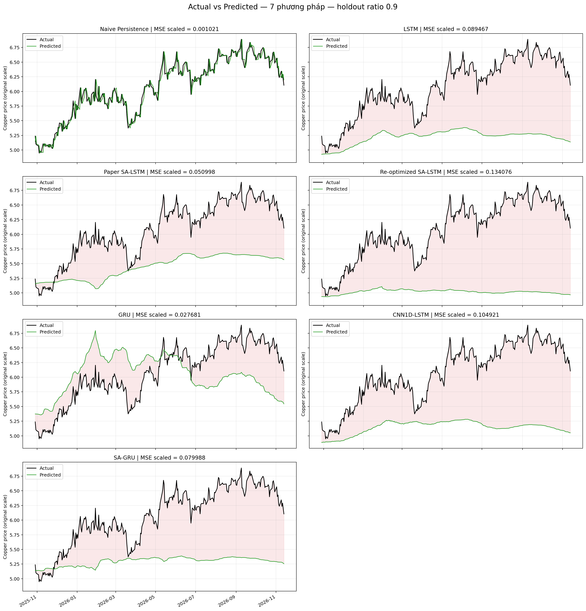
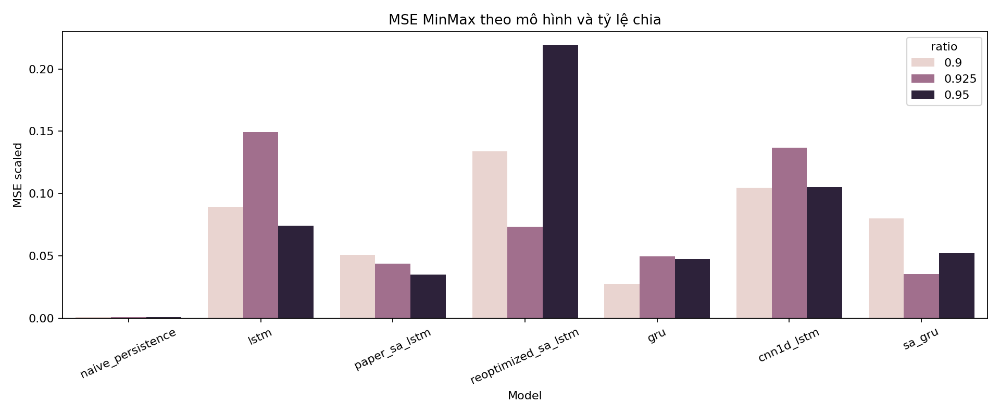

# ĐÁNH GIÁ THỰC NGHIỆM BẢY MÔ HÌNH DỰ ĐOÁN GIÁ ĐỒNG

## Tóm tắt

Báo cáo đánh giá bảy phương pháp dự đoán chuỗi giá đồng trên 2.710 quan sát từ 13/01/2016 đến 13/11/2026. Các mô hình gồm naive persistence, LSTM, SA-LSTM với siêu tham số tham khảo từ bài báo, SA-LSTM tối ưu lại, GRU, CNN1D-LSTM và SA-GRU. Thí nghiệm dùng ba tỷ lệ chia theo thời gian: 90/10, 92,5/7,5 và 95/5.

Naive persistence có MSE nhỏ nhất trên test trong cả ba tỷ lệ. Trong các mạng học sâu, GRU tốt nhất ở 90/10, SA-GRU ở 92,5/7,5 và SA-LSTM tham khảo ở 95/5. Không có một mạng dẫn đầu nhất quán. Test MSE của phần lớn mạng tăng mạnh so với validation; giai đoạn test cũng có giá cao hơn đáng kể miền huấn luyện, phù hợp với vấn đề dịch chuyển phân phối. MSE được tính trên dữ liệu MinMax, không phải USD hay phần trăm.

**Từ khóa:** giá đồng, dự báo chuỗi thời gian, LSTM, GRU, simulated annealing, MSE.

## I. Giới thiệu

Dự báo giá hàng hóa chịu ảnh hưởng của xu thế, biến động và thay đổi chế độ thị trường. LSTM và GRU có khả năng học phụ thuộc theo thời gian; simulated annealing (SA) có thể tìm siêu tham số. Tuy nhiên, kiến trúc phức tạp hơn không mặc nhiên tốt hơn một dự báo tham chiếu đơn giản.

Mục tiêu là so sánh bảy phương pháp trên cùng dữ liệu theo thời gian, xem xét sai số và chi phí tìm kiếm/tập khớp, đồng thời đối chiếu mức độ tương đồng với nghiên cứu SA-LSTM của Chen và cộng sự (2023). Báo cáo phân biệt kết quả quan sát được với đề xuất cho nghiên cứu tiếp theo.

## II. Nghiên cứu liên quan và mức độ tái lập

Tài liệu tham khảo chính là bài *Copper price prediction using LSTM recurrent neural network integrated simulated annealing algorithm* của Chen và cộng sự (2023) ([PDF](../../../doc/Copper%20price%20prediction%20using%20LSTM%20recurrent.pdf)). Bài báo mô tả dữ liệu 4.870 quan sát trong giai đoạn 1990–2009; dùng Spearman chọn WTI, vàng và bạc, MinMax và ước lượng giá đóng cửa đồng cùng ngày. Bài khảo sát tỷ lệ train 90%, 92,5%, 95%; SA-LSTM kích thước 39/111, learning rate 5×10⁻⁵, batch 64, tối đa 100 epoch và dropout. Thiết lập SA được mô tả là T0=1, Tf=0,1, hệ số làm nguội 0,95 (một chỗ khác ghi 0,97), 650 kịch bản và 50 vòng lặp mỗi quá trình. Bài còn có điểm chưa đặc tả nhất quán về optimizer, lớp dense và cửa sổ đầu vào.

Thí nghiệm này **không phải tái lập chính xác** bài báo: dữ liệu, giai đoạn, đặc trưng, cửa sổ, kiến trúc và quy trình tìm kiếm khác nhau. “Paper SA-LSTM” chỉ dùng tham số tham khảo 39/111 và learning rate 5×10⁻⁵ trong notebook; không chạy lại tìm kiếm SA 650 kịch bản như bài báo. Các MSE 0,00195 / 0,0019 / 0,00097 được báo trong nghiên cứu không thể so sánh trực tiếp do khác dữ liệu và thiết lập.

| Khía cạnh | Nghiên cứu Chen và cộng sự | Thí nghiệm trong notebook |
|---|---|---|
| Dữ liệu | 4.870 mẫu, 1990–2009 | 2.710 mẫu, 13/01/2016–13/11/2026 |
| Đầu vào | Spearman chọn WTI, vàng, bạc | Aluminium, Tin, Silver, Gold; chọn trước trên toàn chuỗi, không chọn lại theo train-only |
| Căn thời điểm | Ước lượng giá đóng cửa cùng ngày | Cửa sổ kết thúc tại t, dự đoán Copper(t), tức căn cùng ngày |
| Chia/chuẩn hóa | Tỷ lệ 90%, 92,5%, 95%; MinMax | Chia tuần tự; MinMax scaler chỉ fit trên train; validation 10% phần trước test |
| LSTM | Kích thước 39/111, lr 5×10⁻⁵, batch 64, dropout | Paper SA-LSTM dùng kích thước 39/111 và lr tham khảo; các chi tiết khác theo notebook, không khẳng định trùng kiến trúc/optimizer bài báo |
| Huấn luyện | Tối đa 100 epoch theo mô tả | Tối đa 100 epoch, early stopping patience 15; tìm ứng viên tối đa 20 epoch, patience 4 |
| SA | 650 kịch bản, 50 vòng lặp mỗi quá trình theo mô tả | 100 lượt đánh giá, 15 đề xuất/nhiệt độ; chỉ mô hình reoptimized SA-LSTM và SA-GRU tìm kiếm |
| Chỉ số | Bài báo báo MSE riêng trên bộ dữ liệu của họ | MSE trên nhãn đã MinMax; không so sánh trực tiếp giữa hai nghiên cứu |

Bài tham khảo dự đoán biến động giá vàng chỉ định hướng bố cục học thuật ([PDF](../../../doc/%5BTham%20Kh%E1%BA%A3o%5DD%E1%BB%B1%20%C4%90o%C3%A1n%20Bi%E1%BA%BFn%20%C4%90%E1%BB%99ng%20Gi%C3%A1%20V%C3%A0ng%20IS403.P23.pdf)). Báo cáo không suy diễn thông tin tác giả hay kết quả chưa có bằng chứng trong notebook, tệp kết quả và tài liệu.

## III. Phương pháp

### 3.1. Dữ liệu và đầu vào

Notebook có 2.710 quan sát từ 13/01/2016 đến 13/11/2026. Biến mục tiêu Copper, đặc trưng Aluminium, Tin, Silver, Gold; cửa sổ 22 phiên. Mẫu được căn chỉnh dùng hàng t−21 đến t để dự đoán Copper(t), tức ước lượng cùng ngày chứ chưa phải dự báo trước một ngày. Với dự báo ngày kế tiếp, cần chỉ dùng thông tin đến t−1.

Spearman tính trên toàn chuỗi cho Aluminium 0,947; Tin 0,929; Silver 0,855; Gold 0,852. Đây là nguồn gốc của bốn biến hiện dùng, nhưng chọn biến toàn chuỗi có nguy cơ rò rỉ thông tin tương lai. Notebook tính lại tương quan trên train 90% (Aluminium 0,928; Tin 0,883; Nickel 0,821; WTI 0,771; Gold 0,743; Silver 0,742) nhưng không chọn lại đầu vào theo kết quả train-only. Do đó bộ biến hiện tại không phải lựa chọn độc lập theo từng fold.

### 3.2. Chia tập và mô hình

Dữ liệu chia tuần tự theo thời gian. MinMax scaler chỉ khớp trên train, rồi áp dụng cho validation/test; vì vậy giá chuẩn hóa ngoài [0,1] là hợp lệ nếu test vượt miền train. Validation chiếm 10% dữ liệu trước test.

| Tỷ lệ train/test | Train | Validation | Test | Thời gian test |
|---|---:|---:|---:|---|
| 90/10 | 2.173 | 244 | 271 | 29/10/2025–13/11/2026 |
| 92,5/7,5 | 2.233 | 251 | 204 | 30/01/2026–13/11/2026 |
| 95/5 | 2.294 | 258 | 136 | 07/05/2026–13/11/2026 |

Bảy phương pháp: (1) naive persistence, lấy giá gần nhất làm dự báo; (2) LSTM cơ sở; (3) Paper SA-LSTM với tham số tham khảo; (4) Reoptimized SA-LSTM tìm tham số bằng SA; (5) GRU; (6) CNN1D-LSTM; (7) SA-GRU.

Kiến trúc và nhận xét theo test MSE:

| Phương pháp | Cấu hình chính | Nhận xét theo ba phân chia |
|---|---|---|
| Naive persistence | Baseline, giữ giá Copper gần nhất | MSE thấp nhất chung ở cả ba tỷ lệ |
| LSTM | LSTM 64/32 | MSE 0,089467 / 0,149226 / 0,074180; không vượt baseline |
| Paper SA-LSTM | LSTM 39/111, lr 5×10⁻⁵ | MSE 0,050998 / 0,043773 / 0,034994; mạng tốt nhất tại 95/5 |
| Reoptimized SA-LSTM | LSTM 12/73, lr ≈0,00386847 | MSE 0,134076 / 0,073649 / 0,219060; chỉ tốt hơn LSTM cơ sở ở 92,5/7,5 |
| GRU | GRU 64/32 | MSE 0,027681 / 0,049899 / 0,047480; mạng tốt nhất tại 90/10 |
| CNN1D-LSTM | Conv1D 32 filters + LSTM 48/24 | MSE 0,104921 / 0,136639 / 0,105303; kém baseline và các mạng đứng đầu |
| SA-GRU | GRU 8/17, lr ≈9,9664×10⁻⁵ | MSE 0,079988 / 0,035554 / 0,052073; mạng tốt nhất tại 92,5/7,5 |

Các mạng dùng TensorFlow/Keras, Adam, MSE, batch 64, seed 42, `shuffle=False`. Huấn luyện cuối tối đa 100 epoch với early stopping patience 15; đánh giá ứng viên SA tối đa 20 epoch, patience 4. Tìm kiếm 100 đánh giá ứng viên trên phân chia train/validation 90%, sau đó tái sử dụng tham số ở hai tỷ lệ còn lại.

### 3.3. Simulated annealing và chỉ số

SA dùng T0=1, Tf=0,1, hệ số nguội 0,95 và 15 đề xuất mỗi mức nhiệt. Sau 100 lượt đánh giá, nhiệt độ cuối khoảng 0,73509, cao hơn Tf; tỷ lệ chấp nhận trên toàn bộ lượt đánh giá là 92% cho cả hai lần tìm. Hàm chấp nhận trong mã dùng exp(−Δ/T) cho nghiệm xấu hơn; miền và độ rộng đề xuất là giả định của hiện thực notebook. Đây không phải quy trình bài báo 650 kịch bản.

Chỉ số chính là test MSE trên giá đã MinMax. Chỉ có một seed, không có khoảng tin cậy hay đánh giá qua nhiều lần chạy. MSE chuẩn hóa không phải USD/phần trăm và phụ thuộc scaler của từng phân chia.

## IV. Kết quả thực nghiệm

### 4.1. MSE kiểm tra

| Mô hình | 90/10 | 92,5/7,5 | 95/5 |
|---|---:|---:|---:|
| Naive persistence | **0,001021** | **0,000968** | **0,000870** |
| LSTM | 0,089467 | 0,149226 | 0,074180 |
| Paper SA-LSTM | 0,050998 | 0,043773 | 0,034994 |
| Reoptimized SA-LSTM | 0,134076 | 0,073649 | 0,219060 |
| GRU | 0,027681 | 0,049899 | 0,047480 |
| CNN1D-LSTM | 0,104921 | 0,136639 | 0,105303 |
| SA-GRU | 0,079988 | 0,035554 | 0,052073 |

Persistence có MSE nhỏ nhất ở cả ba phân chia; số in đậm trong bảng đánh dấu kết quả tốt nhất chung. Trong mạng học sâu, GRU tốt nhất ở 90/10 (0,027681), SA-GRU ở 92,5/7,5 (0,035554), Paper SA-LSTM ở 95/5 (0,034994). MSE persistence thấp hơn mạng tốt nhất tương ứng khoảng 27,1; 36,7; 40,2 lần. Đây là so sánh MSE chuẩn hóa trong từng fold, không phải tỷ lệ cải thiện sai số tiền tệ.

### 4.2. Validation, dịch chuyển giá và biểu đồ

Validation MSE thường thấp hơn test MSE đáng kể. Ví dụ LSTM 90/10 tăng từ 0,012466 lên 0,089467; Reoptimized SA-LSTM 95/5 tăng từ 0,033796 lên 0,219060. Ở 90/10, giá Copper tối đa train là 5,106 trong khi trung bình test 6,071. Ở 92,5/7,5, max train 5,106 thấp hơn min test 5,3745; ở 95/5, max train 5,2185 thấp hơn min test 5,9485. Các thống kê này cho thấy test nằm trong miền giá dịch chuyển rõ rệt; chúng phù hợp với suy giảm ngoài mẫu nhưng không tự xác định nguyên nhân duy nhất.

Biểu đồ 90/10 cho thấy persistence bám giá thực tế tốt hơn; các mạng thường dự đoán trơn và thấp trong đoạn giá tăng. Giá test chuẩn hóa trung bình là 1,305; một số trung bình dự báo là Reoptimized SA-LSTM 0,973, LSTM 1,037, Paper SA-LSTM 1,108. GRU có trung bình dự báo 1,296 nhưng MSE vẫn cao hơn persistence, nên khớp trung bình không đồng nghĩa nắm bắt đúng diễn biến.

### 4.3. Tham số và chi phí

SA chọn kích thước LSTM 12/73, learning rate khoảng 0,00386847 cho Reoptimized SA-LSTM; SA-GRU có kích thước 8/17, learning rate khoảng 9,9664×10⁻⁵. Đây là kết quả phụ thuộc không gian tìm kiếm/validation, được tìm trên fold 90% và tái sử dụng ở hai fold kia.

Thời gian tìm kiếm SA cộng từ thời gian từng ứng viên là 811,07 giây cho SA-LSTM và 745,66 giây cho SA-GRU, mỗi quy trình 100 đánh giá. Tổng fit cuối cả ba fold cộng thời gian tìm kiếm lần lượt 836,64 giây (13,94 phút) và 809,88 giây (13,50 phút); đây không nhất thiết là tổng wall-clock đầy đủ và có thể bỏ qua overhead. Notebook không ghi cấu hình phần cứng; thời gian chỉ mô tả lần chạy này. Thời gian của quy trình tìm kiếm theo bài báo không được đo.

Hiện vật: [notebook](../../14-11-copper_7_models.ipynb), [kết quả MSE/epoch](experiment_results.csv), [chia tập](split_summary.csv), [thời gian SA](sa_search_time_summary.csv), [thời gian huấn luyện](training_time_summary.csv).

## V. Kết luận và hướng phát triển

### 5.1. Kết luận

Với dữ liệu và cách căn chỉnh hiện tại, naive persistence đứng đầu trong bảy phương pháp và vượt sáu mô hình học sâu ở cả ba tỷ lệ. Thứ hạng giữa các mạng thay đổi theo tỷ lệ chia; tối ưu SA không bảo đảm cải thiện: Reoptimized SA-LSTM không cải thiện ổn định so với LSTM cơ sở (tốt hơn ở 92,5/7,5 nhưng kém ở 90/10 và 95/5); SA-GRU không vượt GRU cơ sở ở 90/10 và 95/5. Chênh lệch validation-test và dịch chuyển miền giá cho thấy kết quả ngoài mẫu chưa ổn định. Đây là kết luận giới hạn trong cấu hình thí nghiệm, không phải kết luận phổ quát về các kiến trúc.

Đặc biệt, nhãn đang căn cùng ngày, nên chưa thể xem kết quả như dự báo vận hành cho ngày kế tiếp. Cần định nghĩa lại chân trời và thời điểm khả dụng của đặc trưng trước khi diễn giải theo nghĩa dự báo tương lai.

### 5.2. Đề xuất

1. Chốt chân trời dự báo; với dự báo ngày kế tiếp, chỉ dùng thông tin tới t−1 và nhãn Copper(t).
2. Chọn biến và tính Spearman riêng trong mỗi tập train của walk-forward để tránh rò rỉ từ tương lai.
3. Đánh giá bằng walk-forward/rolling-origin, phân tích lỗi theo từng giai đoạn; cân nhắc rolling window hoặc tái huấn luyện định kỳ để xử lý dịch chuyển chế độ.
4. Duy trì persistence, bổ sung seasonal naive và hồi quy đơn giản; báo cáo MAE/RMSE sau inverse-transform về đơn vị giá, bias và lỗi theo giai đoạn.
5. Chạy nhiều seed, báo cáo độ phân tán/khoảng tin cậy và cân bằng ngân sách tìm kiếm giữa các mô hình. Nếu cần tái lập bài báo, cần đặc tả rõ optimizer, kiến trúc, cửa sổ, dense và thực hiện đúng số lượt tìm kiếm.
6. Có thể thử dự đoán phần dư Copper(t)−Copper(t−1) rồi cộng lại giá gần nhất; hiệu quả cần được kiểm chứng qua các fold thời gian, không giả định trước.

## Tài liệu tham khảo và hiện vật

1. Chen và cộng sự (2023). *Copper price prediction using LSTM recurrent neural network integrated simulated annealing algorithm*. [PDF dự án](../../../doc/Copper%20price%20prediction%20using%20LSTM%20recurrent.pdf).
2. *[Tham Khảo] Dự Đoán Biến Động Giá Vàng IS403.P23*. [PDF tham khảo bố cục](../../../doc/%5BTham%20Kh%E1%BA%A3o%5DD%E1%BB%B1%20%C4%90o%C3%A1n%20Bi%E1%BA%BFn%20%C4%90%E1%BB%99ng%20Gi%C3%A1%20V%C3%A0ng%20IS403.P23.pdf).
3. Notebook và đầu ra thí nghiệm: [notebook](../../14-11-copper_7_models.ipynb), [kết quả](experiment_results.csv), [dự đoán persistence 90/10](predictions_naive_persistence_0.9.csv). Các tệp dự đoán còn lại nằm trong cùng thư mục kết quả.

